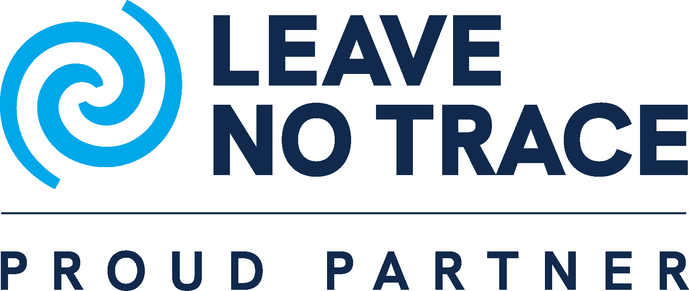

# marola's partners

<a href="./PARTNERS.md">🇧🇷 Leia em português</a>

marola is built in the open, as citizen science, and it does not go alone. These are the
partners that walk with it.

## Leave No Trace

The [Leave No Trace Center for Outdoor Ethics](https://lnt.org/) teaches people to enjoy nature
without leaving a trace, with seven simple principles for anyone outdoors. marola is an official
Proud Partner: whoever goes to the sea should leave it as they found it.

The mark above belongs to Leave No Trace and is not under marola's licence (see
[`REUSE.toml`](./REUSE.toml)).

## On GitHub

- [@ouroboric-dev](https://github.com/ouroboric-dev)
- [@piabrota](https://github.com/piabrota)

## Want to partner?

Write to [admin@marola.dev](mailto:admin@marola.dev).
