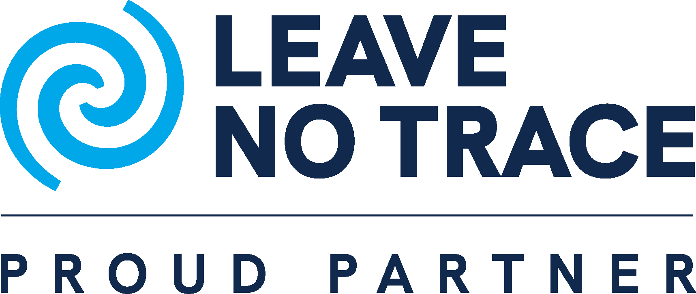

# Parceiros do marola

<a href="./PARTNERS.en.md">🇬🇧 Read in English</a>

O marola é feito em código aberto, como ciência cidadã, e não anda sozinho. Estes são os
parceiros que caminham com ele.

## Leave No Trace

O [Leave No Trace Center for Outdoor Ethics](https://lnt.org/) ensina a aproveitar a natureza sem
deixar rastro, com sete princípios simples para quem está ao ar livre. O marola é parceiro oficial
(*Proud Partner*): quem vai ao mar deve deixá-lo como o encontrou.

O selo acima é marca do Leave No Trace e não está sob a licença do marola (veja o
[`REUSE.toml`](./REUSE.toml)).

## OpenDiving

O [OpenDiving](https://opendiving.app/) é um diário de mergulho de código aberto, feito para durar
mais que qualquer fabricante: importa os arquivos do computador de mergulho, agrupa os mergulhos em
viagens e pode rodar no seu próprio servidor ([github.com/opendiving](https://github.com/opendiving)).
Os dois projetos são feitos sobre dados abertos e apontam um para o outro: o OpenDiving lista o
marola entre os seus apps parceiros
([opendiving/opendiving#106](https://github.com/opendiving/opendiving/issues/106)).

## No GitHub

- [@ouroboric-dev](https://github.com/ouroboric-dev)
- [@piabrota](https://github.com/piabrota)

## Quer ser parceiro?

Escreva para [admin@marola.dev](mailto:admin@marola.dev).
