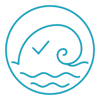
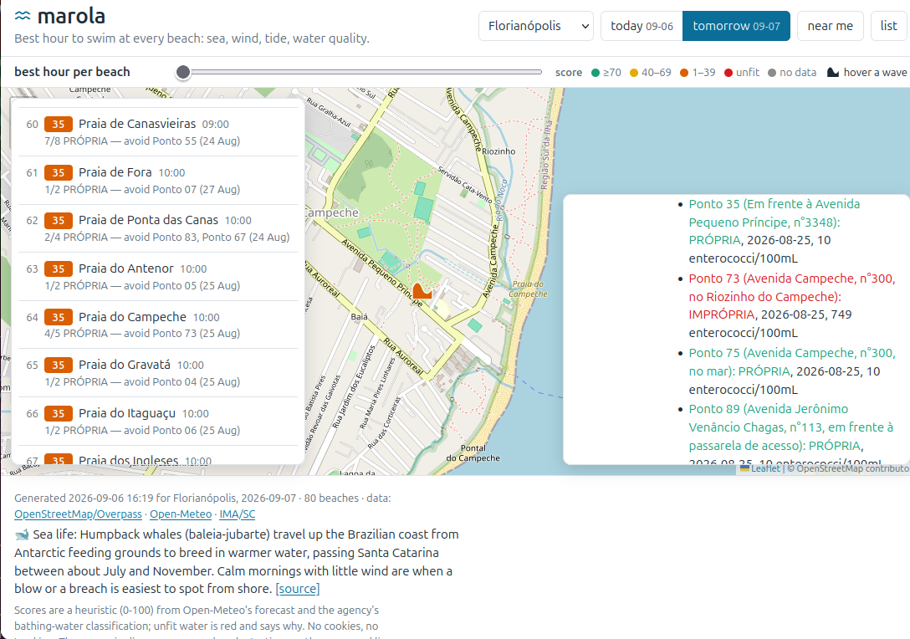

<p align="center"></p>

<h1 align="center">marola</h1>

<p align="center">
<!-- tests, scala, jdk and scala LOC: shields.io endpoint JSON that ci.yml's repo-stats job writes to marola-site's site-data branch from each main run (tools-ci's verdict, the directives of tools/project.scala, cloc of tools/src). -->
<a href="https://doi.org/10.5281/zenodo.23224155"></a>
<a href="https://github.com/marola-dev/marola/releases"></a>
<a href="https://github.com/marola-dev/marola/actions/workflows/ci.yml"></a>
<a href="https://github.com/marola-dev/marola/actions/workflows/ci.yml"></a>
<a href="https://github.com/marola-dev/marola/blob/main/tools/project.scala"></a>
<a href="https://github.com/marola-dev/marola/blob/main/tools/project.scala"></a>
<a href="https://github.com/marola-dev/marola/tree/main/tools"></a>
<a href="#reading-time"></a>
</p>

<p align="center"><a href="./README.md">🇧🇷 Português</a> · <a href="https://marola.dev/">🗺️ marola.dev</a> · <a href="https://docs.marola.dev/">📚 docs.marola.dev</a></p>

## What it is

marola tells you the best hour to swim near you, and why. It joins waves, wind, tide, water
temperature and official bathing-water quality into a score from 0 to 100. The map is at
**[marola.dev](https://marola.dev/)**, with beaches in Florianópolis, Rio de Janeiro and Salvador.

<p align="center"><a href="https://marola.dev/"></a></p>

- **It never makes things up.** Every number comes from public data (OpenStreetMap, Open-Meteo,
  IMA/SC, INEA, INEMA). The safety veto is a rule anyone can read, never an AI's guess.
- **It says when it does not know.** "No data" shows as "no data".
- **It is open and free.** It runs on your computer, with no account and no API key.

## Run it

```bash
git clone --recurse-submodules https://github.com/marola-dev/marola && cd marola/marola-app
```

```bash
# in a marola-app checkout
nix develop
just run -- --brief --lat -27.6733 --lon -48.4700
```

Step by step: [RUN-LOCALLY](https://docs.marola.dev/1-Using-marola/RUN-LOCALLY/).

## This repo

This is marola's umbrella
([MIP-0070](./docs/MIPs/MIP-0070-umbrella-and-polyrepo-split.md)). It holds no product code. It
holds the MIPs, the phase list, the ways of working, the docs site and every code repo as a
submodule. Its automation is `marola-tools`, in Scala 3 under `tools/`
(`scripts/marola-tools --help`). Who publishes and who pins what is in
[REPOS](docs/2-Building-marola/REPOS.md).


<details>
<summary>How to read this figure</summary>

**In one sentence.** Each repo does one thing, and what one repo ships, the next one pins by version.

**How to read it.** Left to right. The top lane is the path to the map; the middle one feeds the
app; the bottom one is this repo and its tools. The orange border marks what a person opens: the
map and the docs.

**Not in the figure.** marola-skills, marola-agents and marola-research, which only read the others.

**Evidence.** [`docs/archify/en/repos.json`](docs/archify/en/repos.json), the figure's source, drawn
by [Archify](https://github.com/tt-a1i/archify) with `just figure`.

</details>

AI agents: read [`AGENTS.md`](./AGENTS.md) first. To contribute, see the
[guide](https://docs.marola.dev/3-Ways-of-working/CONTRIBUTING/).

## How to cite

Cite the concept DOI [10.5281/zenodo.23224155](https://doi.org/10.5281/zenodo.23224155), which
always points at the latest version.

<!-- citation:start -->

BibTeX:

```bibtex
@software{hoffmann_2026_marola,
  author    = {Hoffmann, Matheus and Valério, Bruno and Soares da Silva Junior, Rob Kler and Oliveira, Elisa and Almeida, Leonardo Ramos and Ribeiro, Pablo},
  title     = {{marola: an open, non-profit platform for sea conditions and bathing-water quality at Brazilian beaches, built on public data}},
  year      = {2026},
  publisher = {Zenodo},
  doi       = {10.5281/zenodo.23224155},
  url       = {https://github.com/marola-dev/marola}
}
```

APA:

> Hoffmann, M., Valério, B., Soares da Silva Junior, R. K., Oliveira, E., Almeida, L. R., & Ribeiro, P. (2026). *marola: an open, non-profit platform for sea conditions and bathing-water quality at Brazilian beaches, built on public data* [Computer software]. Zenodo. https://doi.org/10.5281/zenodo.23224155

ABNT (NBR 6023):

> HOFFMANN, Matheus; VALÉRIO, Bruno; SOARES DA SILVA JUNIOR, Rob Kler; OLIVEIRA, Elisa; ALMEIDA, Leonardo Ramos; RIBEIRO, Pablo. **marola**: an open, non-profit platform for sea conditions and bathing-water quality at Brazilian beaches, built on public data. [S. l.]: Zenodo, 2026. DOI 10.5281/zenodo.23224155.

<!-- citation:end -->

## Contact and license

Write to [admin@marola.dev](mailto:admin@marola.dev); vulnerabilities go through the
[security policy](https://github.com/marola-dev/.github/blob/main/SECURITY.md). The docs are
[CC BY 4.0](./LICENSE) and the code is [AGPL-3.0-only](./LICENSES/AGPL-3.0-only.txt); each file
says which in [`REUSE.toml`](./REUSE.toml). Partners are in [PARTNERS](./PARTNERS.en.md).

## Reading time

The badge comes from `marola-tools reading-time` (`just reading-time`), at 238 words per minute.
