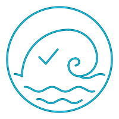
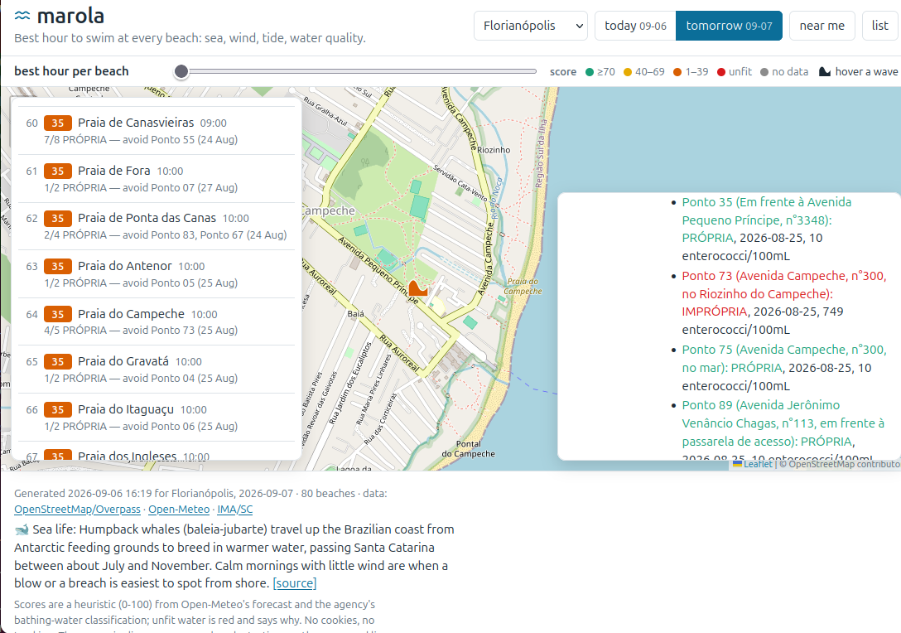
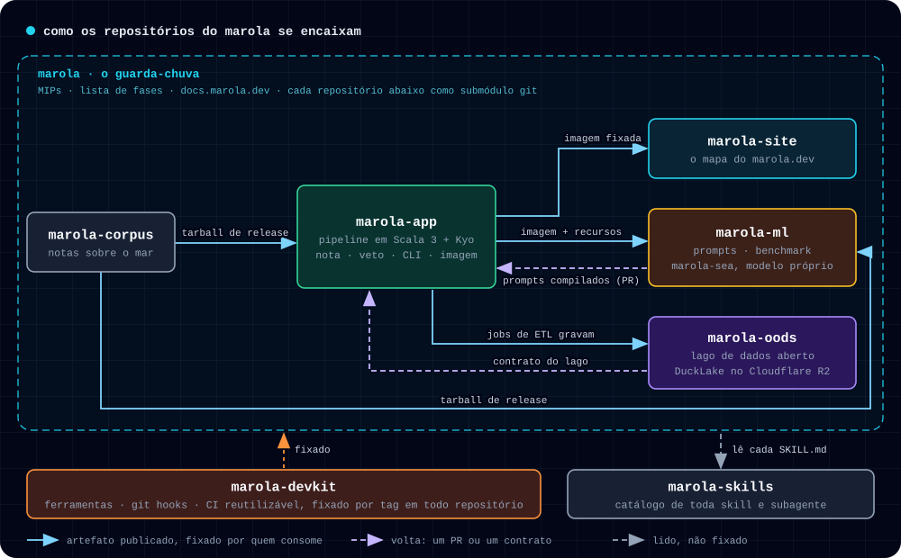
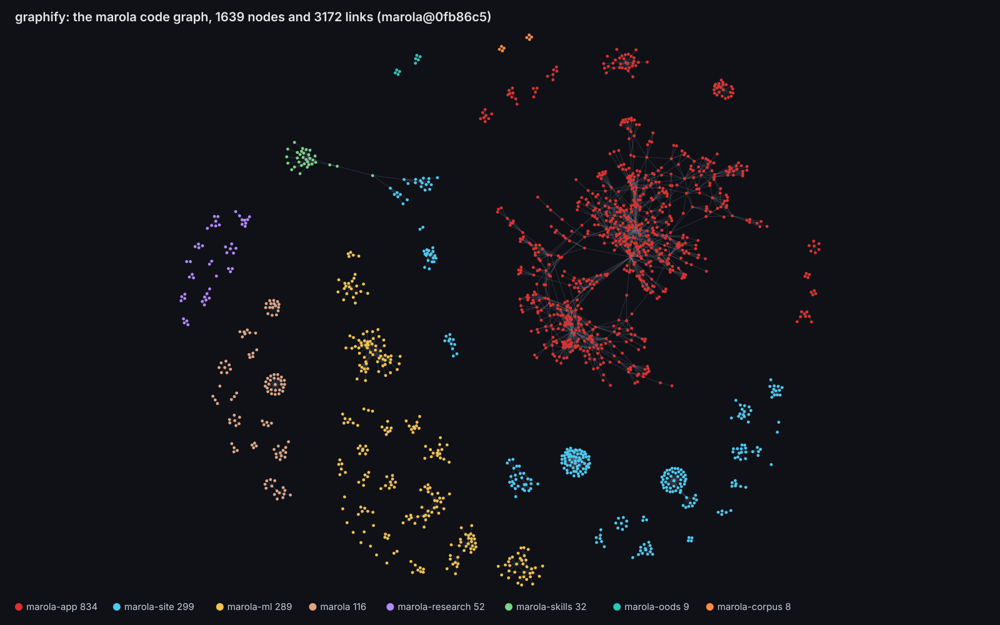

<p align="center"></p>

<h1 align="center">marola</h1>

<p align="center"><b>O super app da água: tudo sobre o mar perto de você, feito em código aberto, como ciência cidadã.</b></p>

<p align="center">
<a href="https://github.com/marola-dev/marola/actions/workflows/ci.yml"></a>
<a href="https://github.com/marola-dev/marola-site/actions/workflows/site.yml"></a>
<!-- ci.yml's repo-stats job (scripts/marola-tools repo-stats) writes these two as shields.io endpoint JSON to marola-site's site-data branch, which marola.dev serves: how many of the last main run's steps went green out of the steps that actually ran (skipped ones excluded), and cloc's code-line count for tools/, the umbrella's Rust tooling. The Scala badges are marola-app's README's. -->
<a href="https://github.com/marola-dev/marola/actions/workflows/ci.yml"></a>
<a href="https://github.com/marola-dev/marola/tree/main/tools"></a>
<a href="https://github.com/marola-dev/marola/tree/main/tools"></a>
<a href="https://marola.dev/"></a>
<a href="./LICENSE"></a>
<a href="#tempo-de-leitura"></a>
<a href="https://github.com/marola-dev/marola/tree/main/docs/assets/logo-v2"></a>
<a href="https://github.com/h0ffmann/ptbr-writer"></a>
<a href="https://github.com/h0ffmann/ptbr-writer#ollaya"></a>
</p>

<p align="center"><a href="./README.en.md">🇬🇧 Read in English (the simple version)</a> · <a href="https://marola.dev/">🗺️ Abrir o mapa ao vivo</a></p>

## O que é o marola?

Imagine um amigo que conhece muito bem o mar. Você pergunta *"dá pra nadar amanhã? que horas?"*, e
ele olha as ondas, o vento, a temperatura da água, se a água está própria para banho, a maré, e
até se tem água-viva ou baleia por perto. Depois ele te diz qual é o melhor horário, e **por quê**.

Esse amigo é o marola. Você já pode usar hoje em **[marola.dev](https://marola.dev/)**: um mapa
das praias de Florianópolis, do Rio de Janeiro e de Salvador, cada uma com uma nota para hoje e
para amanhã.

<p align="center"><a href="https://marola.dev/"></a></p>

Algumas promessas que o marola cumpre:

- **Ele nunca inventa.** Todo número vem de dados reais e públicos. Tudo o que pode te colocar em
  risco (água imprópria, mar agitado) é decidido por regras simples que qualquer pessoa pode ler,
  e não pelo palpite de uma IA. A IA só ajuda a explicar em palavras.
- **É gratuito e roda no seu próprio computador.** Não precisa de conta nem de serviço pago.
- **Ele avisa quando não sabe.** "Sem dados" aparece como "sem dados", nunca é escondido.

O que cada camada do mapa mostra, os repositórios e o que está em andamento em cada um estão em
[O marola hoje](docs/1-Using-marola/O-MAROLA-HOJE.md).

## Por que é código aberto: ciência cidadã 🔬

O marola é um projeto de **ciência cidadã**. O mar é de todos, e o conhecimento sobre ele também
deveria ser.

Os órgãos públicos já medem balneabilidade, ondas, vento e tempo, mas em sites e boletins
espalhados e técnicos. O marola junta, confere, explica em linguagem simples e devolve ao público.

E o caminho também é de volta: quem nada, surfa, pesca e mergulha todo dia vê coisas que nenhum
satélite vê. Essas observações podem conferir e melhorar as previsões.

Por isso tudo aqui é aberto: o código, as fontes de dados, as regras e cada decisão de projeto.
Qualquer pessoa pode ler, conferir e ajudar a melhorar.

## Onde começa, e aonde quer chegar

**Primeiro caso de uso: o agente de natação.** *"Qual o melhor horário amanhã para nadar aqui
perto?"* Isso já funciona: as praias vêm do OpenStreetMap, a previsão do mar e do tempo vem do
Open-Meteo, e a balneabilidade oficial vem dos órgãos ambientais estaduais (IMA/SC, INEA e
INEMA). Tudo vira uma nota de 0 a 100, com os motivos explicados.

**A ambição maior: o super app da água.** Nadar é só a primeira
pergunta. Os mesmos dados, e muitos outros, podem ajudar a proteger pessoas e lugares:

- 🌊 **Alertas de risco costeiro.** Começando pela *ressaca*, que erode as praias do Brasil, com
  um "não entre" firme quando o mar fica perigoso
  ([MIP-0062](./docs/MIPs/MIP-0062-ressaca-hazard.md)).
- 🛰️ **Previsão com os modelos das grandes agências.** As ondas já vêm do **WAVEWATCH III**, o
  modelo da NOAA; o plano é mostrar vários modelos lado a lado e dizer quando discordam
  ([MIP-0051](./docs/MIPs/MIP-0051-wave-model-ensemble.md),
  [MIP-0052](./docs/MIPs/MIP-0052-wave-model-compute.md)).
- 🧪 **Um arquivo aberto da balneabilidade das praias brasileiras**, versionado para que qualquer
  pessoa possa estudar ([MIP-0056](./docs/MIPs/MIP-0056-oods-open-ocean-data-store.md)).
- 🪼 **Relatos de quem está na praia.** Água-viva, baleia e, mais adiante, fotos de como o mar
  está agora, para que observações reais confiram as previsões.

Cada ideia nasce como um documento público (uma "MIP"), que diz o que já está pronto e o que é
plano: [`docs/MIPs/`](./docs/MIPs/README.md).

## Como você pode ajudar (sem programar)

- **Use o mapa** em [marola.dev](https://marola.dev/) e conte quando ele errar.
- **Conte o que você vê na água**, como água-viva ou baleia, ou uma praia que está faltando.
- **Compartilhe conhecimento local**: segurança no mar, vida marinha, condições da sua praia. As
  explicações vêm de notas com fonte em [marola-corpus](https://github.com/marola-dev/marola-corpus).
- **Abra uma issue**, em português ou em inglês:
  [github.com/marola-dev/marola/issues](https://github.com/marola-dev/marola/issues).

---

## Para rodar em cinco minutos

O marola é um conjunto de repositórios de propósito único; este aqui, o repositório guarda-chuva
(*umbrella*), junta todos como submódulos git. O app que você roda é o
[marola-app](https://github.com/marola-dev/marola-app):

```bash
git clone --recurse-submodules https://github.com/marola-dev/marola && cd marola/marola-app
```

```bash
# in a marola-app checkout
nix develop                                                        # JDK 25, sbt, just, ollama (veja o flake.nix dele)
just run -- --brief --lat -27.6733 --lon -48.4700                  # caminho mais rápido: lista em ordem, sem LLM
just ollama-up                                                     # inicia o `ollama serve` e baixa o llama3.2
just run -- --summarize --lat -27.6733 --lon -48.4700              # lista + resumo do LLM + revisão
just ask "o que fazer se eu for pego por uma corrente de retorno?" # resposta com fontes
```

Sem conta na nuvem, sem chave de API. Passo a passo com saída real (em inglês):
[RUN-LOCALLY](https://docs.marola.dev/1-Using-marola/RUN-LOCALLY/).

## Como funciona o repositório guarda-chuva

O marola não é um repositório só, e sim uma família de repositórios pequenos, cada um com uma
função, o seu próprio `AGENTS.md`, documentação, CI e issues. Este aqui, `marola-dev/marola`, é o
**guarda-chuva** (*umbrella*) que junta todos ([MIP-0070](./docs/MIPs/MIP-0070-umbrella-and-polyrepo-split.md)).
Ele não tem código de produto: guarda os documentos de projeto (MIPs), a lista de fases, o jeito de
trabalhar, o site de documentação, a ferramenta dele mesmo (o `marola-tools`, em Rust, em `tools/`)
e cada repositório de código como um submódulo git, fixado num commit.

<p align="center"></p>

- **Contratos, não código compartilhado.** Um repositório nunca lê a árvore de outro. Quem consome
  fixa um artefato publicado por quem produz (um tarball de release, o digest de uma imagem) e
  passa para uma versão nova trocando esse pino num PR. Quem publica e quem fixa o quê:
  [REPOS](docs/2-Building-marola/REPOS.md) (em inglês).
- **A mudança vai no repositório a que pertence.** Um PR por repositório; uma mudança que cruza
  repositórios usa o mesmo nome de branch em todos, o produtor faz merge primeiro e depois cada
  consumidor atualiza o pino.
- **Os ponteiros do guarda-chuva só andam por um PR automático** (`pointer-sync.yml`), nunca à mão.
- **Um site de documentação só.** O [docs.marola.dev](https://docs.marola.dev/) é montado com o
  `docs/` deste repositório mais o `README.md` e o `docs/` de cada um dos outros.
- **Primeiro o projeto, depois o código.** Tudo o que não é trivial começa como uma MIP em
  [`docs/MIPs/`](./docs/MIPs/README.md); as tarefas viram issues, e um agente só pega issues que
  uma pessoa marcou como `agent-ready`.

### O repositório inteiro em duas figuras


<details>
<summary>Como ler esta figura</summary>

**Em uma frase.** Cada repositório faz uma coisa, e o que um entrega o outro fixa por versão.

**Como ler.** Da esquerda para a direita. A faixa de cima é o caminho até o mapa; a do meio, o que
alimenta o app; a de baixo, este repositório e as ferramentas. A borda laranja marca o que uma
pessoa abre: o mapa e a documentação.

**Fora da figura.** O marola-skills, o marola-agents e o marola-research, que só leem os outros.

**Evidência.** [`docs/archify/repos.json`](docs/archify/repos.json), a fonte da figura, desenhada
pelo [Archify](https://github.com/tt-a1i/archify) com `just figure`.

</details>

<p align="center"></p>

<details>
<summary>Como ler esta figura</summary>

**Em uma frase.** É o código de todos os repositórios de uma vez, como o
[graphify](https://github.com/Graphify-Labs/graphify) o vê.

**Como ler.** Cada ponto é uma função, classe ou arquivo; cada linha, uma chamada ou um import. A
cor diz de que repositório o ponto é. Pontos juntos conversam muito entre si.

**Fora da figura.** O que o graphify não lê, como dados, imagens e as próprias MIPs.

**Evidência.** O `graph.json` do branch `routing-bundle`, que o CI refaz a cada merge na `main`
([MIP-0084](./docs/MIPs/MIP-0084-zero-setup-routing.md)); `just graphify-figure` redesenha a figura com
o `marola-tools graph-svg`.

</details>

A nota e o veto de segurança são Scala determinístico; o modelo apenas interpreta e redige, e nunca
derruba um veto. Toda a documentação técnica, de todos os repositórios, está em inglês em
**[docs.marola.dev](https://docs.marola.dev/)**; veja também o [PHILOSOPHY](docs/3-Ways-of-working/PHILOSOPHY.md),
o guia de [contribuição](https://docs.marola.dev/3-Ways-of-working/CONTRIBUTING/) e o [Código de Conduta](https://github.com/marola-dev/.github/blob/main/CODE_OF_CONDUCT.md). Se você é um
agente de IA: leia primeiro o [`AGENTS.md`](./AGENTS.md), depois o `AGENTS.md` do repositório que
vai mudar.

## Como contribuir

PRs pequenos, um assunto por PR, no repositório a que a mudança pertence. Uma mudança que não é
trivial começa como uma MIP em `docs/MIPs/`, aqui. Todo commit leva os trailers `Tested:` e
`Co-Authored-By: Claude <noreply@anthropic.com>`. Agentes de IA contribuem aqui como qualquer
pessoa e seguem o `AGENTS.md`. As descrições dos PRs saem bilíngues, primeiro em pt-BR, pela skill
`bipr` do [ptbr-writer](https://github.com/h0ffmann/ptbr-writer), o plugin do mantenedor para
escrita técnica em português (`/ptbr-writer:bipr`, ativado no `.claude/settings.json`).

Para uma revisão do Gemini, peça o revisor `marola-dev/gemini` no PR
([como funciona](https://github.com/marola-dev/marola-devkit/blob/main/docs/4-reference_workflows.md#gemini-review)).

## Como citar

Cada release deste repositório (`just release X.Y.Z`) é arquivada no [Zenodo](https://zenodo.org/),
que dá a ela um DOI. Cite o DOI conceitual, [10.5281/zenodo.23224155](https://doi.org/10.5281/zenodo.23224155), que sempre
aponta para a versão mais recente. O registro lista cada repositório do marola como parte dele, e o
WW3 GPU Lab ([10.5281/zenodo.23221351](https://doi.org/10.5281/zenodo.23221351)) como trabalho relacionado. O botão **Cite this
repository** do GitHub (barra lateral direita) exporta APA e BibTeX a partir do
[`CITATION.cff`](./CITATION.cff).

<!-- citation:start -->

BibTeX:

```bibtex
@software{hoffmann_2026_marola,
  author    = {Hoffmann, Matheus and Valério, Bruno and Soares da Silva Junior, Rob Kler and Oliveira, Elisa and Almeida, Leonardo Ramos and Ribeiro, Pablo},
  title     = {{marola: an open, non-profit platform for sea conditions and bathing-water quality at Brazilian beaches, built on public data}},
  year      = {2026},
  publisher = {Zenodo},
  doi       = {10.5281/zenodo.23224155},
  url       = {https://github.com/marola-dev/marola}
}
```

APA:

> Hoffmann, M., Valério, B., Soares da Silva Junior, R. K., Oliveira, E., Almeida, L. R., & Ribeiro, P. (2026). *marola: an open, non-profit platform for sea conditions and bathing-water quality at Brazilian beaches, built on public data* [Computer software]. Zenodo. https://doi.org/10.5281/zenodo.23224155

ABNT (NBR 6023):

> HOFFMANN, Matheus; VALÉRIO, Bruno; SOARES DA SILVA JUNIOR, Rob Kler; OLIVEIRA, Elisa; ALMEIDA, Leonardo Ramos; RIBEIRO, Pablo. **marola**: an open, non-profit platform for sea conditions and bathing-water quality at Brazilian beaches, built on public data. [S. l.]: Zenodo, 2026. DOI 10.5281/zenodo.23224155.

<!-- citation:end -->

## Agradecimentos

O marola existe graças ao trabalho de muita gente: os colaboradores do
[OpenStreetMap](https://www.openstreetmap.org/copyright) (cada praia do mapa é deles, sob a ODbL),
o [Open-Meteo](https://open-meteo.com/) (as previsões do mar e do tempo), o
[Mapbox GL JS](https://github.com/mapbox/mapbox-gl-js) (o mapa), o [Ollama](https://ollama.com/) e o
[Kyo](https://getkyo.io/). Os dados de balneabilidade vêm dos boletins do INEA (Rio de Janeiro), do
INEMA (Bahia) e do IMA/SC (Santa Catarina).

As organizações parceiras do marola, como o [Leave No Trace](https://lnt.org/), estão em
[PARTNERS](./PARTNERS.md).

## Contato

Para qualquer pedido sobre o marola, escreva para [admin@marola.dev](mailto:admin@marola.dev).
Vulnerabilidades vão pelo canal privado descrito na [política de segurança](https://github.com/marola-dev/.github/blob/main/SECURITY.md).

## Tempo de leitura

Todo README deste repositório mostra quanto tempo leva para ler, em português e em inglês. A conta
é do `marola-tools reading-time`, nunca de cabeça: conta as palavras que uma pessoa lê (sem código,
imagens, links e comentários) a 181 palavras por minuto em português e 238 em inglês (Brysbaert,
2019), mais 15 segundos por bloco de código. Quem muda um README roda `just reading-time`, que
reescreve o selo, e o CI falha se o selo ficou velho. Cada submódulo segue a mesma regra no próprio
repositório.

## Licença

- Documentação (os docs, as MIPs, os artigos, este README): [CC BY 4.0](./LICENSE).
- Código (`tools/`, `scripts/`, `.github/`, `mkdocs/`, `justfile`, `flake.nix`): [AGPL-3.0-only](./LICENSES/AGPL-3.0-only.txt).
- As skills de terceiros em `.claude/skills/` mantêm as próprias licenças.
- Cada repositório do marola tem a sua própria `LICENSE`.
- As versões até a v0.2.2 foram publicadas sob [MIT](./LICENSES/MIT.txt) e continuam sob MIT.

A licença de cada arquivo está em [`REUSE.toml`](./REUSE.toml). © 2026 colaboradores do marola.
