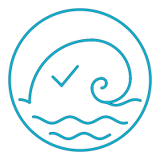
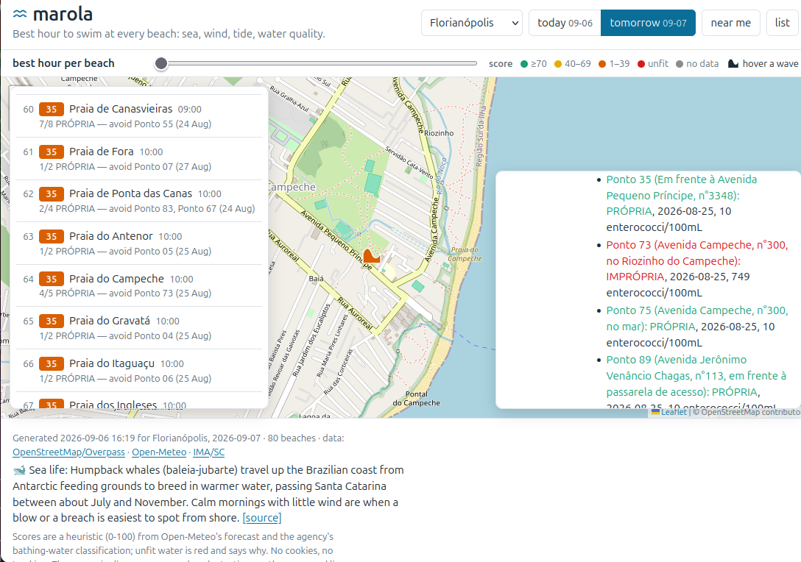

<p align="center"></p>

<h1 align="center">marola</h1>

<p align="center">
<!-- tests, scala, jdk and scala LOC: shields.io endpoint JSON that ci.yml's repo-stats job writes to marola-site's site-data branch from each main run (tools-ci's verdict, the directives of tools/project.scala, cloc of tools/src). -->
<a href="https://doi.org/10.5281/zenodo.23224155"></a>
<a href="https://github.com/marola-dev/marola/releases"></a>
<a href="https://github.com/marola-dev/marola/actions/workflows/ci.yml"></a>
<a href="https://github.com/marola-dev/marola/actions/workflows/ci.yml"></a>
<a href="https://github.com/marola-dev/marola/blob/main/tools/project.scala"></a>
<a href="https://github.com/marola-dev/marola/blob/main/tools/project.scala"></a>
<a href="https://github.com/marola-dev/marola/tree/main/tools"></a>
<a href="#tempo-de-leitura"></a>
</p>

<p align="center"><a href="./README.en.md">🇬🇧 English</a> · <a href="https://marola.dev/">🗺️ marola.dev</a> · <a href="https://docs.marola.dev/">📚 docs.marola.dev</a></p>

## O que é

O marola diz qual é o melhor horário para nadar perto de você, e por quê. Ele junta ondas, vento,
maré, temperatura da água e a balneabilidade oficial numa nota de 0 a 100. O mapa está em
**[marola.dev](https://marola.dev/)**, com praias de Florianópolis, do Rio de Janeiro e de Salvador.

<p align="center"><a href="https://marola.dev/"></a></p>

- **Nunca inventa.** Todo número vem de dados públicos (OpenStreetMap, Open-Meteo, IMA/SC, INEA,
  INEMA). O veto de segurança é uma regra que qualquer pessoa lê, nunca o palpite de uma IA.
- **Avisa quando não sabe.** "Sem dados" aparece como "sem dados".
- **É aberto e gratuito.** Roda no seu computador, sem conta e sem chave de API.

## Rodar

```bash
git clone --recurse-submodules https://github.com/marola-dev/marola && cd marola/marola-app
```

```bash
# in a marola-app checkout
nix develop
just run -- --brief --lat -27.6733 --lon -48.4700
```

O passo a passo está em [RUN-LOCALLY](https://docs.marola.dev/1-Using-marola/RUN-LOCALLY/).

## Este repositório

Este é o guarda-chuva do marola
([MIP-0070](./docs/MIPs/MIP-0070-umbrella-and-polyrepo-split.md)). Ele não tem código de produto.
Guarda as MIPs, a lista de fases, o jeito de trabalhar, o site de documentação e cada repositório
de código como um submódulo. As automações dele são o `marola-tools`, em Scala 3 em `tools/`
(`scripts/marola-tools --help`). Quem publica e quem fixa o quê está em
[REPOS](docs/2-Building-marola/REPOS.md).


<details>
<summary>Como ler esta figura</summary>

**Em uma frase.** Cada repositório faz uma coisa, e o que um entrega o outro fixa por versão.

**Como ler.** Da esquerda para a direita. A faixa de cima é o caminho até o mapa; a do meio, o que
alimenta o app; a de baixo, este repositório e as ferramentas. A borda laranja marca o que uma
pessoa abre: o mapa e a documentação.

**Fora da figura.** O marola-skills, o marola-agents e o marola-research, que só leem os outros.

**Evidência.** [`docs/archify/repos.json`](docs/archify/repos.json), a fonte da figura, desenhada
pelo [Archify](https://github.com/tt-a1i/archify) com `just figure`.

</details>

Agentes de IA: leiam primeiro o [`AGENTS.md`](./AGENTS.md). Para contribuir, veja o
[guia](https://docs.marola.dev/3-Ways-of-working/CONTRIBUTING/).

## Como citar

Cite o DOI conceitual [10.5281/zenodo.23224155](https://doi.org/10.5281/zenodo.23224155), que
sempre aponta para a versão mais recente.

<!-- citation:start -->

BibTeX:

```bibtex
@software{hoffmann_2026_marola,
  author    = {Hoffmann, Matheus and Valério, Bruno and Soares da Silva Junior, Rob Kler and Almeida, Leonardo Ramos and Ribeiro, Pablo},
  title     = {{marola: an open, non-profit platform for sea conditions and bathing-water quality at Brazilian beaches, built on public data}},
  year      = {2026},
  publisher = {Zenodo},
  doi       = {10.5281/zenodo.23224155},
  url       = {https://github.com/marola-dev/marola}
}
```

APA:

> Hoffmann, M., Valério, B., Soares da Silva Junior, R. K., Almeida, L. R., & Ribeiro, P. (2026). *marola: an open, non-profit platform for sea conditions and bathing-water quality at Brazilian beaches, built on public data* [Computer software]. Zenodo. https://doi.org/10.5281/zenodo.23224155

ABNT (NBR 6023):

> HOFFMANN, Matheus; VALÉRIO, Bruno; SOARES DA SILVA JUNIOR, Rob Kler; ALMEIDA, Leonardo Ramos; RIBEIRO, Pablo. **marola**: an open, non-profit platform for sea conditions and bathing-water quality at Brazilian beaches, built on public data. [S. l.]: Zenodo, 2026. DOI 10.5281/zenodo.23224155.

<!-- citation:end -->

## Contato e licença

Escreva para [admin@marola.dev](mailto:admin@marola.dev); vulnerabilidades vão pela
[política de segurança](https://github.com/marola-dev/.github/blob/main/SECURITY.md). A
documentação é [CC BY 4.0](./LICENSE) e o código é
[AGPL-3.0-only](./LICENSES/AGPL-3.0-only.txt); cada arquivo diz a sua em
[`REUSE.toml`](./REUSE.toml). Os parceiros estão em [PARTNERS](./PARTNERS.md).

## Tempo de leitura

O selo vem do `marola-tools reading-time` (`just reading-time`), a 181 palavras por minuto.
