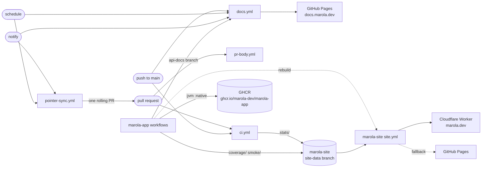
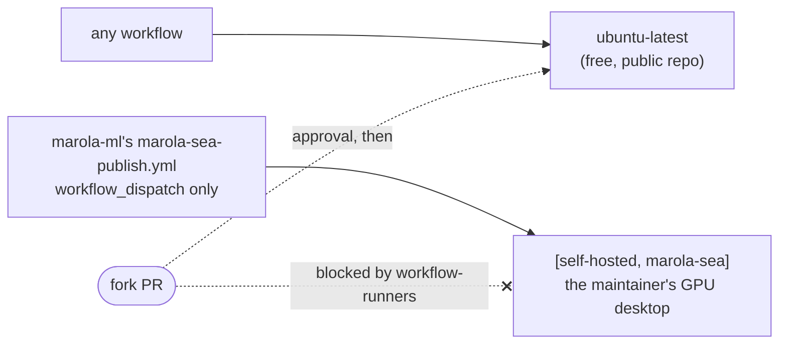

# CI/CD

Every gate and every deploy, in every marola repo, is a GitHub Actions workflow on GitHub's standard
`ubuntu-latest` runner, except marola-ml's GPU publish (below). The design behind this layout is
[MIP-0065](../MIPs/MIP-0065-ci-cd-on-github-hosted-runners.md). The generic jobs are marola-devkit's
[reusable workflows](https://docs.marola.dev/5-Repos/marola-devkit/4-reference_workflows/), called
at the same tag as the flake input; bump them together. This page has the umbrella's own workflows,
the org secret and the settings no workflow can change; each repo's workflows are on its own page.

## How a change reaches marola.dev and docs.marola.dev

Which repo produces each artifact, who reads it and what pins it is REPOS'
[artifacts, pins and dispatches](../2-Building-marola/REPOS.md#artifacts-pins-and-dispatches)
table. Each repo's own CI, releases and secrets:

- marola-app: build, test, the image, e2e, coverage and the release
  ([3-development](https://docs.marola.dev/5-Repos/marola-app/3-development/)).
- marola-site: the map's build and deploy to marola.dev, and its health checks
  ([3-development](https://docs.marola.dev/5-Repos/marola-site/3-development/)).
- marola-corpus: the corpus tarball on each `v*` tag
  ([3-development](https://docs.marola.dev/5-Repos/marola-corpus/3-development/)).
- marola-ml: the prompt compile, the benchmark gate, the ml image and the GPU publish
  ([3-development](https://docs.marola.dev/5-Repos/marola-ml/3-development/)).
- marola-oods: `oods-check` against the pinned app image
  ([3-development](https://docs.marola.dev/5-Repos/marola-oods/3-development/)).
- marola-devkit: its self-tests and the release rule
  ([3-development](https://docs.marola.dev/5-Repos/marola-devkit/3-development/)).

## The workflows

| Workflow | Trigger | Runner | Gates or deploys | Secrets and variables | By hand |
|---|---|---|---|---|---|
| `ci.yml` | PR; push to `main` | `ubuntu-latest` | The merge gates, each run only when `dorny/paths-filter` says its inputs changed: `python-ci` (devkit: ruff and marola's `scripts/*` self-tests), `static-ci` (devkit: actionlint, hadolint and `docker compose config` on the mkdocs stack), `agents-check` (devkit: the AGENTS.md invariants block), `quality-other` (nix, with submodules: `flake.lock` is current, `just --list`, `workflow-runners`, `docs-lint`, `wiring --check` on `REPOS.md`'s wiring block), `docs-build` (`docs.yml`'s aggregated `mkdocs --strict`, on the PR's pinned submodule commits). On `main` only: `repo-stats` publishes the stats, Scala lines counted in the marola-app submodule, to marola-site's `site-data` | `GITHUB_TOKEN`, `PR_BOT_APP_ID` / `PR_BOT_KEY` (marola-pr-bot) | `just quality` locally; re-run from the Actions tab |
| `ci.yml`'s `graph` job | PR or push to `main` changing a gitlink, `flake.lock`, `.graphifyignore` or `ci.yml` | `ubuntu-latest` | `graph build` from `nix develop .#lint` on the pinned submodule commits (MIP-0076 §5.4); uploads `graph.json` and `build.json` as the `graph` artifact for 7 days and logs whether `unshare -rn` works. Nothing committed or deployed | `GITHUB_TOKEN` | `just graph build` locally |
| `ci-short-circuit.yml` | PR closed | `ubuntu-latest` | Devkit `ci-short-circuit`: cancels the closed PR's in-flight runs, which the concurrency group can't see | `GITHUB_TOKEN` | — |
| `pr-body.yml` | PR opened, reopened, ready, pushed | `ubuntu-latest` | Devkit `pr-body`: fills the description from the commits (`uprd`); skips forks and bot branches | `GITHUB_TOKEN` | `just uprd` |
| `labels.yml` | dispatch only | `ubuntu-latest` | Devkit `labels-sync`: applies the devkit's label manifest to this repo | `GITHUB_TOKEN` | `gh workflow run labels.yml`; `just labels-sync` locally |
| `docs.yml` | `repository_dispatch: submodule-docs-updated`; push to `main` touching `docs/**`, `mkdocs/**`, `README.md`, `flake.lock` or the docs scripts; daily; dispatch | `ubuntu-latest` | Builds docs.marola.dev from every repo and, on `main`, **deploys** it to Pages (`github-pages` environment): [DOCS-SITE.md](DOCS-SITE.md) | `GITHUB_TOKEN` | `gh workflow run docs.yml`; `just docs` locally |
| `pointer-sync.yml` | `repository_dispatch: submodule-updated` (each code repo's `notify-umbrella.yml`, on every push to `main`) or `submodule-docs-updated` (the same push, when it touched `README.md` or `docs/**`); daily; dispatch | `ubuntu-latest` | The only thing that moves submodule pointers (MIP-0070 §5.6): `scripts/pointer-sync.sh` runs `git submodule update --remote` and commits whatever moved, with `REPOS.md`'s wiring block regenerated by `wiring` (from `nix develop .#lint`) in the same commit, onto `chore/pointer-sync`, force-pushed, with one open PR listing each submodule's old → new commit and a compare link; when `main` has caught up, that PR is closed. Pushed and opened as marola-pr-bot (MIP-0086) so the PR's CI runs | `PR_BOT_APP_ID` / `PR_BOT_KEY` | `gh workflow run pointer-sync.yml` |
| `profile-activity.yml` | PR merged into `main` | `ubuntu-latest` (reusable workflow's `runner:` input) | Pings `h0ffmann/h0ffmann` to refresh its activity list; without the token it only leaves a notice | `PROFILE_DISPATCH_TOKEN` | — |
| `pointer-sync-merge.yml` | `CI` or `PR body` completed on `chore/pointer-sync`; hourly; dispatch | `ubuntu-latest` | Squash-merges the sync PR as marola-merge-bot (#739, MIP-0086) when `ci-ok` from GitHub Actions has succeeded on its head and every other check and status passed, no `hold` label is on it, the org variable `AUTO_MERGE` is not `false`, the head is still the commit they ran on, and it changes only gitlinks and REPOS.md's wiring table, each moved gitlink on its marola-dev repo's default branch; otherwise one PR comment says why and a person merges it. Each merge is one more push to `main`, so one more `ci.yml` run | `MERGE_BOT_APP_ID` (variable), `MERGE_BOT_KEY` | `gh workflow run pointer-sync-merge.yml`; `scripts/pointer-sync-merge.sh --repo marola-dev/marola --dry-run` |
| `deps-merge.yml` | daily 07:15 UTC; dispatch | `ubuntu-latest` | Squash-merges, as marola-merge-bot (#740, MIP-0086 §5.5), each Dependabot PR in the repos its `REPOS:` list names (marola-ml) that the devkit's `deps-merge --unattended` passes: Python manifests only, patch or minor bumps, every check green, no `hold` ([rules](https://docs.marola.dev/5-Repos/marola-devkit/4-reference_tools/#pull-requests-and-stacks)). Each refused PR gets one line in the run log, not a comment, and a person merges it ([DEV-FLOW](DEV-FLOW.md#dependency-prs)). Skipped when the org variable `AUTO_MERGE` is `false` | `MERGE_BOT_APP_ID` (variable), `MERGE_BOT_KEY` | `gh workflow run deps-merge.yml`; `just deps-merge` for what it refused |
| `bump-ready.yml` | `CI` completed green on a `chore/devkit-v*` branch, or on `main` for a `chore: marola-devkit v…` commit | `ubuntu-latest` (devkit `notify-devkit`) | Sends the devkit a `bump-ready` `repository_dispatch` so its `bump-merge` runs within minutes (the `main` case starts the canary step at once after marola's own bump lands); without the token, a notice and the hourly run (#859) | `PR_BOT_APP_ID` / `PR_BOT_KEY` | — |

`repo-stats` writes to marola-site's `site-data` through `scripts/site-data-push.sh`, which
retries when two pushes race, and sends no dispatch: the map picks the stats up on its next build.

## The self-hosted rule

No workflow here may run on a self-hosted runner: the one that does, `marola-sea-publish.yml`, is
marola-ml's, and it may never gain a `pull_request`, `pull_request_target` or `workflow_call`
trigger. A `runs-on:` or `runner:` value must be a literal, never a `${{ }}` expression that could
resolve to the desktop. `workflow-runners` enforces this in `quality-other` here and in marola-ml's
CI there.

The repo is public, and on a public repo anyone can open a pull request. A `pull_request` job on
a self-hosted runner would run a fork's code on the maintainer's machine, which is what GitHub
warns against in "Self-hosted runners should almost never be used for public repositories".
Standard hosted runners are free for public repos; larger and GPU runners are always billed, so
GPU training stays on the desktop, behind a manual dispatch.

## The maintainer's manual settings

Repository settings that no workflow or agent can change. MIP-0065 depends on them:

- **Fork PR approval:** Settings → Actions → General → "Require approval for all external
  contributors". The two weaker levels stop asking once a user has had any commit merged.
- **The desktop runner** carries the `marola-sea` label only, so no `runs-on: ubuntu-latest` job
  can land on it. It serves marola-ml's `marola-sea-publish.yml`.
- **No `CI_RUNNER` variable.** The repo's Actions variables are `MERGE_BOT_APP_ID` (and the org's `PR_BOT_APP_ID` and `AUTO_MERGE`).
- **The app image is marola-app's package**, `ghcr.io/marola-dev/marola-app`. A package's first
  push creates it private:
  either make it public, so `docker pull ghcr.io/marola-dev/marola-app:jvm` works logged out, or
  grant marola-site, marola-ml and marola-oods read access under its "Manage Actions access".
- **Secrets:** `HF_TOKEN` is marola-ml's (its `3-development` page). Here: optionally
  `PROFILE_DISPATCH_TOKEN`, a PAT outside MIP-0086's scope. Every dispatch is in REPOS'
  [wiring table](../2-Building-marola/REPOS.md#artifacts-pins-and-dispatches).
- **Automation identity** (MIP-0086): two GitHub Apps, no PAT.
  - **marola-pr-bot** pushes `chore/pointer-sync`, opens its PR, sends the code repos' `notify-umbrella.yml`
    dispatches and pushes marola-site's `site-data`, so those runs trigger CI. It is installed on every repo
    and is never a bypass actor. Its id is the org variable `PR_BOT_APP_ID`, its key the org secret
    `PR_BOT_KEY`, visible to all repos.
  - **marola-merge-bot** is installed on marola and the devkit's consumers (a "selected" installation). It
    holds a `pull_request` bypass on each consumer's `main-rule` (the devkit's `@consumers` extra), so it can
    merge a PR without review but never push to `main`. `MERGE_BOT_KEY` and the repo variable
    `MERGE_BOT_APP_ID` exist only in marola and marola-devkit. Only the jobs listed in a repo's
    `.github/merge-key-allowlist` may name the key, and `merge-key-check` enforces that they run only
    checked-in steps (no nix, npm, pip or curl). In marola those are `pointer-sync-merge.yml` and
    `deps-merge.yml`; in the devkit, `bump-consumers`, `bump-merge`, `release` and the leak drill.
    Whoever holds the key can land a PR on
    every consumer's `main`. `pointer-sync-merge.yml` merges only when `ci-ok` has succeeded and every
    moved pointer is on its repo's default branch, never a fork's commit that GitHub also serves through
    the parent repo.
  - **Pausing:** the org variable `AUTO_MERGE` set to `false` stops every auto-merge. It must have visibility
    "all repositories": `gh variable set AUTO_MERGE --org marola-dev --body <true|false> --visibility all`
    (the default reaches private repos only, so public marola would never see it). A `hold` label stops one PR.
  - **Devkit bumps:** the devkit's `bump-merge` job runs when a consumer's bump CI ends green
    (`bump-ready`, the devkit's `notify-devkit`) and hourly. It squash-merges each consumer's
    `chore/devkit-vX.Y.Z` PR, newest release only, once it is green. The devkit's variables
    `BUMP_SOAK_HOURS` (a wait after the release) and `BUMP_CANARY_HOURS` (marola first, the rest that
    many hours after its bump merged) are 0 by default. A major, a red check, a PR not opened by the
    merge bot or a change outside the devkit pins is left for a person, with one comment
    ([rules](https://docs.marola.dev/5-Repos/marola-devkit/4-reference_workflows/#bump-merge-not-reusable)).
    **Pausing** and the `hold` label stop it too.
  - **Dependency PRs:** `deps-merge.yml` mints its token for the repos in its `REPOS:` list only,
    with Contents and Pull requests write and Checks and Commit statuses read. The token has no
    Workflows permission, so GitHub refuses any merge through it that touches `.github/workflows/`,
    even with a leaked key; GitHub Actions bumps stay with a person. What it merges is in
    [DEV-FLOW](DEV-FLOW.md#dependency-prs). **Pausing** and the `hold` label stop it too.
  - **After a suspected leak** (MIP-0086 §5.9): suspend the App's installation (org settings → GitHub Apps →
    Configure → Suspend). Tokens already minted stop within seconds (marola-dev/marola-devkit#101's drill:
    first refusal 8 s after the suspension, HTTP 403). Generate a new key and `gh secret set` it
    (`--org marola-dev` for `PR_BOT_KEY`; `-R marola-dev/marola` and `-R marola-dev/marola-devkit` for
    `MERGE_BOT_KEY`), delete the old key in the App's settings, read the audit log for the bot's pushes and
    merges since the suspected time, then unsuspend. There is no scheduled rotation.
- **Pages:** source "GitHub Actions", custom domain `docs.marola.dev` (a DNS `CNAME` to
  `marola-dev.github.io`). An Actions-deployed site ignores a `CNAME` file, so the domain lives
  only in this setting.
