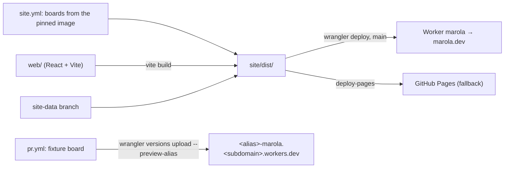

# MIP-0088: marola-site in React on Vite, on the Cloudflare Worker

| | |
|---|---|
| **Status** | Draft |
| **Author** | aracyla |
| **Created** | 2026-10-07 |
| **Phase** | 3 (`docs/PHASES.md`: the site is Phase 3's first deploy artefact). Phase 1 (the Telegram bot) is not done, and this MIP does nothing for it |
| **Related** | MIP-0005 (the map and static site), MIP-0009 (the `site_check.js` harness), MIP-0054 (i18n), MIP-0078 (the move to the Cloudflare Worker that keeps serving marola.dev, marola-dev/marola-site#84; not yet pushed, §11), MIP-0035 (the map plugin API, Draft) |
| **Effort** | L: the page is rewritten (≈1,500 lines of `app.js`, `ui.js`, `flow.js`, `chat.js` and three HTML pages), the 1,114-line `site_check.js` harness is replaced by a Vitest suite, and `site.yml` gains a Node build. The Worker, its token and its domain stay as they are. PR previews alone are S (§5.1) |
| **Gain** | `infra/dev-loop`: components and a module graph in place of one 818-line `app.js` that builds DOM from strings, tests that render components instead of stubbing a DOM by hand, a dev server with hot reload, and a preview URL per PR on the Worker. `user value`: none directly; visitors should see the same page |
| **Effort vs Gain** | `cheap win` for PR previews (task 1), which stand alone on today's page. `expensive, defer` for the rewrite: its whole gain is maintainability, so do it when the page next grows a surface plain JS carries badly (MIP-0035's plugin layers, FUTURE-WORK §1's per-activity views) |
| **Depends on** | Nothing has to merge first. It keeps MIP-0078's Worker (marola-dev/marola-site#84) as marola.dev's host, with its GitHub Pages fallback, its `CLOUDFLARE_API_TOKEN` and its custom domain unchanged. Static asset requests and Version URLs are free, so no paid-resource gate applies, but `AGENTS.md` keeps deploys a human's act. The rewrite touches the same files as any open marola-site visible change, so it should not run beside one. No Phase 1 gate, since this is not a cloud backend |
| **Blocked by** | none |
| **Risk** | A rewrite that ships a page which looks the same but drops a behaviour `site_check.js` covers today (a score band, a no-data state, the 404 forwarder, the CSP), on a public-safety page |
| **Cost so far** | — |

### Readiness

| | |
|---|---|
| **Manually reviewed** | no |
| **Written by** | aracyla, with Claude Code (the `/marola-devkit:mip` skill), from the requests of 2026-10-07 (a React rewrite of the site; then Vite + React as the stack); revised 2026-10-11 to stay on the Worker |
| **Tasks** | not yet — written once the MIP is Accepted |
| **Tests** | §7: `bands.test.ts`, `waterDot.test.ts`, `i18n.test.ts`, the component suite ported from `site_check.js`, `tsc --noEmit`, the board-types drift check, the inline-script build check |
| **Spec-kit** | none |
| **Issues** | not filed — Draft |

## 1. Summary

Rebuild the page as a React 19 app built by Vite into the same static `site/dist/`, and keep
serving it from the Cloudflare Worker `marola` that MIP-0078 put in front of marola.dev. The page
stays static: no server, no Worker script, no LLM, boards precomputed every 3 h. It also keeps
`script-src 'self'`, because a Vite build emits no inline script (§4.2). The Worker serves static
assets free and unlimited, already answers a missing path with `404.html`, and gives each upload a
Version URL, so a PR can get a preview without a new host. PR previews are a small change that
ships on its own first. The rewrite follows when it is worth its cost.

## 2. Motivation

marola-site's own `AGENTS.md` says "Plain JavaScript, no framework and no build step", and its
`docs/2-libraries.md` says `just site-build` (in a marola-site checkout) "does not bundle or
transpile anything". That was the right call for MIP-0005's single Leaflet page, and the page has
since outgrown it:

- `site/static/app.js` is 818 lines (47 KB). From one file it fetches `areas.json` and the boards,
  builds the map, the markers, the list, the card, the hour slider and the four GIBS raster layers.
  The UI is HTML strings plus a hand-written `icon(name)` inliner.
- `scripts/site_check.js` (1,114 lines) tests that file by running it in a `vm` with a hand-built
  stub DOM and a stub `mapboxgl`. Each new DOM API the page uses means more stub.
- Each visible change needs before and after screenshots at two sizes (marola-site `AGENTS.md`),
  taken locally. A reviewer can't open the change itself, because nothing deploys a branch.

## 3. User-visible change

None intended. The same three pages and `404.html`, the same pt-BR and English copy, the same map,
layers, bands and emergency panel.

One difference is measurable:

- **URLs.** None from hosting: the Worker already answers `/about.html` with a `307` to `/about`
  (§4.1). The page's own links move to the extension-less form, saving that redirect.
- **JavaScript.** The page's own scripts total about 102 KB unminified today, next to the 1.8 MB
  vendored Mapbox GL CSP build. React 19 plus react-dom adds about 219 KB minified before gzip
  (§4.2's empty build).

The parity checklist in §7 is the acceptance test.

## 4. Data sources and dependencies reviewed

### 4.1 Hosting: the Worker `marola`, static assets only

Today's `wrangler.jsonc` (marola-site `50b4592`) declares a Worker with no script:
`assets.directory` is `./site/dist`, `not_found_handling` is `"404-page"`, `workers_dev` is on, and
`marola.dev` is its custom domain. `site.yml` deploys it with `cloudflare/wrangler-action@v4` and
`command: deploy`, `continue-on-error`, beside the GitHub Pages fallback. A Vite build changes what
is in `site/dist/`, not how it is served.

- **Cost.** "Requests to static assets are free and unlimited" (Workers static assets billing,
  2026-10-11).
- **Free plan limits.** 20,000 files per Worker version and 25 MiB per file (Workers limits,
  2026-10-11). The site is three areas' boards, the 17-file `site-data` panels, a 1.8 MB Mapbox
  build and a handful of hashed bundles: far below both.
- **Serving.** `html_handling` defaults to `auto-trailing-slash`, which answers `/file.html` with a
  `307` to `/file` (HTML handling, 2026-10-11). Checked live on 2026-10-11: `/about.html` returns
  `307` to `/about`, and a missing path returns `404`.
- **Headers.** `_headers` in the assets directory allows 100 rules, each line up to 2,000
  characters, and applies to static asset responses but not to responses a Worker script makes
  (Workers static assets headers, 2026-10-11). The page does not say outright that HTML responses
  are covered. marola.dev sends no CSP header today; the CSP lives in each page's `<meta>`.
- **Previews.** Each `wrangler versions upload` makes a Version URL, and `--preview-alias <name>`
  gives a readable `<name>-marola.<subdomain>.workers.dev`. They run only on `workers.dev`, are
  public when enabled, default to on when `workers_dev` is on, and can be restricted with
  Cloudflare Access. An alias is lowercase letters, digits and dashes, starts with a letter, and
  with the Worker name stays within 63 characters. Only the 1,000 most recent aliases are kept
  (Version URLs, 2026-10-11). An uploaded version is not deployed, so marola.dev never serves a
  preview.
- **The Cloudflare Vite plugin.** Cloudflare's React guide deploys through
  `@cloudflare/vite-plugin`, which generates its own `wrangler.json` and ignores `assets.directory`
  (React framework guide, 2026-10-11). This site does not use it: `site/dist/` is assembled from the
  Vite output, the boards and the `site-data` panels after the build, so the plain
  `assets.directory` config stays. The guide's `single-page-application` not-found mode is also
  wrong here: the page relies on a real `404` for a missing board.

### 4.2 Framework: Vite 8 + React 19

An empty React app was built with Vite in a scratch directory on 2026-10-07 (npm `latest`: vite
8.3.3, react and react-dom 19.3.0, @vitejs/plugin-react 6.1.2). Its `dist/index.html` has one
`<script type="module" crossorigin src="/assets/index-<hash>.js">` and no inline script, so
`default-src 'self'` holds unchanged. The bundle is 219,465 B minified, mostly react-dom. Its
filenames are content-hashed, which replaces `site.yml`'s `?v=<sha>` cache-bust step.

For the map, `react-map-gl` 8.1.3 has a `./mapbox` entry point and lists `mapbox-gl >=1.13.0` as an
optional peer dependency (npm registry, 2026-10-07). Its source (`dist/mapbox.cjs`, read
2026-10-11) settles how it loads Mapbox:

- `mapLib` takes a module or a promise of one and accepts anything with a `Map` export, so the
  vendored CSP build (`vendor/mapbox-gl-csp.js`, Mapbox GL 3.32.0, a UMD bundle) can be passed in.
- `workerUrl`, `workerClass`, `workerCount` and `baseApiUrl` props are copied onto that module
  before the map is created, which is what `app.js` does by hand today with `mapboxgl.workerUrl`.
- Two traps. With no `mapLib` it falls back to `import("mapbox-gl")`, a bare specifier Vite has to
  resolve at build time even when it never runs. And unless `RTLTextPlugin={false}` is passed, it
  calls `setRTLTextPlugin` with a script on `api.mapbox.com`, which `default-src 'self'` blocks.

TypeScript 7.0.2 (2026-07-08) and json-schema-to-typescript 16.0.0 (2026-08-28) are the current
releases (npm registry, 2026-10-11).

## 5. Design

All changes are in marola-site. The umbrella only gets this MIP.

### 5.1 Task 1: PR previews on the Worker (ships first, on today's plain-JS page)

A `pr.yml` job builds `site/dist/` against `site/fixtures/board.json`, which needs no image and no
proxy, and runs `wrangler versions upload --preview-alias pr-<number>` with the existing
`CLOUDFLARE_API_TOKEN`. The alias is the PR number, since branch names like `mip-0088/2-map` break
the alias rules (§4.1). The job runs only for same-repo branches, so a fork PR is never handed a
secret, and it comments the URL on the PR beside the screenshots. The fixture build carries a
banner saying the data is not live (§6). `wrangler.jsonc` gains `"preview_urls": true`, so the
setting is declared rather than inherited from `workers_dev`. The page's internal links to
`about.html` and `support.html` become `/about` and `/support`.

There is no human step: the Worker, its token, its domain and the GitHub Pages fallback stay as they
are.

### 5.2 Tasks 2 onward: the rewrite

- **Layout.** `web/` holds `index.html`, `about.html`, `support.html` and `404.html` as Vite
  multi-page inputs (`build.rollupOptions.input`), plus `src/`. The source is TypeScript
  (`.ts`/`.tsx`, `strict`; decided 2026-10-11, §11). Files under `web/public/` are copied as-is:
  `vendor/` (Mapbox GL CSP build and worker, Inter, waves.mp3, licences), `favicon.svg`, `img/` and
  `_headers`. `site/static/` is deleted in the last task.
- **Components** split `app.js` along its existing seams: `MapView` (Mapbox, markers, raster
  layers), `FlowLayer` (`flow.js`'s WebGL custom layer, ported nearly verbatim behind a ref),
  `BeachList`, `BeachCard`, `HourSlider`, `LayerRail`, `EmergencyPanel`, `ChatWidget`. The band
  logic (`colour()`/`band()`, five bands) moves to a pure `bands.ts` with no React import and keeps
  its CSS classes. Anything that decides what a visitor reads about safety stays a pure function.
- **Map.** Use `react-map-gl/mapbox` with `mapLib` set to the vendored CSP build, `workerUrl` to
  `vendor/mapbox-gl-csp-worker.js`, and `RTLTextPlugin={false}` (§4.2). `vite.config.ts` aliases
  `mapbox-gl` to the vendored file, so the library's fallback import resolves to the same build and
  no second copy of Mapbox enters the bundle. If the map still fails under the CSP in the browser,
  fall back to a ~50-line `useMapbox` hook over the same vendored build, which is what `app.js` does
  today.
- **Types.** `web/src/board.d.ts` is generated from `site/board.schema.json` by
  json-schema-to-typescript and committed. The schema already comes from the pinned app image
  (`scripts/board-schema.sh --check`), so a drift check that regenerates the file and diffs it ties
  the page's types to the board marola-app writes. `tsc --noEmit` joins the gates; Vite itself only
  strips types.
- **i18n.** `site/i18n/*.json` stays the source of truth (MIP-0054). `i18n_bundle.py` keeps its
  checks, and a `useT()` hook imports the catalogs. The generated `i18n.js` goes away.
- **Config.** `mapbox-config.js` stays a separate, unbundled file that `scripts/mapbox_config.sh`
  writes at deploy. The token never enters the bundle, so `vite build` needs no secret.
- **Headers and CSP.** `_headers` sets `Cache-Control: public, max-age=31536000, immutable` on
  `/assets/*`, which is safe because the names are content-hashed. The CSP stays in each page's
  `<meta>` tag, as today. Moving it to `_headers` waits on §11's HTML check. `wrangler.jsonc`
  keeps `assets.directory` and `not_found_handling: "404-page"`. A build check fails if
  any emitted HTML holds an inline `<script>` or a `style=` attribute.
- **`site.yml`.** It adds `actions/setup-node`, `npm ci` and `npm run build` (writing `site/dist/`)
  before the existing copy of boards and panels. The `?v=<sha>` stamp is dropped, and the publish
  allowlist gains `assets/` and `_headers`.
- **PR previews.** Task 1's job gains the Node build, so each rewrite PR's preview is the Vite
  page on fixture data.
- **Rules that change.** marola-site's `AGENTS.md` Code style ("no framework and no build step")
  and `docs/2-libraries.md` are rewritten in the same PR that lands the build. `flake.nix` already
  provides node.

Nothing goes through an LLM, and the page still renders only what the boards hold.

## 6. Scoring / safety impact

None to scoring: `Swimability` is in marola-app, and the page only renders the board. The page's
own safety-relevant logic is the band thresholds (no data, unfit or `score <= 0`, 1 to 39, 40 to
69, ≥70), the `unfit` veto display, the water-quality drop colours and the emergency numbers. It
moves unchanged into pure functions, and each one keeps a unit test (§7). A preview URL shows
fixture data, so it gets a banner saying so and is never linked as the map.

## 7. Verification plan

- **Task 1.**
  - A same-repo PR gets a `pr-<number>-marola.<subdomain>.workers.dev` comment, and that URL serves
    the fixture page with its banner, `/about`, and a `404` for `/data/missing.json`.
  - A fork PR's job is skipped and never reads a secret.
  - marola.dev is unchanged after the upload: `just site-live-check` in a marola-site checkout
    passes, and `curl -sI https://marola.dev/` shows the same deployment.
- **Unit (Vitest)**: `bands.test.ts` (each band edge: `null`, `0`, `1`, `39`, `40`, `69`, `70`,
  `unfit:true` with a high score), `waterDot.test.ts`, `i18n.test.ts` (every key resolves in both
  locales).
- **Component (Vitest + Testing Library, jsdom, `mapbox-gl` mocked)**: port each assertion in
  `site_check.js` to a named test. Run it against `site/fixtures/board.json` and the frozen
  `board-schema1.json`, and against the board schema from the image (`BOARD_SCHEMA`, as today).
  `site_check.js` is deleted only once every assertion has a counterpart, with a mapping table in
  the PR body.
- **Build checks**: no inline `<script>` or `style=` in `site/dist/*.html`; the allowlist still
  passes; `redirect_check.js` still passes against the built `404.html`.
- **Rewrite done**:
  - marola.dev serves the Vite build from the Worker.
  - Before and after screenshots at 1280 × 800 and 390 × 844 match on all three pages.
  - The PR's preview URL opened.
  - No CSP violation, and `site-health.yml` stays green for a week.

## 8. Risks, limitations, and honest caveats

- **Parity drift.** A rewrite reproduces what its author noticed. The mitigation is §7's
  assertion-by-assertion port of `site_check.js` before deleting it.
- **Previews are public** when Version URLs are on, and they show fixture data. They need the
  banner, and optionally Cloudflare Access. Turning Version URLs on also exposes any later upload
  at its version URL, not only the aliased ones.
- **Payload.** About 219 KB more JS before gzip. Mapbox's 1.8 MB already dominates, but on a slow
  phone at a beach it is not free.
- **Dependency surface.** `npm ci` brings in a lockfile with hundreds of transitive packages, where
  today there are zero. Add Dependabot or Renovate for `web/`, or accept manual bumps.
- **Two rules are reversed** (no framework, no build step). Both were deliberate, so a reviewer
  should weigh reversing them as well as the code.
- **Mapbox in React.** React's StrictMode double-mounts effects in dev, so the map must be created
  once per container and removed on unmount, or dev runs bill two map loads.

## 9. Alternatives considered

- **Do nothing.** The page works and the Worker costs $0. It stays the default for the rewrite
  until the page next grows.
- **Move to Cloudflare Pages.** The first draft of this MIP did: Pages has branch previews and
  `404.html` handling built in. The Worker already has both (§4.1), and staying avoids a new
  project, a wider token and a domain cutover. Cloudflare's migration guide runs from Pages to
  Workers, not the reverse. marola-dev/marola-site#84 also found that `wrangler pages project
  create` on wrangler 4.148 made a Worker.
- **The Cloudflare Vite plugin.** Cloudflare's recommended path for React on Workers. It owns the
  Wrangler config and the build output, while this site assembles `site/dist/` after the build from
  the boards and panels, and needs no Worker script (§4.1).
- **Workers Builds (Cloudflare's own CI).** It can't run the pinned app image or reach the Brazil
  proxy over Tailscale, so `site.yml` keeps building in GitHub Actions.
- **Vite with no framework.** Modules, a dev server and hashed assets, with no React and no
  payload increase. It leaves the string-built DOM as it is. This is the best fallback if the
  maintainer wants the build step without the rewrite.
- **Preact or Svelte.** Smaller runtimes, but React was asked for and has the larger Mapbox
  ecosystem (react-map-gl). Worth revisiting if §8's payload concern wins.

## 11. Open questions

Decided:

- **TypeScript or JSX?** TypeScript, `strict`, with the board types generated from the schema
  (§5.2). Decided by the author on 2026-10-11.
- **Does react-map-gl take the CSP build?** Yes, from its source (§4.2): `mapLib` takes the
  vendored module and `workerUrl` is passed through. It needs `RTLTextPlugin={false}` and a
  `mapbox-gl` alias in `vite.config.ts`. The browser check under the real CSP is part of task 2's
  verification, with the `useMapbox` hook as the fallback.
- **Keep GitHub Pages as the fallback?** Yes. MIP-0078 set it up, and this MIP changes nothing
  about it.

Checked at task 1, each with its fallback:

- **Does today's token cover `versions upload`?** It is scoped to "Edit Cloudflare Workers", the
  same permission `wrangler deploy` already uses for this Worker, so it should. The first same-repo
  `pr.yml` run is the check. If it fails, the token's owner adds the missing permission; nothing
  else in task 1 changes.
- **Does `_headers` cover HTML responses?** Probably. Cloudflare's own example sets
  `Content-Security-Policy: default-src 'self'` on `/*` and detaches it from `/*.jpg`, which only
  makes sense if pages get it (Workers static assets headers, 2026-10-11). The page does not say
  whether the `404-page` response gets it. Check with `curl -sI` on a task 1 preview for `/`,
  `/about` and a missing path. Until then the CSP stays in each page's `<meta>`, which works either
  way. Moving it to a header, and adding `frame-ancestors`, is a follow-up, not part of this MIP.

Notes:

- **MIP-0078 is not in this index yet.** marola-site cites it for the Worker move (`site.yml`,
  `AGENTS.md`, `docs/3-development.md`, `wrangler.jsonc`), and marola-dev/marola-site#84 calls it
  a local draft. This MIP builds on the Worker as that PR deployed it, so nothing here waits on the
  draft.
- **Numbering:** drafted as MIP-0080 on 2026-10-07; renumbered because MIP-0080 is the vendored
  skills lock (#701).

## Appendix

### Checked live

- marola-site `origin/main` `5bf85b7`, 2026-10-07: `wrangler.jsonc` (Worker static assets, custom
  domain `marola.dev`), `site.yml` (`cloudflare/wrangler-action@v4` with `command: deploy`,
  `continue-on-error`, GitHub Pages fallback), `AGENTS.md` ("no framework and no build step"),
  `site/areas.json` (3 areas), `site-data` (17 files), file sizes (`app.js` 818 lines / 47,269 B;
  `site_check.js` 1,114 lines; `vendor/mapbox-gl-csp.js` 1.8 MB).
- marola-site `origin/main` `50b4592`, 2026-10-11: `wrangler.jsonc` unchanged (Worker `marola`,
  static assets only, `not_found_handling: "404-page"`, `workers_dev: true`, custom domain
  `marola.dev`); `site.yml` still deploys with `command: deploy`, `continue-on-error`.
- `curl -sI https://marola.dev/about.html`, 2026-10-11: `307`, `location: /about`; a missing path
  returns `404`; no `content-security-policy` header.
- <https://developers.cloudflare.com/workers/static-assets/billing-and-limitations/>, 2026-10-11:
  "Requests to static assets are free and unlimited".
- <https://developers.cloudflare.com/workers/platform/limits/>, 2026-10-11: 20,000 files per
  Worker version on Free, 25 MiB per file.
- <https://developers.cloudflare.com/workers/static-assets/routing/advanced/html-handling/>,
  2026-10-11: `auto-trailing-slash` is the default; `/file.html` gets a `307` to `/file`.
- <https://developers.cloudflare.com/workers/static-assets/headers/>, 2026-10-11: `_headers` in
  the assets directory, 100 rules, 2,000 characters per line, not applied to Worker-script
  responses.
- <https://developers.cloudflare.com/workers/configuration/previews/>, 2026-10-11: Version URLs on
  `versions upload`, `--preview-alias`, `preview_urls`, public when enabled, `workers.dev` only,
  alias rules, 1,000 aliases kept.
- <https://developers.cloudflare.com/workers/framework-guides/web-apps/react/>, 2026-10-11: React
  through `@cloudflare/vite-plugin`; "The `directory` field is not used when configuring assets with
  Vite"; `not_found_handling: "single-page-application"`.
- <https://developers.cloudflare.com/workers/static-assets/migration-guides/migrate-from-pages/>,
  2026-10-07: the guide runs Pages → Workers; "Workers has a distinctly broader set of features".
- react-map-gl 8.1.3 tarball, `dist/mapbox.cjs`, 2026-10-11: `Promise.resolve(mapLib ||
  import("mapbox-gl"))`; `setGlobals` copies `workerUrl`, `workerClass`, `workerCount`,
  `baseApiUrl`, `maxParallelImageRequests`; `RTLTextPlugin` defaults to
  `https://api.mapbox.com/mapbox-gl-js/plugins/mapbox-gl-rtl-text/v0.2.3/mapbox-gl-rtl-text.js` and
  is skipped when falsy. marola-site `site/static/vendor/mapbox-gl-csp.js` is Mapbox GL 3.32.0.
- npm registry, 2026-10-11: typescript 7.0.2 (2026-07-08), json-schema-to-typescript 16.0.0
  (2026-08-28).
- npm registry, 2026-10-07: react / react-dom 19.3.0 (2026-09-09), vite 8.3.3 (2026-10-06),
  @vitejs/plugin-react 6.1.2 (2026-10-05), react-map-gl 8.1.3 (2026-09-02; peers
  `mapbox-gl >=1.13.0`; exports `./mapbox`, `./maplibre`, `./mapbox-legacy`).
- Local build, 2026-10-07: an empty `vite build` with React gives one external module script and a
  219,465 B bundle.

### Not checked

- Whether `_headers` applies to the `404-page` response, and to HTML at all (§11, task 1).
- Whether the "Edit Cloudflare Workers" token can run `versions upload` (§11, task 1).
- react-map-gl with the vendored build in a browser under the real CSP (§11, task 2); only its
  source was read.
- Whether TypeScript 7 and json-schema-to-typescript 16 handle the schema's `enum` and
  `additionalProperties: false` the way the drift check needs.
- The size of a real port. 219 KB is the empty-app floor, not a measurement of marola's page.
- A pin at least two weeks old: vite 8.3.3 was released on 2026-10-06, so implementation
  should pin the previous minor.
