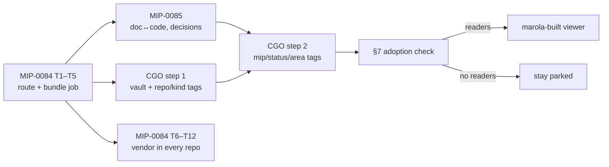

# MIP-0089: CGO — Claude, graphify and Obsidian as marola's knowledge map, and what a marola-built viewer would cost

| | |
|---|---|
| **Status** | Draft |
| **Author** | Hoffmann |
| **Created** | 2026-10-12 |
| **Phase** | None: dev-loop and outreach tooling, outside `docs/PHASES.md`'s sequence. It must not displace Phase 1 (the Telegram bot), which is not done |
| **Related** | MIP-0076 (graphify, pinned and offline), MIP-0084 (the `routing-bundle` this reads), MIP-0085 (doc↔code and decisions, the tags' source), MIP-0080 (`skills.lock`), MIP-0079 (why the vault is not a release) |
| **Effort** | M for CGO (an export step and a stdlib tag pass in MIP-0084's bundle job, a reusable workflow, one page); L for a marola-built viewer, which this MIP parks |
| **Gain** | `community/outreach`: a person can open every marola repo as one Obsidian vault and see which MIPs, docs and code touch an idea. `infra/dev-loop`: the same tags make `route` answers filterable by repo and MIP |
| **Effort vs Gain** | `do when MIP-0084 lands` for CGO step 1, `do when MIP-0085 lands` for step 2, `park` for a marola-built viewer until §7's adoption check says people use the vault |
| **Depends on** | MIP-0084 task 5 (the bundle job) for step 1; MIP-0085 tasks 5 and 6 (`doc_code.py`, `decisions.py`) for step 2. No paid resource: Obsidian's app is free, graphify runs offline in CI |
| **Blocked by** | 0084 |
| **Risk** | The vault is built and nobody opens it: the 2026-10-10 scan behind MIP-0084 found no session outside its builders used the graph, and a vault for people has no such scan yet |
| **Cost so far** | — |

### Readiness

| | |
|---|---|
| **Manually reviewed** | no |
| **Written by** | Hoffmann, with Claude Code |
| **Tasks** | none yet: §5's steps become `MIP-0089.tasks.md` if this MIP is Accepted |
| **Tests** | `vault_tags --self-test` and `kg-enroll --self-test` (§7), named here, not written |
| **Spec-kit** | none |
| **Issues** | not filed — Draft. Tracking issue for the study: see the PR |

The study behind this MIP, with the spike's commands and numbers, the cost model and the ordering
argument, is [`MIP-0089/cgo-study.pdf`](./MIP-0089/cgo-study.pdf) (source:
[`MIP-0089/cgo-study.md`](./MIP-0089/cgo-study.md)).

## 1. Summary

"CGO" is three tools marola already touches, used together: **Claude** (Claude Code and Claude
Projects) asks the graph, **graphify** builds it, and **Obsidian** shows it to a person. MIP-0084
already builds the code graph in CI for agents. This MIP adds one export step to that job, so the
same graph also ships as an Obsidian vault in which every note is tagged by repo, kind, MIP and
area. It also prices a marola-built viewer, and parks it: on the 2026-10-12 spike, building one
costs about ten PRs for what Obsidian already does for free. Order: MIP-0084, then CGO step 1
beside MIP-0085, then CGO step 2.

## 2. Motivation

Hoffmann's request (2026-10-12): adopt Claude + graphify + Obsidian, so people can see how ideas
match across marola-corpus, marola-oods, marola-research and every other marola repo by opening
one graph, with labels and tags indexing the knowledge, and add other repositories in one click.

Two gaps stand in the way today, both measured on 2026-10-12 (study §3):

- **The graph is for agents only.** MIP-0076 and MIP-0084 produce `graph.json` and a `route` CLI.
  A person reads neither. graphify can write an Obsidian vault (`graphify export obsidian`,
  0.9.86), but nothing in marola runs it.
- **graphify's vault does not say which repo a note is from, or which MIP it belongs to.** Its
  notes carry three tags: file type, edge confidence and community
  (`graphify/export.py`, `to_obsidian`, `node_tags = [ftype_tag, conf_tag, comm_tag]`). The global
  graph does record a `repo` field per node; the export drops it.
- **Ideas do not match across repos in a code-only graph.** On seven repos merged with
  `graphify global add --as <repo>`, 16 of 641 communities span more than one repo, and 803 of
  30,979 edges cross repos, most of them to unresolved nodes. The links a reader wants (this MIP
  explains that file, this decision ruled out that tool) are MIP-0085's doc↔code and decisions
  indexes, not graphify's edges.

On "Grafiphyy": no tool by that name was found. It is read here as **graphify**, whose PyPI
package is spelled `graphifyy` (Graphify-Labs/graphify, Apache-2.0, 0.9.86 uploaded
2026-10-11), the tool MIP-0076 pinned and MIP-0084 and MIP-0085 build on.

## 3. User-visible change

Before: a person who wants to see how MIP-0083 relates to marola-app's code reads the MIP, then
greps marola-app.

After, from any machine with Obsidian installed:

```text
$ git fetch https://github.com/marola-dev/marola refs/marola/vault:refs/marola/vault
$ git archive refs/marola/vault | tar -x -C ~/marola-vault
# open ~/marola-vault as a vault in Obsidian
```

A note in the vault:

```markdown
---
source_file: "core/src/main/scala/marola/scoring/Swimability.scala"
repo: "marola-app"
url: "https://github.com/marola-dev/marola-app/blob/8d3af82/core/src/main/scala/marola/scoring/Swimability.scala#L23"
tags:
  - repo/marola-app
  - kind/code
  - mip/MIP-0031
  - mip/MIP-0054
  - area/scoring
  - graphify/EXTRACTED
---
# Swimability
## Connections
- [[dot-waveDelta()]] - `method` [EXTRACTED]
…
```

Obsidian's tag pane then filters by `#mip/MIP-0083` or `#repo/marola-oods`, and its graph view
colours by those tags. An agent gets the same tags from `route` (`route query … --tag mip/MIP-0083`).

Adding a repository outside the umbrella:

```text
$ just kg-enroll h0ffmann/ww3-gpu
opened h0ffmann/ww3-gpu#NNN: "ci: publish a code graph for marola's knowledge map"
```

That PR adds one ten-line caller of the devkit's reusable `knowledge-graph.yml`; once it merges,
the next bundle run includes the repo under `repo/ww3-gpu`.

## 4. Data sources and dependencies reviewed

### graphify (the "G")

`graphifyy` 0.9.86 on PyPI (uploaded 2026-10-11, Apache-2.0), installed into a scratch venv and
run under `unshare -rn env -i` with no keys, as MIP-0076's spikes did. Verified on 2026-10-12:

- `graphify update .` builds a code and Markdown graph with no model call: seven repos in 22.4 s
  in total (study §3, table 1).
- `graphify global add <graph.json> --as <tag>` merges repos into one graph and tags each node
  with `repo`; `graphify cluster-only --no-label` reclusters the merge with no model call (14,200
  nodes, 30,979 edges, 641 communities, 15 s).
- `graphify export obsidian --dir <vault>` writes one note per node with wikilinks and YAML
  frontmatter, plus `graph.canvas` grouped by community: 14,841 notes, 64 MB, 6 s.
- `graphify export html` writes a community-aggregated `graph.html` (641 nodes, 0.6 MB, 1 s).
- Docs, PDFs and images get semantic edges only through an LLM backend; MIP-0076 measured a full
  pass at about 0.6–0.7M input tokens and rejected it. This MIP keeps that rejection.
- Graphify Cloud (hosted, cross-repo) has a 14-day trial and no published price; not used.

### Obsidian (the "O")

obsidian.md/pricing and /license, fetched 2026-10-12: the app is free for personal and commercial
use, no account; Sync $4/user/month annually, Publish $8/site/month annually, and a $50/user/year
commercial licence that the FAQ calls optional. The app is closed source (⚠ not stated on the
pricing page; widely known). Using it as a viewer adds no dependency to any marola repo: the vault
is plain Markdown, readable without Obsidian.

### Claude (the "C")

Claude Code reads the graph through MIP-0084's vendored `route`; Claude Projects through
MIP-0084's `routing-digest.md`. Cloud sessions load no plugins or MCP servers (MIP-0084 §4), so
graphify's MCP server stays out. CGO adds no Claude surface; it adds tags `route` can filter on.

### A marola-built viewer

Libraries checked on the npm registry, 2026-10-12: `sigma` 4.0.0, `graphology` 0.26.0 and
`cytoscape` 3.34.3, all MIT. Each would be vendored, as marola-site vendors Mapbox GL JS, and
served from docs.marola.dev (GitHub Pages, free). Costed in study §5.

**Pick**: graphify's own Obsidian export, post-processed with a stdlib tag pass, published by the
bundle job MIP-0084 already specifies. A marola-built viewer only if the vault finds readers.

## 5. Design

The order, against MIP-0084's and MIP-0085's task rows (study §4 argues it):



### 5.1 Step 1: the vault in the bundle (after MIP-0084 task 5)

The umbrella's `graph` job (MIP-0084 §5.3) gains, after `graph build` and `route bench`:

1. `graphify global add` per repo graph, `--as <repo>`, then `graphify cluster-only --no-label
   --no-viz`, all under MIP-0076's `env -i` wrapper (no key, no model call).
2. `graphify export obsidian --dir vault/`.
3. `vault_tags.py` (devkit, stdlib) rewrites each note's frontmatter: adds `repo`, `url` (the
   GitHub blob at the bundle's recorded SHA and line) and the tags `repo/<name>` and
   `kind/<file_type>`; keeps graphify's own tags; writes `vault/README.md` (how to open it, the
   tag scheme, the bundle's commit).
4. The vault is committed to `refs/marola/vault`, outside `refs/heads/`, so plain clones never
   fetch it (MIP-0084 §5.3's 10 MB rule). Same ruleset as `routing-bundle`.

Size control: the umbrella's `.graphifyignore` and each repo's exclude vendored code. Excluding
`site/static/vendor/` and vendored `.claude/skills/` alone drops the merged graph from 14,200 to
6,398 nodes (study §3). The job fails over 30 MB of notes rather than publish a vault Obsidian
indexes slowly.

### 5.2 Step 2: MIP, decision and area tags (after MIP-0085 tasks 5 and 6)

`vault_tags.py` reads MIP-0085's `doc_code.json` and `DECISIONS.md` from the bundle and adds:

| Tag | From | Example |
|---|---|---|
| `mip/MIP-NNNN` | doc↔code edges, and a MIP's own notes | `mip/MIP-0083` |
| `status/<s>` | the MIP's Status row | `status/accepted` |
| `area/<a>` | the `area/*` labels on the MIP's issues (`labels.yml`) | `area/dev-tooling` |
| `decision` | a row of `DECISIONS.md` | |

An ambiguous doc↔code link (MIP-0085 §5.4) is not tagged; it is listed in the note's body with
its candidates. `route` gains `--tag <t>` on `query`, `docs` and `code`.

### 5.3 Other repos in one PR (`knowledge-graph.yml`, `kg-enroll`)

- **marola-devkit** ships a reusable workflow, `knowledge-graph.yml`: on push to the caller's
  default branch it runs `graphify update . --no-cluster` offline and force-pushes `graph.json`
  and `build.json` to the caller's `refs/marola/graph`. No secret is needed in the caller.
- **`kg-enroll <owner/repo>`** (devkit tool) opens a PR in the target repo adding the caller file,
  and a PR in the umbrella adding a line to `knowledge-sources.yml` (repo, ref, tag). The bundle
  job reads that list and fetches each `refs/marola/graph` with `git fetch --depth 1`.
- A repo inside the umbrella needs none of this: the bundle job already graphs the submodules.
  That covers marola-corpus, marola-oods, marola-research, marola-skills and marola-agents today.

"One click" is therefore one reviewed PR per outside repo, by design: a graph that steers agents
and readers is never added without a person merging it (MIP-0084 §8).

### 5.4 A marola-built viewer: parked

Study §5 prices three tiers. The decision here:

- **Do now (free, in step 1)**: also commit graphify's `graph.html` to the vault ref, so a reader
  without Obsidian gets a browser view.
- **Park**: an `atlas` page on docs.marola.dev (sigma.js over a pruned graph, filters by the §5.2
  tags, deep links to GitHub). Revisit when §7's adoption check shows readers.
- **Reject**: graphify's LLM pass for semantic doc edges, and Graphify Cloud (§9).

## 6. Scoring / safety impact

None. No code path in marola-app changes.

## 7. Verification plan

- **`vault_tags --self-test`** (devkit): `repo_tag_added`, `kind_tag_added`, `url_pins_sha`,
  `graphify_tags_kept`, `mip_tag_from_doc_code`, `ambiguous_link_not_tagged`,
  `status_tag_from_mip_row`, `idempotent_second_run`, `refuses_over_size_cap`.
- **`kg-enroll --self-test`**: `caller_file_rendered`, `sources_line_added`,
  `refuses_repo_already_listed`, `dry_run_writes_nothing`.
- **CI**: the bundle job on a branch publishing to a scratch ref; `refs/marola/vault` rejected for
  a person's token by the ruleset; a run with no `GRAPHIFY_*`/API key in its environment and no
  network to model hosts (the `env -i` wrapper, as MIP-0076 §7).
- **Done means (step 1)**: the vault opens in Obsidian 1.x on Linux and Windows, `#repo/` tags
  list every submodule, a note's `url` opens the right line on GitHub, and the vault is under 30 MB.
- **Done means (step 2)**: `#mip/MIP-0083` lists at least the files MIP-0085's `route code
  MIP-0083` lists; one outside repo (ww3-gpu) enrolled through `kg-enroll` appears as `repo/ww3-gpu`.
- **Adoption, not a gate**: four weeks after step 1, count vault ref fetches (the clone traffic
  API does not split refs, so ⚠ the measure is a question in the project's thread plus
  `just route-usage --tag`). Fewer than three people opening it keeps §5.4's viewer parked.

## 8. Risks, limitations, and honest caveats

- **Nobody opens it.** The risk in the header. Step 1 is a few dozen lines in a job that already
  runs, so the loss is small; the viewer stays parked until there is evidence.
- **Code-only edges do not show ideas.** Cross-repo meaning comes from MIP-0085's indexes and the
  tags; without step 2 the vault is a code map, not a map of ideas. Study §3 has the numbers.
- **The vault is a second thing agents and people trust.** It inherits the bundle's ruleset and
  reviewed workflow; `vault_tags.py` writes YAML from repo data, so it quotes every value and never
  interpolates into a shell.
- **graphify churn.** It released 0.9.66 to 0.9.86 in ten days. The export format is pinned with
  graphify (MIP-0076's nixpkgs pin); `vault_tags --self-test` runs on a fixture vault per bump.
- **Obsidian is closed source.** It is a viewer only; the vault is plain Markdown, and the
  `graph.html` in the same ref needs no Obsidian. Nothing in marola requires it.
- **marola-research is a stub today** (REPOS.md lists it as "Science" with no contract): its
  notes will be few until it has content.

## 9. Alternatives considered

- **Do nothing**: agents keep `route`; people keep reading MIPs and grepping.
- **A marola-built viewer now** (study §5, tier B): about ten PRs and an estimated $60 of agent
  time plus a person's review, to rebuild Obsidian's tag pane, search and graph view for an
  audience not yet shown to exist.
- **graphify's LLM pass for semantic doc edges**: 0.6–0.7M input tokens per pass (MIP-0076);
  study §5 prices a daily run at about $2/month on the cheapest current Claude model and $40–80/month
  on Sonnet or Opus, before output tokens, and its edges are inferred, not checked. Rejected again.
- **Graphify Cloud**: cross-repo graphs, hosted, no published price, and marola's knowledge would
  live on a vendor's service. Rejected.
- **Obsidian Publish** for a public vault: $8/site/month and a closed host; docs.marola.dev already
  serves the docs. Rejected.
- **A committed vault** in a repo's tree: thousands of generated files churning on every pointer
  move, which MIP-0076 rejected for `graph.json`.

## 11. Open questions

- Is "Grafiphyy" graphify? **Default:** yes (§2); Hoffmann corrects this if another tool was meant.
- Should outside repos (ww3-gpu, the awesome lists) be in the default vault, or in a second one?
  **Default:** one vault, `repo/` tags keep them apart; Hoffmann decides per repo at `kg-enroll`.
- Should the vault be public? **Default:** yes, like the bundle: every repo in it is public.
- Is MIP-0084 the number Hoffmann meant for "graph plugin"? **Default:** yes. The project's
  shared folder also holds an unpushed draft titled "MIP-0084: What it takes to make marola an
  Apache project"; that number is taken on `main` by zero-setup routing, so the draft needs a new
  number before it is pushed.

## Appendix

### Checked live (2026-10-12)

- `graphifyy` 0.9.86 from PyPI in a scratch venv: `graphify --help` (the `export obsidian`,
  `global`, `merge-graphs` and `cluster-only` commands), `graphify/export.py` (`to_obsidian`'s tag
  list), and the spike in study §3, run under `unshare -rn env -i` with no keys.
- pypi.org/pypi/graphifyy/json: licence Apache-2.0, 0.9.86 uploaded 2026-10-11.
- github.com/Graphify-Labs/graphify README: Cloud trial, no price; LLM needed only for non-code.
- obsidian.md/pricing and obsidian.md/license.
- registry.npmjs.org: `sigma` 4.0.0, `graphology` 0.26.0, `cytoscape` 3.34.3, MIT.

### Not checked

- Obsidian's performance on a 6,000-note vault on a low-end laptop.
- Whether a ruleset can cover a ref outside `refs/heads/` (MIP-0084 assumed it for branches only).
- The output-token side of the LLM-pass price in §9.
