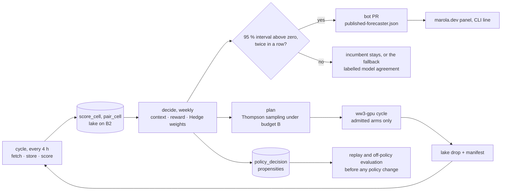

# MIP-0091: The Marola forecaster's architecture — the evaluation goes first, no new repo, and the design requirements from Read, Evaluate, Adopt on Operational WeatherBench

| | |
|---|---|
| **Status** | Accepted (2026-10-13, initial review by Hoffmann; needs refinement before its task list is written) |
| **Author** | Hoffmann |
| **Created** | 2026-10-13 |
| **Phase** | None: R&D outside the phase list, as MIP-0083. Zero cloud spend. Computed arms run on owned hardware. Nothing here moves Phase 1 (the Telegram bot), which is not done |
| **Related** | MIP-0083 (the forecast experiment: the evaluation this MIP puts first), MIP-0070 (the polyrepo split and its test for a new repo), MIP-0075 (the B2 lake the record must reach), MIP-0051 and MIP-0038 (the wave models and the shown disagreement), MIP-0052 (wave model compute), MIP-0062 (the ressaca veto, untouched), MIP-0053 (the learned local correction, a candidate arm), the policy note *Contextual Bandits for Weather Bench: The Marola forecaster* (v0.1.0, 2026-10-12, private until its Zenodo record; its own MIP follows this one), h0ffmann/ww3-gpu (the computed arms) |
| **Effort** | XL for the whole, which has these parts. A wave extension of marola-app's `experiment` (L). A `forecaster` sbt module with a replay (L). A lake-drop contract for computed arms (M). A site panel and the product hook (M). Stages 1 and 2 of §5.6, which this MIP makes first, are L together |
| **Gain** | `user value`: marola names the arm (the candidate forecaster) that it quotes for each coast and lead, selected by verified skill, or says that the models agree or disagree. `community/outreach`: a continuous wave and wind benchmark on Brazilian instruments through a strong El Niño, with its method public. `infra/dev-loop`: the order of the modules and the repository question do not occur again |
| **Effort vs Gain** | `do next` for stages 1 and 2 (wave truth into the evaluation, and the forecaster written and replayed on the wind record that already increases). `do when X lands` for stage 3 (X = a computed arm whose correctness gate passed) and stage 4 (X = the first pass of the gate on a `scored` point). `park` for any new repository, with the two triggers of §5.6 |
| **Depends on** | MIP-0083 v0 in unattended operation: its `experiment` module is in marola-app's `main` at f769245 (checked 2026-10-13). MIP-0075 task 5, the B2 `SampleStore`. A record kept in the Actions cache is evicted after 7 days unused, and the forecaster cannot learn from that record. PNBOIA files through BNDO (MIP-0083 task 18, a person's act) for wave truth. The policy MIP for the parameters of the decision rules. No Phase 1 gate, no paid resource |
| **Blocked by** | 0083 |
| **Risk** | The forecaster learns from a record that is not durable, or too short, and changes the quoted arm because of noise. §5.6 makes the B2 lake a prerequisite of stage 2. Because of R10's gate, hysteresis and fallback, a change needs evidence on two consecutive weekly runs |

### Readiness

| | |
|---|---|
| **Manually reviewed** | yes — Hoffmann, 2026-10-13 (initial review: Accepted, needs refinement) |
| **Written by** | Hoffmann, with Claude Code |
| **Tasks** | not yet: the refinement is first. Then the stages of §5.6 become `MIP-0091.tasks.md` |
| **Tests** | `WaveScoreSpec`, `LicenceTierSpec`, `LakeDropSpec`, `ContextSpec`, `RewardSpec`, `HedgeSpec`, `GateSpec`, `FallbackSpec`, `BudgetSpec`, `PropensityLogSpec`, `ReplaySpec`, `DoublyRobustSpec`, `PublishSpec` (§7), named here, not written |
| **Spec-kit** | none |
| **Issues** | not filed — waits for the refinement and the task list |

## 1. Summary

marola will quote one wind and wave forecast for each beach. Verified skill will select that
forecast among several candidates (arms). This MIP decides three questions before any of it is
built.

The evaluation (marola-eval) is first, and the forecaster (marola-forecaster) is built on the
evaluation. The reason is that the forecaster's reward is the evaluation's output, and that the
evaluation is already two thirds built as MIP-0083's `experiment` module.

No new repository is necessary. The forecaster is a second sbt module in marola-app. The computed
wave runs stay in h0ffmann/ww3-gpu behind a pinned artifact. The science goes to marola-research,
which contains only a licence today.

The architecture must satisfy the twenty requirements of §4.3. Those requirements come from a
Read, Evaluate, Adopt pass on Brightband's Operational WeatherBench (OWB). The pass read OWB,
evaluated what of it stays valid on Brazilian instruments, and adopted the rest. §5 draws the
modules and the order of their delivery.

## 2. Motivation

The owner asked three things on 2026-10-13. Which module is first, marola-forecaster or
marola-eval? How many repositories are necessary? What must the architecture satisfy, when Read,
Evaluate, Adopt (REA) is applied to OWB?

Three facts decide the first two questions:

- **Nothing can be selected before it is measured.** The policy note's rule (its §4.5) uses the
  95 % paired bootstrap interval of the skill difference. The rule replaces the incumbent only
  when that interval is above zero two consecutive times. That interval is MIP-0083's
  `HeadToHead` in
  [`Scorer.scala`](https://github.com/marola-dev/marola-app/blob/main/experiment/src/main/scala/marola/experiment/score/Scorer.scala),
  already in `main`. Without score cells there is no interval, no Hedge weight and no bandit
  posterior. The only output that needs no score cells is the deterministic fallback, the median
  of the admissible arms, which is MIP-0038's spread with a number.
- **The evaluation is already in progress.** marola-app `main` at f769245 (2026-10-13) has
  `experiment/` with 17 Scala sources and 6 resources. That commit also has a lake DDL of seven
  tables, the paired block bootstrap, and `experiment.yml`, which runs a cycle every 4 hours. The
  evaluation's record is in the Actions cache. The cache evicts a record after 7 days unused
  (marola-app's `4-reference_experiment-cycle.md`). Thus the evaluation's record is not yet a
  record that the forecaster can use.
- **A "marola-eval" repository was proposed and withdrawn** on 2026-10-09 (MIP-0083 §9). The
  `experiment` module keeps marola-app's HTTP, JSON and ledger code because the module stays in
  marola-app. That decision, four days old, answers half of the repository question.

What is missing is the forecaster, the layer above the scores. Its parts are the context, the
reward, the two decision rules and the replay. The forecaster also has the contract through which a
computed wave run enters the record. It also has the one file through which the product learns which
arm to quote. §5 designs the forecaster.

## 3. User-visible change

Nothing until a point is `scored` (MIP-0083 §5.8) and the gate passed on two consecutive weekly
runs. Then the detailed CLI block, and later the beach page, get one labelled line. This line is
computed from the record, and a model never writes it:

```text
Today:     Waves 1.3 m                          (MIP-0038's agreed / mixed / split word beside it)
Winner:    Waves 1.3 m, IFS wind + WW3. Quoted because it beat GFS wind + WW3 by 0.08 CRPSS at the
           Santa Catarina buoys, 24–72 h, over the last 90 days (n = 212). Models: agreed.
Fallback:  Waves 1.3 m, model agreement (median of 4 models; no winner yet at this coast).
```

The swimability score and the ressaca veto print exactly what they print today (§6).

## 4. Data sources and dependencies reviewed

This section is the REA pass for the architecture. The policy note did the REA pass for the
method. This section repeats the same three steps for the modules and contracts, and the result is
the requirements that §5 must satisfy.

### 4.1 Read: what OWB is (checked 2026-10-13)

The methodology page at <https://owb.brightband.com/methodology>, fetched 2026-10-13 `(v)`:

| Element | OWB | What it means for an architecture |
|---|---|---|
| Truth | "by default each model is scored against its own analysis". OWB scores precipitation against ERA5. | the protocol selects the truth, and the selection is stated one time and versioned |
| Grid and weights | "a fixed 0.25° global grid (1440×721; no regridding)". The means are "area-weighted … proportional to the cosine of latitude". | one fixed geometry for each protocol version |
| Regions | "the global mean plus the tropics, the northern and southern hemispheres, North America, and Europe". "Region boundaries follow the WBX public-benchmark convention". "Scores are computed for a wider set of regions than the dashboard exposes". | the regions that a dashboard shows are a subset of the scored regions |
| Leads and ranking | Every 6 h to 360 h. "The scorecard summarizes a subset — days 1, 3, 5, 7, 10, and 15". "Only each day's 12Z cycle is ranked". | the scorecard is a projection of the score store, not the store |
| Metrics | RMSE, ACC (Z500), vector-wind RMSE, SEEPS. Fair CRPS, spread, debiased ensemble-mean RMSE, spread–skill, K = 16. | proper scores, aggregated by component |
| Baseline | an ERA5 climatology, always on the chart | a skill floor is part of the protocol, not a view |
| Variables | Geopotential, temperature, 10 m wind, 850 hPa wind, 24 h precipitation. No wave or ocean variable. | waves are marola's addition |
| In-situ truth | none: no station, buoy or point verification on the page | observation truth is marola's addition |
| Licence and citation | "distributed under the CC BY 4.0 license", which covers "this dashboard and the derived scores". Third-party data is under its own terms. No DOI and no citation instructions for OWB itself. | derived scores can be CC BY 4.0, with the terms of each source kept |
| Engine | WeatherBench-X (Google Research, Apache 2.0 `(v)` its repository page, 2026-10-13). Scores are stored for each model, target, variable, metric, region, init and lead. | Scoring is a library. The store is keyed, and the dashboard reads the store. |
| Decision | none: OWB ranks | the selection of a model is marola's addition |

### 4.2 Evaluate: what holds on Brazilian instruments, and what marola already has

MIP-0083 §4.10 and the policy note §3 did the data part. The consequences for
the architecture are:

| Gap | Consequence for the architecture |
|---|---|
| OWB's truth is each model's analysis. Over a sparsely observed ocean, that truth gives an advantage to agreement with IFS, not with the sea. | Truth is observations at points (METAR, INMET, PNBOIA buoys, radiosondes), with its representativeness error carried. It is never compared with OWB's numbers directly. |
| No South America region. The Brazilian shelf is a small part of the southern-hemisphere mean. | marola's regions are its own context cells (South, Southeast, Northeast; buoy, station, beach). The scorecard is a projection of those cells. |
| No waves | wave variables (Hs, peak period, direction) with their own truth, their own climatology floor and a hazard-weighted score above the ressaca threshold (MIP-0062) |
| Few instruments: PNBOIA operated a maximum of approximately nine buoys at the same time (MIP-0083 §4.10) | Most cells stay `low_sample` for a long time. The fallback is the normal state. The design must make the fallback honest, not exceptional. |
| Some truth is under agreements that restrict redistribution (BNDO's Termo de Compromisso, MIP-0083 §4.10, and the technical-cooperation agreements that the policy note lists as planned) | Every observation row has a licence tier. Scoring uses every tier. The export filters by tier. The scorecard says which cells it cannot show. |
| No money for GPU inference every cycle | Fetched arms are free. Scoring runs on GitHub Actions. Computed arms run on owned hardware under a budget that is a protocol value. |
| OWB ranks, but marola must select one number for each beach for a swimmer | a forecaster with a conservative rule, no live exploration, and safety outside it |

What marola already has, checked 2026-10-13 `(v)` unless marked otherwise:

- The `experiment` module of marola-app at f769245 has `Protocol`, `Provider` and `Route` as data.
  `Variable` has five cases and no wave, and `Network.Pnboia` and `PointKind.Buoy` are already
  declared. `ScoreCell` and `PairCell` are monoids, and `Scorer.HeadToHead` has its `Verdict.Tie`.
  `SampleStore` uses a local DuckLake. `Export` writes the scorecard only when a point is `scored`.
  The ENSO week and anomaly are logged as MLflow params on each cycle.
- MIP-0038 (Draft): the agreed / mixed / split word and the per-model numbers in the detailed block.
- MIP-0062 (Draft): the ressaca veto at the Navy's warning height, deterministic, in `scoring/`.
- h0ffmann/ww3-gpu at fe472ab. These items are from the policy note's source note of 2026-10-12
  and were not re-read ⚠. One command builds WW3 and does its regression tests. `W3SNL1` is ported
  and bit-identical on three backends. WFIP-0001 (GFS wind against WeatherNext 3 wind on the
  southern-Brazil case) is a Draft. WW4 was at 0.0.0 with placeholder physics on 2026-10-07.
- marola-research at 875b0e0: a `LICENSE` and nothing else.
- The private note repository (bundle `marola-forecaster.bundle`, head 5eca2ee) contains the note in
  two languages, its PDF pipeline and a Zenodo script. The private note repository also contains a
  MIP draft held "until the owner's go-ahead".

### 4.3 Adopt: the requirements the architecture must satisfy

| # | Requirement | Comes from | Satisfied by (§5) |
|---|---|---|---|
| R1 | Measurement before decision. The forecaster reads score cells and writes nothing that the scorer reads. The build enforces the direction (`forecaster` depends on `experiment`, never the reverse). | OWB's engine/store split; §2's first fact | §5.1, §5.4 |
| R2 | One fixed, versioned, public protocol. The protocol sets leads every 6 h to 360 h, scorecard days 1/3/5/7/10/15, a 12Z ranking, K = 16, fair CRPS, windows 7/30/90 d, `min_n`. A change is a new version and a new MLflow experiment. | OWB's fixed protocol; MIP-0083 §4.8, §5.6 | `protocol.json`, unchanged |
| R3 | The decision parameters (η, hysteresis, bootstrap seed, budget B, hazard weight, kill switch) are in a `policy.json`. That file is versioned like the protocol and committed before the first replay. | the policy note §4.5.3 (pre-registration) | §5.4 |
| R4 | Truth is observations at points. Each row has instrument, averaging, QC flag and licence tier. A missing observation is a `missing` row, never a model value. | §4.2 row 1; MIP-0083 §5.5 | §5.3 |
| R5 | Waves are first-class. The wave variables are Hs, peak period, direction, with buoy truth, a climatology floor and a threshold-weighted CRPS above 2.5 m. Wind and wave rows stay separate. | §4.2 row 3; policy note §4.4 | §5.3 |
| R6 | A climatology floor is always present and the reward is skill relative to it (CRPSS). A cell with no floor publishes no reward. | OWB's baseline; MIP-0083 §4.10 | §5.3, §5.4 |
| R7 | Scores stay monoids. The forecaster consumes windowed folds, never raw samples, so every decision is a pure function of (protocol, policy, cells, context) and `replay` reproduces `decide`. | MIP-0083 §5.2 | §5.4 |
| R8 | Two information structures, two algorithms. Fetched arms are full-information experts (Hedge). Computed arms are a budgeted bandit (Thompson sampling with a knapsack). Never a bandit over arms whose loss is observed in all cases. | policy note §4.5.1, §4.5.2 | §5.4 |
| R9 | Causality. Every context feature is dated before the issue time. The replay rejects a feature stamped after the decision. | policy note §4.3; MIP-0083 §5.11 | `ContextSpec`, `ReplaySpec` |
| R10 | Conservative switching. A change of the quoted arm needs the 95 % interval of the paired block bootstrap above zero against the incumbent on the common set. The change needs that result on two consecutive weekly runs. Otherwise the incumbent stays. A cell that is `low_sample`, or where the gate never passed, publishes the median of the admissible arms, labelled model agreement. A kill switch in `policy.json` returns every cell to the fallback. | policy note §4.5.1, §4.6; MIP-0083 §5.14 rule 8 | §5.4 `Gate`, `Fallback` |
| R11 | No live exploration. A swimmer sees only an arm that passed its correctness gate and was verified. Exploration changes which computed arms run. | policy note §4.6 | §5.4 `Budget`, §5.5 |
| R12 | Safety outside the forecaster. `Swimability.score` and the ressaca veto read nothing from the forecaster. `cli` does not depend on `forecaster`. The product reads one committed file, moved only by a reviewed PR. | MIP-0083 §6; AGENTS.md | §5.5, §6 |
| R13 | Every decision is logged with its propensity (context, sampled values, chosen set, probability of each arm), so a new policy is valued off-policy (doubly robust) on the decision log before it comes into use. | policy note §4.5.2 | §5.4 `PropensityLog`, `Evaluate` |
| R14 | Non-stationarity. The experts have a 90-day sliding window. The bandit has a discounted posterior. When the ENSO status changes, a cell is reset to its parent's weights. | policy note §4.6; the El Niño window | §5.4 `Context` |
| R15 | Admission is correctness, not skill. Admission is by WW3 regtests for A1–A3 (bit-for-bit for the GPU port), and by GoogleTest plus a regtest replay for WW4. The pass is recorded with commit and command and travels with the samples. Skill is measured only by R4–R7. | policy note §4.2 | §5.5 manifest |
| R16 | Contracts, not trees. A computed run enters the record as a drop of `ForecastSample` rows with a manifest. The run plan returns the same way. One lake writer. No repository reads the tree of another repository. | MIP-0070 §5.4; MIP-0075 §5.4 | §5.5 |
| R17 | Zero spend by construction. Fetched arms are free. Scoring runs on Actions. Computed arms run on owned hardware. B is a protocol value. Nothing provisions. | AGENTS.md cost rule; policy note §4.8 | §5.6 |
| R18 | Disagreement is shown. When admissible arms disagree by more than a threshold, the published view says so adjacent to the winner. | MIP-0038 | §3 |
| R19 | Honest output. Every published number names its forecaster, window, `n` and `low_sample`, and no page compares a station-truth score with an OWB number. | MIP-0083 §4.10 | §3, §5.5 |
| R20 | A public chain. Scorecards are CC BY 4.0 with each source's terms. There is a dated Zenodo dataset for each protocol version. The note and the weekly reports are in marola-research and on marola.dev. | OWB's licence; MIP-0079; policy note §5 | §5.6 stage 5 |

### 4.4 Where the code could live

| Candidate | What was checked | Verdict |
|---|---|---|
| marola-app `experiment` (exists) | f769245: ADR-0002 made it a fourth sbt module, aggregated by `root`. `cli` does not depend on it. Its routes, clients, lake and scorer are the measurement. | **the evaluation**: waves are rows, variables and one route added to it (§5.3) |
| a `forecaster` sbt module in marola-app (new) | the same toolchain (Scala 3, Kyo RC7, JDK 25), the same lake engine, `dependsOn(experiment)`. A jar is built from it alone, like the jar of the `experiment` module. | **the forecaster** (§5.4): the dependency direction of R1 is one `dependsOn` line |
| a `marola-forecaster` code repo (new) | If this repository exists, it consumes score cells as a pinned artifact: a versioned Parquet export for each cycle. Every schema change then needs two PRs (MIP-0070 §9's "full modularity" cost). | rejected now. §5.6 names the trigger that changes this. |
| a `marola-eval` repo (new) | the owner withdrew it on 2026-10-09 (MIP-0083 §9) | rejected |
| h0ffmann/ww3-gpu (exists, outside the org) | Fortran, MPI, NetCDF, Kokkos under Nix. Regtests. Owned RTX 4090. | **the computed arms**, behind the lake-drop contract (§5.5). §11 asks if it joins the org. |
| marola-ml (exists) | offline Python: DSPy, the fine-tune, the benchmark gate. MIP-0083 task 21 already points its grid-score job here. | optional analysis only (figures, the WBX South crop). Nothing that the forecaster needs runs here. |
| marola-site (exists) | marola-site#99 is the scorecard page (MIP-0083 task 10). marola.dev has no research page (policy note §5). | the panel of §3 and the research page, stage 5 |
| marola-research (exists, empty) | 875b0e0: `LICENSE` only | the note's public copy, the replay results for each protocol version, the weekly reports' sources |
| the private note repository (exists as a bundle) | the place where the note is written, and its PDF and Zenodo pipeline. It contains a MIP draft until the owner's approval. | not part of the runtime architecture. It stays private until publication. |

**The pick:** zero new repositories. Two modules in marola-app, one contract to ww3-gpu, two
existing repositories for pages and science.

## 5. Design

### 5.1 The module map

```d2
direction: right
measure: "marola-app · experiment (marola-eval)" {
  routes: "forecast routes\nopen_meteo · marine · lake_drop"
  obs: "observation clients\nMETAR · INMET · PNBOIA"
  lake: "lake on B2\nsamples · score_cell · pair_cell"
  scorer: "Matcher · Scorer\nmonoids · HeadToHead"
  routes -> lake
  obs -> lake
  lake -> scorer
  scorer -> lake
}
decide: "marola-app · forecaster (marola-forecaster)" {
  ctx: "Context · Reward"
  hedge: "Hedge · Gate · Fallback"
  budget: "Budget\nThompson sampling, knapsack"
  log: "PropensityLog · Replay · Evaluate"
  ctx -> hedge
  ctx -> budget
  hedge -> log
  budget -> log
}
compute: "h0ffmann/ww3-gpu, owned hardware" {
  ww3: "A1–A4 runs\nregtest record"
}
product: "marola-app cli and core · marola-site" {
  file: "published-forecaster.json\nmoved by a reviewed PR"
  swim: "Swimability · ressaca veto\nunchanged"
}
measure.lake -> decide.ctx: "score cells, by protocol version"
decide.budget -> compute.ww3: "run-plan.json"
compute.ww3 -> measure.routes: "lake drop + manifest"
decide.hedge -> product.file: "bot PR"
```

The arrows are the only places where data crosses a boundary. Each arrow is a row of §5.5. No
arrow goes from `product` to `decide` or `measure`.

### 5.2 The flow



### 5.3 marola-eval: what `experiment` gains

All of it is data and rows in the shape that MIP-0083 §4.4 set, and one route and one score
term:

- **Licence tier.** `Instrument` gets `tier: Tier` (`enum Tier(label)`: `public`, `agreement`).
  The tier is copied into `ObservationSample` and into every `ScoreCell` that it produces.
  `Export` removes `agreement`-tier cells and lists them as "not shown: n cells under agreement
  terms" (`LicenceTierSpec`).
- **Wave variables.** `Variable` gets `wave_height`, `wave_peak_period`, `wave_direction`
  (`MeasureUnit`: metres, seconds, degrees). Direction is scored only above a wave-height floor,
  as wind direction is scored above 2 m/s.
- **Wave truth.** PNBOIA buoys are `buoy` sampling points (MIP-0083 task 12). A `PnboiaClient`
  reads the BNDO files into `ObservationSample`. Where the Termo de Compromisso applies, the
  samples have `tier = agreement`.
- **Wave forecasts.** A `marine` route uses the Open-Meteo marine API with `models=` (the call
  that MIP-0051 and MIP-0038 already describe). `providers.json` has one row for each wave model.
  The models that Open-Meteo serves on this coast are ⚠ until the first live fixture records
  them.
- **The climatology floor.** A `climatology_cell` table (point, variable, day-of-year window,
  mean, CRPS of the climatological distribution) is built one time for each point. The source is
  ERA5 point series or the instrument's own record. `Scorer` writes `sumCrpsClim` adjacent to
  `sumCrps`, so CRPSS can be calculated from any window.
- **The hazard tail.** A threshold-weighted CRPS sum, `sumTwCrps`, uses the threshold and the
  weight from `policy.json` (2.5 m, weight 2, the policy note's defaults). It is one more monoid
  field. The laws of `ScoreMonoidSpec` cover the field, and the laws do not change.
- **The lake-drop route.** `Route.LakeDrop` is a `ForecastSource`. It reads
  `ww3/<arm>/<run_init>/samples.parquet` and its `manifest.json` from a B2 prefix, not from an
  HTTP API. If the manifest of a lake drop does not have the gate record of R15, the route
  refuses the lake drop. The route writes `run_index` rows as each other route does. The cycle of
  the `experiment` module stays the only writer of the lake (MIP-0075 §5.4).

### 5.4 marola-forecaster: the `forecaster` module

`build.sbt` gets a fifth module, `forecaster` (`marola-forecaster`). The module has
`dependsOn(experiment)`, `root` aggregates it, and it has its own jar. `cli` has no dependency on
the module. The files are under `forecaster/src/main/scala/marola/forecaster/`:

| File | What |
|---|---|
| `Policy.scala` | `Policy` (`derives Schema`): version, `eta`, `windowDays`, `hysteresisRuns = 2`, `bootstrapSeed`, `budget: Budget`, `hazard: Threshold`, `killSwitch: Boolean`. Read from `forecaster/policy.json`. |
| `Context.scala` | `Context(enso: EnsoStatus, region: Region, pointKind: PointKind, leadBucket: LeadBucket, season: Season, seaState: SeaState)` and `Context.of(cells, cycle: Instant): Context`, which reads only rows dated before `cycle` (R9). `parent: Option[Context]` for the `low_sample` fallback. |
| `Reward.scala` | `crpss(cell: Score, clim: Score): Double`. `reward(ctx, arm, window): Option[Double]`, which gives the sum of `ω_v · CRPSS_v`, `None` without a floor (R6). |
| `Hedge.scala` | `Weights(ctx) = Map[Arm, Double]`. `update(w, losses, eta)` as `w · exp(−η ℓ)`. Pure. |
| `Gate.scala` | `decide(incumbent: Arm, candidate: Arm, pairs: Chunk[PairCell], seed): Verdict` on `Scorer.HeadToHead`. `Hysteresis(runs)`, which counts consecutive passes (R10). |
| `Fallback.scala` | `median(admissible: Chunk[Forecast]): Forecast` and the `model agreement` label |
| `Budget.scala` | `plan(ctx, posteriors, costs, budget, rng): RunPlan` by sampled reward per cost until B is spent. `discount(posterior, factor)` (R14). Every arm's selection probability from the sampled draws. |
| `PropensityLog.scala` | `PolicyDecision(cycle, ctx, arm, probability, sampled, chosen, policyVersion)` to the `policy_decision` table |
| `Replay.scala` | `replay(from, until)`: runs `decide` and `plan` over the lake in time order, for each ENSO stratum. It gives the cumulative regret against the best fixed arm, the number of changes, and the CRPSS in the hazardous bin (policy note §4.5.3). |
| `Evaluate.scala` | the doubly robust estimate of a candidate `Policy` on the decision log (R13) |
| `Publish.scala` | `PublishedForecaster(version, perContext: Map[Context, Quoted])`, `Quoted(arm, crpss, n, window, lowSample, agreement)`. Writes `published-forecaster.json` and `forecaster/latest.json`. |
| `Main.scala` | `decide`, `plan`, `replay`, `evaluate`, `publish` |

The shape is in the house style. The registry, policy, context, reward, Hedge, gate,
fallback and budget are plain Scala with no effect. `Sync`, `Env[Deps]` and `Abort` appear only
in `Main` and in the store reads, as in `experiment`. `Clock` is the only source of the current
time, so `ReplaySpec` makes it constant.

The weekly job is `forecaster.yml` in marola-app. It has `schedule` on Monday 06:17 UTC and the
`oods-lake` concurrency group, and it runs `decide`, then `plan`, then `publish`. When `publish`
changes `published-forecaster.json`, the job opens a PR against marola-app. The body of the PR has
the diff and the two HeadToHead intervals. A person merges the PR. The run
plan goes to B2 as `forecaster/run-plan/<cycle>.json`.

### 5.5 Contracts

| Producer → consumer | Artifact | Pinned or gated by |
|---|---|---|
| `experiment` → `forecaster` | `score_cell`, `pair_cell`, `climatology_cell` in the lake | The protocol version. A schema change is a new version, and the forecaster reads one version. |
| `forecaster` → `cli`, `core` | `published-forecaster.json`, a resource in marola-app | A PR that a person merges (`PublishSpec` checks the file against the decision log). The kill switch makes the file empty. |
| `forecaster` → ww3-gpu | `forecaster/run-plan/<cycle>.json` on B2 | The `policy.json` version in the file. ww3-gpu runs only the arms that the plan names and that it has admitted. |
| ww3-gpu → `experiment` | `ww3/<arm>/<run_init>/samples.parquet` + `manifest.json` (run_init, content sha, grid, forcing, the regtest commit and command, the parity hash for the GPU port) | The `lake_drop` row in `providers.json`. A lake drop without a gate record is a `missing` run row with a reason. |
| `experiment`, `forecaster` → marola-site | `forecast-benchmark/latest.json` (MIP-0083) and `forecaster/latest.json` on `site-data` | the JSON Schemas that the jar contains |
| `forecaster` → marola-research | Replay results for each protocol version. The weekly report's numbers. | a dated Zenodo dataset for each protocol version |

### 5.6 The order, and when a repository would be warranted

| Stage | Where | Delivers | Waits on |
|---|---|---|---|
| 0 | marola-app, marola-oods | MIP-0083 v0 done: 7 unattended days. The B2 `SampleStore` (MIP-0075 task 5), so that the record is durable. | in progress |
| 1 | marola-app `experiment` | §5.3: tier, wave variables, PNBOIA, the marine route, the climatology floor, the hazard term | stage 0, and the BNDO files |
| 2 | marola-app `forecaster` | §5.4 on the wind record only: the module, `decide`, `replay`, `evaluate`, `forecaster/latest.json` for information. The replay on the IFS and GFS archive for each ENSO stratum. | stage 0. It can run at the same time as stage 1: the files are different. |
| 3 | marola-app `experiment`, ww3-gpu | The `lake_drop` route and manifest. `Budget` and `plan`. ww3-gpu's side of the contract. | an admitted computed arm: WW3 regtests recorded for the nest in use |
| 4 | marola-app, marola-site | `published-forecaster.json`, `forecaster.yml`'s PR, the `models=` hook in `OpenMeteoClient` that reads it, the panel of §3 | the first pass of the gate on a `scored` point, on two consecutive weekly runs |
| 5 | marola-research, marola-site | the note's public copy, the research page, the weekly report, the Zenodo datasets | the owner's publication approval (policy note §5) |

Stage 2 before stage 3 is the order that the owner asked about. In short: the code of
the forecaster can start as soon as the wind record is durable. Nothing that the forecaster
publishes waits for a wave or a computed arm. What the forecaster *quotes* waits for stage 1 and
stage 4.

The test of MIP-0070 §9, "once one grows its own cadence or contributors", makes a new repository
necessary on two triggers and no other:

- **`marola-ww3`** (or ww3-gpu adopted into the org) when the WW3 cycle runs unattended on a
  self-hosted runner with its own workflow, data cadence and gates. Its toolchain does not belong
  in marola-app's sbt build. The lake-drop contract already isolates it, so the move changes no
  consumer.
- **A private adapter repository** when an agreement delivers data in a format, or under terms,
  that cannot be parsed in public code. If that trigger occurs, the repository will contain one
  `ObservationSample` adapter, consumed as a pinned artifact, and nothing else.

### 5.7 What is deterministic

Everything. No LLM reads or writes any of it. The LLM summary is permitted to name the quoted arm,
read from `published-forecaster.json` under MIP-0039's fact guard, and nothing more.

## 6. Scoring / safety impact

None. `Swimability.score` and the ressaca veto (MIP-0062) read nothing that this MIP produces.
`cli` does not depend on `forecaster`. The only product-side change, in stage 4, is which model id
`OpenMeteoClient` passes in `models=`, from a committed file, with the spread of MIP-0038 shown
beside it.

## 7. Verification plan

munit specs, fixtures through `Http.withTransport`, and the lake on a local directory, as in the
tests of `experiment`:

- `WaveScoreSpec`: `wave_direction_scored_only_above_floor`, `tw_crps_weights_tail_only`,
  `crpss_zero_at_climatology`, `no_floor_no_reward`.
- `LicenceTierSpec`: `agreement_rows_scored`, `agreement_rows_never_exported`,
  `export_lists_hidden_cells`.
- `LakeDropSpec`: `drop_without_gate_record_is_missing_run`, `content_sha_mismatch_recorded`,
  `parity_hash_required_for_gpu_arm`.
- `ContextSpec`: `features_dated_before_cycle_only`, `low_sample_falls_back_to_parent`,
  `enso_change_resets_to_parent`.
- `RewardSpec`: `weights_fixed_from_policy`, `reward_is_sum_of_crpss`.
- `HedgeSpec`: `weights_follow_exp_minus_eta_loss`, `best_expert_dominates_on_fixed_sequence`.
- `GateSpec`: `interval_above_zero_twice_switches`, `interval_containing_zero_keeps_incumbent`,
  `one_pass_then_tie_keeps_incumbent`, `kill_switch_empties_every_cell`.
- `FallbackSpec`: `median_of_admissible_only`, `labelled_model_agreement`.
- `BudgetSpec`: `budget_never_exceeded`, `probabilities_sum_to_one_per_slot`,
  `discount_forgets_old_rewards`, `gpu_arm_changes_cost_not_reward`.
- `PropensityLogSpec`: `every_decision_logged_with_probability`.
- `ReplaySpec`: `replay_equals_live_decisions`, `later_observation_changes_nothing`,
  `strata_reported_separately`.
- `DoublyRobustSpec`: `recovers_known_value_of_logged_policy` on a synthetic log.
- `PublishSpec`: `file_matches_decision_log`, `low_sample_cells_quote_fallback`.

Live, after stage 2: `replay` will run on the IFS and GFS archive from 2024-03-14, with
`policy.json` committed first. `forecaster/latest.json` will be on `site-data` for four weekly runs.
**Done** for stage 2 when four weekly runs show that the gate and the fallback operate on real cells
and `replay` equals the logged decisions. **Done** for stage 4 when the first
`published-forecaster.json` PR merges with its two intervals in the body.

## 8. Risks, limitations, and honest caveats

- **The record is not durable yet.** Until MIP-0075 task 5 is merged, `experiment.yml` keeps the
  lake in the Actions cache. That cache is evicted after 7 days unused. Stage 2 waits for the B2
  store. If it starts earlier, it trains on a record that can be lost.
- **The fallback is the normal state.** With a small number of buoys, most cells stay `low_sample`
  for months, and the panel will say "model agreement" much more frequently than it names a winner.
  That is the honest result, and the page must not make it look better than it is.
- **The forecaster on a short, El Niño-only record.** It is possible that skill learned in October
  2026 to March 2027 does not stay valid in neutral years. R14's window and reset, and the strata of
  the replay, keep that visible. They do not correct it.
- **One lake writer.** The cycle of the `experiment` module, the weekly `decide` and the OODS ETLs
  share one concurrency group. A long ETL delays a decision by minutes, and never corrupts it.
- **The published file is a merge by a person.** A week in which no person merges the PR is a week
  on the previous winner. The gate already found that winner acceptable. The bot never merges the
  PR.
- **ww3-gpu is one person's repository.** If ww3-gpu stops, stage 3 stays unbuilt and the
  forecaster selects among fetched arms only. Nothing else waits.
- **Open-Meteo's marine models on this coast, the PNBOIA file format and the agreements' terms are
  ⚠.** Each is a `missing` row or a `not shown` cell until it is checked, never a guess.

## 9. Alternatives considered

- **Do nothing, rank only as OWB does.** marola must still select one number for each beach. Today
  it selects `best_match` with no message (MIP-0038 §2).
- **The forecaster first, trained on simulations.** A bandit tuned on synthetic rewards learns the
  simulator. Every cycle that is not sampled during the El Niño period is lost (MIP-0083 §2). But
  a forecaster module loses nothing if it waits.
- **A `marola-eval` repository.** The owner withdrew it on 2026-10-09 (MIP-0083 §9).
- **A `marola-forecaster` code repository now.** If the forecaster is in its own code repository
  now, it reads score cells as a versioned export. As a result, every schema change becomes two
  PRs and a version bump. MIP-0070 §9 rejected that cost for `core` and `local`. In the same
  build, the dependency direction that R1 requires is one `dependsOn` line. §5.6 keeps the
  trigger.
- **The forecaster inside `experiment`.** This alternative loses the direction of R1 that the
  build enforces. A scorer that can read the policy's output needs only one import to give a score
  that depends on a selection.
- **The bandit in Python (marola-ml).** If the bandit is in Python, the replay and the live
  decision rule are two implementations. Then `replay_equals_live_decisions` cannot be a test.
- **A blend of the arms.** A blend averages the errors of the arms and hides which arm is quoted
  (MIP-0083 §9, §5.11).
- **One bandit over every arm.** This alternative discards the losses of fetched arms that marola
  observes in all cases (policy note §4.5.1).
- **Live epsilon-greedy.** This alternative shows swimmers a forecast selected at random (R11).

## 11. Open questions

- **Rename `experiment` to `eval`?** **Default:** no. ADR-0002 named it and eight filed tasks
  refer to it. The name of the benchmark is "marola-eval", and the name of its module is
  `experiment`.
- **One MIP or two?** The policy note's own MIP draft (arms, reward, algorithms) is held in the
  private note repository. **Default:** two. This MIP is the architecture and the order. The
  policy MIP gets the next free number, cites this MIP, and contains the defaults of the
  parameters. The owner decides at that PR.
- **Does ww3-gpu join marola-dev?** **Default:** no, it stays h0ffmann/ww3-gpu. The lake-drop
  contract is the same in each case, and §5.6's first trigger says when to ask this question
  again.
- **Which wave truth first?** **Default:** a PNBOIA buoy off Santa Catarina with a continuous
  record (the policy note §6), confirmed when the BNDO files are read.
- **Who merges the `published-forecaster.json` PR?** **Default:** a person, as for every merge
  except the pointer sync (AGENTS.md). The PR never uses the path of `pointer-sync-merge.yml`.
- **`forecaster.yml` as its own workflow, or a step of `experiment.yml`?** **Default:** its own,
  weekly, in the same concurrency group, so a failed decision never blocks a cycle.
- **η, B, the hazard weight, the hysteresis.** **Default:** the values of the policy note. η = 1,
  and B = one 1.1 km cycle a day on owned hardware. The hazard weight is weight 2 above 2.5 m. The
  hysteresis is two consecutive weekly passes. The values are fixed in `policy.json` v1 before the
  first replay.
- **Follow-up MIP:** the policy MIP from the private note repository, with the next free number.
- **Follow-up MIP:** WeatherBench-X on a South crop (MIP-0083 task 21). This MIP does not change
  it.

## Appendix

### Checked live

- <https://owb.brightband.com/methodology>, 2026-10-13. The session's web tool fetched the page.
  The environment's egress policy refuses a direct `curl`. Read: regions, truth, grid and weights,
  leads and the 12Z ranking, scorecard days, metrics, and the CC BY 4.0 statement. Found: no DOI
  and no citation instructions, no wave or in-situ variable.
- <https://github.com/google-research/weatherbenchX>, 2026-10-13: "A modular framework for
  evaluating weather forecasts", Apache License 2.0. The check did not find its region definitions
  on the landing page.
- marola-dev/marola at 638cb1f, 2026-10-13. Read: `AGENTS.md`, `docs/MIPs/TEMPLATE.md`, the MIP
  index (highest 0087), MIP-0083 and its tasks, MIP-0070, MIP-0075, MIP-0051, MIP-0052, MIP-0038,
  MIP-0062, MIP-0053, `docs/2-Building-marola/REPOS.md`, `NEW-REPO.md`, `.claude/rules/docs.md`.
  Open PRs #796, #798 and #801 use MIP-0088, MIP-0089 and MIP-0090.
- marola-dev/marola-app at f769245, 2026-10-13. Read: `build.sbt` (the `experiment` module and its
  dependencies), `experiment/` (17 Scala sources, 6 resources, `lake.sql` with seven tables,
  `Scorer.HeadToHead`, `Labels.scala`'s enums), `.github/workflows/experiment.yml`, ADR-0002,
  `docs/4-reference_experiment-cycle.md`, `protocol.json`, `providers.json`,
  `sampling-points.json`.
- marola-dev/marola-research at 875b0e0, 2026-10-13: `LICENSE` only.
- marola-dev/marola-devkit at 0749822, 2026-10-13: the `mip` skill and `docs_lint.py`.
- The policy note v0.1.0 (2026-10-12) and its repository bundle at 5eca2ee. Read: the note in
  English and Portuguese, the source notes on OWB, MIP-0083 and ww3-gpu, the held MIP draft, the
  publication chain.

### Not checked

- h0ffmann/ww3-gpu directly: every ww3-gpu fact above is from the policy note's source note at
  fe472ab (2026-10-12).
- The status of any technical-cooperation agreement, and what each partner can provide.
- WeatherBench-X's region boundaries, and if OWB's hidden regions include South America.
- Open-Meteo's marine API: which wave models the API serves on the Brazilian coast, and `models=`
  on the API (taken from MIP-0051 and MIP-0038).
- PNBOIA's file format, averaging and latency. The BNDO terms per station.
- Kyo RC7 names other than those that `experiment` already uses.
- The seven unattended days of MIP-0083 v0, and if the B2 secrets are set in marola-app.

## Index

An alphabetical index of the terms of this MIP: "Where" gives the sections of this document, and "header" is the table below the title.

| Term | Where | See also |
|---|---|---|
| η (`eta`) | [§4.3](#43-adopt-the-requirements-the-architecture-must-satisfy), [§5.4](#54-marola-forecaster-the-forecaster-module), [§11](#11-open-questions) | Hedge, `policy.json` |
| Actions cache | header, [§2](#2-motivation), [§8](#8-risks-limitations-and-honest-caveats) | record, `SampleStore` |
| admissible arms | [§2](#2-motivation), [§4.3](#43-adopt-the-requirements-the-architecture-must-satisfy), [§5.4](#54-marola-forecaster-the-forecaster-module), [§7](#7-verification-plan) | fallback, correctness gate |
| admission | see correctness gate | |
| agreement (licence tier) | see licence tier | |
| alternatives | [§9](#9-alternatives-considered) | repository, new |
| arm | header, [§1](#1-summary), [§4.3](#43-adopt-the-requirements-the-architecture-must-satisfy), [§5.4](#54-marola-forecaster-the-forecaster-module), [§9](#9-alternatives-considered) | arm, computed, arm, fetched, incumbent, admissible arms |
| arm, computed | header, [§1](#1-summary), [§2](#2-motivation), [§4.2](#42-evaluate-what-holds-on-brazilian-instruments-and-what-marola-already-has), [§4.3](#43-adopt-the-requirements-the-architecture-must-satisfy), [§4.4](#44-where-the-code-could-live), [§5.6](#56-the-order-and-when-a-repository-would-be-warranted) | ww3-gpu, correctness gate, budget B, lake drop |
| arm, fetched | [§4.2](#42-evaluate-what-holds-on-brazilian-instruments-and-what-marola-already-has), [§4.3](#43-adopt-the-requirements-the-architecture-must-satisfy), [§8](#8-risks-limitations-and-honest-caveats), [§9](#9-alternatives-considered) | Hedge, Open-Meteo |
| B2 | see lake | |
| bandit | [§2](#2-motivation), [§4.3](#43-adopt-the-requirements-the-architecture-must-satisfy), [§9](#9-alternatives-considered) | Thompson sampling, Hedge, budget B |
| BNDO | header, [§4.2](#42-evaluate-what-holds-on-brazilian-instruments-and-what-marola-already-has), [§5.3](#53-marola-eval-what-experiment-gains), [§5.6](#56-the-order-and-when-a-repository-would-be-warranted), [§11](#11-open-questions), [Not checked](#not-checked) | PNBOIA, licence tier |
| bootstrap, paired block | [§2](#2-motivation), [§4.2](#42-evaluate-what-holds-on-brazilian-instruments-and-what-marola-already-has), [§4.3](#43-adopt-the-requirements-the-architecture-must-satisfy), [§5.1](#51-the-module-map), [§5.4](#54-marola-forecaster-the-forecaster-module), [Checked live](#checked-live) | gate, incumbent |
| Brightband | see OWB (Operational WeatherBench) | |
| budget B | [§4.2](#42-evaluate-what-holds-on-brazilian-instruments-and-what-marola-already-has), [§4.3](#43-adopt-the-requirements-the-architecture-must-satisfy), [§5.2](#52-the-flow), [§5.4](#54-marola-forecaster-the-forecaster-module), [§11](#11-open-questions) | Thompson sampling, arm, computed, `policy.json` |
| buoy | see PNBOIA | |
| causality (R9) | R9 ([§4.3](#43-adopt-the-requirements-the-architecture-must-satisfy)), [§5.4](#54-marola-forecaster-the-forecaster-module) | context, replay |
| CC BY 4.0 | [§4.1](#41-read-what-owb-is-checked-2026-10-13), [§4.3](#43-adopt-the-requirements-the-architecture-must-satisfy), [Checked live](#checked-live) | Zenodo, licence tier |
| `cli` | [§4.3](#43-adopt-the-requirements-the-architecture-must-satisfy), [§4.4](#44-where-the-code-could-live), [§5.4](#54-marola-forecaster-the-forecaster-module), [§5.5](#55-contracts), [§6](#6-scoring-safety-impact) | Swimability, `published-forecaster.json` |
| climatology floor | [§4.1](#41-read-what-owb-is-checked-2026-10-13), [§4.2](#42-evaluate-what-holds-on-brazilian-instruments-and-what-marola-already-has), [§4.3](#43-adopt-the-requirements-the-architecture-must-satisfy), [§5.3](#53-marola-eval-what-experiment-gains), [§5.4](#54-marola-forecaster-the-forecaster-module), [§5.6](#56-the-order-and-when-a-repository-would-be-warranted) | CRPSS, reward |
| context | [§2](#2-motivation), [§4.2](#42-evaluate-what-holds-on-brazilian-instruments-and-what-marola-already-has), [§4.3](#43-adopt-the-requirements-the-architecture-must-satisfy), [§5.4](#54-marola-forecaster-the-forecaster-module) | ENSO, score cell |
| contracts | [§2](#2-motivation), [§4.3](#43-adopt-the-requirements-the-architecture-must-satisfy), [§4.4](#44-where-the-code-could-live), [§5.5](#55-contracts), [§5.6](#56-the-order-and-when-a-repository-would-be-warranted), [§11](#11-open-questions) | lake drop, run plan, `published-forecaster.json` |
| correctness gate | header, [§4.3](#43-adopt-the-requirements-the-architecture-must-satisfy), [§5.2](#52-the-flow), [§5.3](#53-marola-eval-what-experiment-gains), [§5.5](#55-contracts), [§5.6](#56-the-order-and-when-a-repository-would-be-warranted) | regtest, arm, computed, manifest |
| CRPS | [§4.1](#41-read-what-owb-is-checked-2026-10-13), [§4.3](#43-adopt-the-requirements-the-architecture-must-satisfy), [§5.3](#53-marola-eval-what-experiment-gains) | CRPSS, hazard weight |
| CRPSS | [§3](#3-user-visible-change), [§4.3](#43-adopt-the-requirements-the-architecture-must-satisfy), [§5.3](#53-marola-eval-what-experiment-gains), [§5.4](#54-marola-forecaster-the-forecaster-module), [§7](#7-verification-plan) | CRPS, climatology floor, reward |
| decision layer | see forecaster, the | |
| decision log | [§4.3](#43-adopt-the-requirements-the-architecture-must-satisfy), [§5.4](#54-marola-forecaster-the-forecaster-module), [§5.5](#55-contracts), [§7](#7-verification-plan) | propensity, replay |
| deterministic | [§2](#2-motivation), [§4.2](#42-evaluate-what-holds-on-brazilian-instruments-and-what-marola-already-has), [§5.7](#57-what-is-deterministic) | LLM, fallback, ressaca veto |
| disagreement between models | header, [§2](#2-motivation), [§3](#3-user-visible-change), [§4.2](#42-evaluate-what-holds-on-brazilian-instruments-and-what-marola-already-has), [§4.3](#43-adopt-the-requirements-the-architecture-must-satisfy), [§6](#6-scoring-safety-impact) | MIP-0038, fallback |
| doubly robust estimate | [§4.3](#43-adopt-the-requirements-the-architecture-must-satisfy), [§5.4](#54-marola-forecaster-the-forecaster-module), [§7](#7-verification-plan) | propensity, decision log |
| El Niño | header, [§4.3](#43-adopt-the-requirements-the-architecture-must-satisfy), [§8](#8-risks-limitations-and-honest-caveats), [§9](#9-alternatives-considered) | ENSO |
| ENSO | [§4.2](#42-evaluate-what-holds-on-brazilian-instruments-and-what-marola-already-has), [§4.3](#43-adopt-the-requirements-the-architecture-must-satisfy), [§5.4](#54-marola-forecaster-the-forecaster-module), [§5.6](#56-the-order-and-when-a-repository-would-be-warranted), [§7](#7-verification-plan) | El Niño, context |
| evaluation, the | header, [§1](#1-summary), [§2](#2-motivation), [§4.4](#44-where-the-code-could-live) | marola-eval, `experiment` module, MIP-0083 |
| `experiment` module | [§1](#1-summary), [§2](#2-motivation), [§4.2](#42-evaluate-what-holds-on-brazilian-instruments-and-what-marola-already-has), [§4.4](#44-where-the-code-could-live), [§5.3](#53-marola-eval-what-experiment-gains), [§11](#11-open-questions) | evaluation, the, marola-eval, `forecaster` module |
| experts | see arm, fetched | |
| exploration, no live (R11) | [§4.2](#42-evaluate-what-holds-on-brazilian-instruments-and-what-marola-already-has), R11 ([§4.3](#43-adopt-the-requirements-the-architecture-must-satisfy)), [§9](#9-alternatives-considered) | swimmer, correctness gate |
| fallback | [§2](#2-motivation), [§3](#3-user-visible-change), [§4.2](#42-evaluate-what-holds-on-brazilian-instruments-and-what-marola-already-has), [§4.3](#43-adopt-the-requirements-the-architecture-must-satisfy), [§5.4](#54-marola-forecaster-the-forecaster-module), [§8](#8-risks-limitations-and-honest-caveats) | admissible arms, `low_sample`, kill switch, disagreement between models |
| `forecaster` module | [§4.3](#43-adopt-the-requirements-the-architecture-must-satisfy), [§4.4](#44-where-the-code-could-live), [§5.4](#54-marola-forecaster-the-forecaster-module), [§5.5](#55-contracts), [§5.6](#56-the-order-and-when-a-repository-would-be-warranted), [§6](#6-scoring-safety-impact) | forecaster, the, marola-forecaster, `experiment` module |
| forecaster, the | [§1](#1-summary), [§2](#2-motivation), [§4.3](#43-adopt-the-requirements-the-architecture-must-satisfy), [§5.6](#56-the-order-and-when-a-repository-would-be-warranted), [§8](#8-risks-limitations-and-honest-caveats), [§9](#9-alternatives-considered) | `forecaster` module, arm, evaluation, the |
| `forecaster.yml` | [§5.4](#54-marola-forecaster-the-forecaster-module), [§5.6](#56-the-order-and-when-a-repository-would-be-warranted), [§11](#11-open-questions) | `published-forecaster.json`, lake |
| gate | [§3](#3-user-visible-change), [§4.3](#43-adopt-the-requirements-the-architecture-must-satisfy), [§5.4](#54-marola-forecaster-the-forecaster-module), [§5.6](#56-the-order-and-when-a-repository-would-be-warranted), [§7](#7-verification-plan) | hysteresis, bootstrap, paired block, correctness gate, fallback |
| hardware, owned | header, [§4.2](#42-evaluate-what-holds-on-brazilian-instruments-and-what-marola-already-has), [§4.3](#43-adopt-the-requirements-the-architecture-must-satisfy), [§4.4](#44-where-the-code-could-live), [§5.1](#51-the-module-map), [§11](#11-open-questions) | arm, computed, zero spend (R17) |
| hazard weight | [§4.2](#42-evaluate-what-holds-on-brazilian-instruments-and-what-marola-already-has), [§4.3](#43-adopt-the-requirements-the-architecture-must-satisfy), [§5.3](#53-marola-eval-what-experiment-gains), [§5.4](#54-marola-forecaster-the-forecaster-module), [§5.6](#56-the-order-and-when-a-repository-would-be-warranted), [§11](#11-open-questions) | CRPS, ressaca veto, `policy.json` |
| Hedge | [§2](#2-motivation), [§4.3](#43-adopt-the-requirements-the-architecture-must-satisfy), [§5.4](#54-marola-forecaster-the-forecaster-module), [§7](#7-verification-plan) | arm, fetched, Thompson sampling |
| Hoffmann (the owner) | header, [Readiness](#readiness), [§2](#2-motivation), [§11](#11-open-questions) |  |
| honest output (R19) | R19 ([§4.3](#43-adopt-the-requirements-the-architecture-must-satisfy)) | `low_sample`, OWB (Operational WeatherBench) |
| Hs | see wave variables | |
| hysteresis | header, [§4.3](#43-adopt-the-requirements-the-architecture-must-satisfy), [§5.4](#54-marola-forecaster-the-forecaster-module), [§11](#11-open-questions) | gate, incumbent |
| IFS and GFS | [§3](#3-user-visible-change), [§4.2](#42-evaluate-what-holds-on-brazilian-instruments-and-what-marola-already-has), [§5.6](#56-the-order-and-when-a-repository-would-be-warranted), [§7](#7-verification-plan) | Open-Meteo, replay |
| incumbent | [§2](#2-motivation), [§4.3](#43-adopt-the-requirements-the-architecture-must-satisfy), [§5.2](#52-the-flow), [§5.4](#54-marola-forecaster-the-forecaster-module), [§7](#7-verification-plan) | gate, hysteresis |
| kill switch | [§4.3](#43-adopt-the-requirements-the-architecture-must-satisfy), [§5.4](#54-marola-forecaster-the-forecaster-module), [§5.5](#55-contracts), [§7](#7-verification-plan) | fallback, `policy.json` |
| lake | [§4.3](#43-adopt-the-requirements-the-architecture-must-satisfy), [§5.1](#51-the-module-map), [§5.3](#53-marola-eval-what-experiment-gains), [§5.5](#55-contracts), [§8](#8-risks-limitations-and-honest-caveats) | `SampleStore`, lake drop, MIP-0075 |
| lake drop | [§4.4](#44-where-the-code-could-live), [§5.3](#53-marola-eval-what-experiment-gains), [§5.5](#55-contracts), [§5.6](#56-the-order-and-when-a-repository-would-be-warranted), [§7](#7-verification-plan), [§11](#11-open-questions) | manifest, ww3-gpu, contracts |
| lead | header, [§4.1](#41-read-what-owb-is-checked-2026-10-13), [§4.3](#43-adopt-the-requirements-the-architecture-must-satisfy), [§5.4](#54-marola-forecaster-the-forecaster-module), [Checked live](#checked-live) | protocol |
| learner | see forecaster, the | |
| licence tier | [§4.2](#42-evaluate-what-holds-on-brazilian-instruments-and-what-marola-already-has), [§4.3](#43-adopt-the-requirements-the-architecture-must-satisfy), [§5.3](#53-marola-eval-what-experiment-gains), [§5.6](#56-the-order-and-when-a-repository-would-be-warranted), [§7](#7-verification-plan) | BNDO, CC BY 4.0 |
| LLM | [§5.7](#57-what-is-deterministic) | deterministic, MIP-0039 |
| `low_sample` | [§4.2](#42-evaluate-what-holds-on-brazilian-instruments-and-what-marola-already-has), [§4.3](#43-adopt-the-requirements-the-architecture-must-satisfy), [§5.4](#54-marola-forecaster-the-forecaster-module), [§7](#7-verification-plan), [§8](#8-risks-limitations-and-honest-caveats) | fallback, PNBOIA |
| manifest | [§4.3](#43-adopt-the-requirements-the-architecture-must-satisfy), [§5.3](#53-marola-eval-what-experiment-gains), [§5.5](#55-contracts) | lake drop, correctness gate |
| marola-app | [§1](#1-summary), [§2](#2-motivation), [§4.4](#44-where-the-code-could-live), [§5.4](#54-marola-forecaster-the-forecaster-module), [§5.6](#56-the-order-and-when-a-repository-would-be-warranted) | `experiment` module, `forecaster` module |
| marola-eval | [§1](#1-summary), [§2](#2-motivation), [§4.4](#44-where-the-code-could-live), [§5.1](#51-the-module-map), [§5.3](#53-marola-eval-what-experiment-gains), [§9](#9-alternatives-considered), [§11](#11-open-questions) | evaluation, the, `experiment` module |
| marola-forecaster | [§1](#1-summary), [§2](#2-motivation), [§4.4](#44-where-the-code-could-live), [§5.4](#54-marola-forecaster-the-forecaster-module), [§9](#9-alternatives-considered) | forecaster, the, `forecaster` module |
| marola-ml | [§4.4](#44-where-the-code-could-live), [§9](#9-alternatives-considered) |  |
| marola-research | [§1](#1-summary), [§4.2](#42-evaluate-what-holds-on-brazilian-instruments-and-what-marola-already-has), [§4.4](#44-where-the-code-could-live), [§5.5](#55-contracts), [§5.6](#56-the-order-and-when-a-repository-would-be-warranted) | Zenodo, policy note |
| marola-site | [§4.4](#44-where-the-code-could-live), [§5.1](#51-the-module-map), [§5.5](#55-contracts), [§5.6](#56-the-order-and-when-a-repository-would-be-warranted) | scorecard |
| `marola-ww3` | [§5.6](#56-the-order-and-when-a-repository-would-be-warranted) | repository, new, ww3-gpu |
| measurement before decision (R1) | R1 ([§4.3](#43-adopt-the-requirements-the-architecture-must-satisfy)), [§4.4](#44-where-the-code-could-live), [§9](#9-alternatives-considered) | `forecaster` module, score cell |
| MIP-0038 | [§2](#2-motivation), [§3](#3-user-visible-change), [§4.2](#42-evaluate-what-holds-on-brazilian-instruments-and-what-marola-already-has), [§4.3](#43-adopt-the-requirements-the-architecture-must-satisfy), [§6](#6-scoring-safety-impact), [§9](#9-alternatives-considered) | disagreement between models |
| MIP-0039 | [§5.7](#57-what-is-deterministic) | LLM |
| MIP-0051 | header, [§5.3](#53-marola-eval-what-experiment-gains), [Checked live](#checked-live), [Not checked](#not-checked) | Open-Meteo |
| MIP-0052 | header, [Checked live](#checked-live) |  |
| MIP-0053 | header, [Checked live](#checked-live) |  |
| MIP-0062 | header, [§4.2](#42-evaluate-what-holds-on-brazilian-instruments-and-what-marola-already-has), [§6](#6-scoring-safety-impact), [Checked live](#checked-live) | ressaca veto |
| MIP-0070 | header, [§4.3](#43-adopt-the-requirements-the-architecture-must-satisfy), [§4.4](#44-where-the-code-could-live), [§5.6](#56-the-order-and-when-a-repository-would-be-warranted), [§9](#9-alternatives-considered), [Checked live](#checked-live) | repository, new |
| MIP-0075 | header, [§4.3](#43-adopt-the-requirements-the-architecture-must-satisfy), [§5.3](#53-marola-eval-what-experiment-gains), [§5.6](#56-the-order-and-when-a-repository-would-be-warranted), [§8](#8-risks-limitations-and-honest-caveats), [Checked live](#checked-live) | lake, `SampleStore` |
| MIP-0079 | [§4.3](#43-adopt-the-requirements-the-architecture-must-satisfy) | Zenodo |
| MIP-0083 | header, [§1](#1-summary), [§2](#2-motivation), [§4.2](#42-evaluate-what-holds-on-brazilian-instruments-and-what-marola-already-has), [§5.6](#56-the-order-and-when-a-repository-would-be-warranted), [§11](#11-open-questions) | evaluation, the, `experiment` module |
| model (selected) | see arm | |
| model agreement | see fallback | |
| non-stationarity (R14) | R14 ([§4.3](#43-adopt-the-requirements-the-architecture-must-satisfy)), [§5.4](#54-marola-forecaster-the-forecaster-module), [§8](#8-risks-limitations-and-honest-caveats) | ENSO, El Niño |
| open questions | [§11](#11-open-questions) | policy MIP, ww3-gpu |
| Open-Meteo | [§5.3](#53-marola-eval-what-experiment-gains), [§5.6](#56-the-order-and-when-a-repository-would-be-warranted), [§6](#6-scoring-safety-impact), [§8](#8-risks-limitations-and-honest-caveats), [Not checked](#not-checked) | arm, fetched, `published-forecaster.json` |
| OWB (Operational WeatherBench) | [§1](#1-summary), [§2](#2-motivation), [§4.1](#41-read-what-owb-is-checked-2026-10-13), [§4.2](#42-evaluate-what-holds-on-brazilian-instruments-and-what-marola-already-has), [§4.3](#43-adopt-the-requirements-the-architecture-must-satisfy), [§9](#9-alternatives-considered), [Checked live](#checked-live) | REA (Read, Evaluate, Adopt), WeatherBench-X, scorecard |
| Phase 1 (the Telegram bot) | header | zero spend (R17), status (Accepted) |
| PNBOIA | [§4.2](#42-evaluate-what-holds-on-brazilian-instruments-and-what-marola-already-has), [§5.3](#53-marola-eval-what-experiment-gains), [§5.6](#56-the-order-and-when-a-repository-would-be-warranted), [§8](#8-risks-limitations-and-honest-caveats), [§11](#11-open-questions), [Not checked](#not-checked) | BNDO, truth, wave variables |
| policy | [§4.3](#43-adopt-the-requirements-the-architecture-must-satisfy), [§5.2](#52-the-flow), [§5.4](#54-marola-forecaster-the-forecaster-module), [§9](#9-alternatives-considered) | `policy.json`, policy note, doubly robust estimate |
| policy MIP | header, [§4.2](#42-evaluate-what-holds-on-brazilian-instruments-and-what-marola-already-has), [§4.4](#44-where-the-code-could-live), [§11](#11-open-questions), [Checked live](#checked-live) | policy note, private note repository |
| policy note | [§2](#2-motivation), [§4](#4-data-sources-and-dependencies-reviewed), [§4.2](#42-evaluate-what-holds-on-brazilian-instruments-and-what-marola-already-has), [§4.3](#43-adopt-the-requirements-the-architecture-must-satisfy), [§11](#11-open-questions) | policy MIP, private note repository |
| `policy.json` | [§4.3](#43-adopt-the-requirements-the-architecture-must-satisfy), [§5.3](#53-marola-eval-what-experiment-gains), [§5.4](#54-marola-forecaster-the-forecaster-module), [§5.5](#55-contracts), [§7](#7-verification-plan), [§11](#11-open-questions) | policy, kill switch, η (`eta`), budget B, hazard weight |
| private adapter repository | [§5.6](#56-the-order-and-when-a-repository-would-be-warranted) | repository, new, licence tier |
| private note repository | [§4.2](#42-evaluate-what-holds-on-brazilian-instruments-and-what-marola-already-has), [§4.4](#44-where-the-code-could-live), [§11](#11-open-questions) | policy note, policy MIP |
| propensity | [§4.3](#43-adopt-the-requirements-the-architecture-must-satisfy), [§5.4](#54-marola-forecaster-the-forecaster-module), [§7](#7-verification-plan) | decision log, doubly robust estimate |
| protocol | [§4.1](#41-read-what-owb-is-checked-2026-10-13), [§4.3](#43-adopt-the-requirements-the-architecture-must-satisfy), [§5.5](#55-contracts) | policy, lead |
| public chain (R20) | R20 ([§4.3](#43-adopt-the-requirements-the-architecture-must-satisfy)) | CC BY 4.0, Zenodo, marola-research |
| `published-forecaster.json` | [§5.4](#54-marola-forecaster-the-forecaster-module), [§5.5](#55-contracts), [§5.6](#56-the-order-and-when-a-repository-would-be-warranted), [§7](#7-verification-plan), [§11](#11-open-questions) | `forecaster.yml`, `cli`, kill switch |
| REA (Read, Evaluate, Adopt) | [§1](#1-summary), [§2](#2-motivation), [§4](#4-data-sources-and-dependencies-reviewed) | OWB (Operational WeatherBench) |
| record | header, [§2](#2-motivation), [§3](#3-user-visible-change), [§5.6](#56-the-order-and-when-a-repository-would-be-warranted), [§8](#8-risks-limitations-and-honest-caveats) | lake, Actions cache, `SampleStore` |
| regtest | [§4.2](#42-evaluate-what-holds-on-brazilian-instruments-and-what-marola-already-has), [§4.3](#43-adopt-the-requirements-the-architecture-must-satisfy), [§5.1](#51-the-module-map), [§5.5](#55-contracts), [§5.6](#56-the-order-and-when-a-repository-would-be-warranted) | correctness gate, WW3 |
| replay | [§4.3](#43-adopt-the-requirements-the-architecture-must-satisfy), [§5.4](#54-marola-forecaster-the-forecaster-module), [§5.6](#56-the-order-and-when-a-repository-would-be-warranted), [§7](#7-verification-plan) | decision log, `policy.json` |
| repository, new | header, [§1](#1-summary), [§4.4](#44-where-the-code-could-live), [§5.6](#56-the-order-and-when-a-repository-would-be-warranted), [§9](#9-alternatives-considered) | `marola-ww3`, private adapter repository, MIP-0070 |
| requirements R1–R20 | [§1](#1-summary), [§4.3](#43-adopt-the-requirements-the-architecture-must-satisfy) | measurement before decision (R1), switching, conservative (R10), safety outside the forecaster (R12), zero spend (R17), public chain (R20) |
| ressaca veto | header, [§3](#3-user-visible-change), [§4.2](#42-evaluate-what-holds-on-brazilian-instruments-and-what-marola-already-has), [§4.3](#43-adopt-the-requirements-the-architecture-must-satisfy), [§5.1](#51-the-module-map), [§6](#6-scoring-safety-impact) | Swimability, MIP-0062, safety outside the forecaster (R12) |
| reward | [§1](#1-summary), [§4.3](#43-adopt-the-requirements-the-architecture-must-satisfy), [§5.4](#54-marola-forecaster-the-forecaster-module) | CRPSS, climatology floor |
| risks and limitations | [§8](#8-risks-limitations-and-honest-caveats) | record, fallback, El Niño |
| run plan | [§4.3](#43-adopt-the-requirements-the-architecture-must-satisfy), [§5.1](#51-the-module-map), [§5.4](#54-marola-forecaster-the-forecaster-module), [§5.5](#55-contracts) | budget B, ww3-gpu |
| safety outside the forecaster (R12) | [§4.2](#42-evaluate-what-holds-on-brazilian-instruments-and-what-marola-already-has), R12 ([§4.3](#43-adopt-the-requirements-the-architecture-must-satisfy)), [§6](#6-scoring-safety-impact) | ressaca veto, Swimability, `cli` |
| `SampleStore` | header, [§4.2](#42-evaluate-what-holds-on-brazilian-instruments-and-what-marola-already-has), [§5.6](#56-the-order-and-when-a-repository-would-be-warranted) | lake, MIP-0075 |
| score cell | [§2](#2-motivation), [§4.3](#43-adopt-the-requirements-the-architecture-must-satisfy), [§5.5](#55-contracts) | context, reward |
| scorecard | [§4.1](#41-read-what-owb-is-checked-2026-10-13), [§4.2](#42-evaluate-what-holds-on-brazilian-instruments-and-what-marola-already-has), [§4.3](#43-adopt-the-requirements-the-architecture-must-satisfy), [§4.4](#44-where-the-code-could-live), [Checked live](#checked-live) | OWB (Operational WeatherBench), licence tier, marola-site |
| `scored` | header, [§3](#3-user-visible-change), [§4.2](#42-evaluate-what-holds-on-brazilian-instruments-and-what-marola-already-has), [§5.6](#56-the-order-and-when-a-repository-would-be-warranted) | gate, scorecard |
| stages 0–5 | [§5.6](#56-the-order-and-when-a-repository-would-be-warranted), [§7](#7-verification-plan), [§8](#8-risks-limitations-and-honest-caveats) | repository, new |
| stations (METAR, INMET) | [§4.1](#41-read-what-owb-is-checked-2026-10-13), [§4.2](#42-evaluate-what-holds-on-brazilian-instruments-and-what-marola-already-has), [§4.3](#43-adopt-the-requirements-the-architecture-must-satisfy), [§5.1](#51-the-module-map) | truth, PNBOIA |
| status (Accepted) | header, [Readiness](#readiness) | Hoffmann (the owner), Phase 1 (the Telegram bot) |
| Swimability | [§3](#3-user-visible-change), [§4.3](#43-adopt-the-requirements-the-architecture-must-satisfy), [§5.1](#51-the-module-map), [§6](#6-scoring-safety-impact) | ressaca veto, safety outside the forecaster (R12) |
| swimmer | [§4.2](#42-evaluate-what-holds-on-brazilian-instruments-and-what-marola-already-has), [§4.3](#43-adopt-the-requirements-the-architecture-must-satisfy), [§9](#9-alternatives-considered) | exploration, no live (R11) |
| switching, conservative (R10) | header, R10 ([§4.3](#43-adopt-the-requirements-the-architecture-must-satisfy)), [§5.4](#54-marola-forecaster-the-forecaster-module) | gate, hysteresis, fallback, kill switch |
| Telegram bot | see Phase 1 (the Telegram bot) | |
| Termo de Compromisso | see BNDO | |
| tests (munit specs) | [Readiness](#readiness), [§7](#7-verification-plan) | replay, correctness gate |
| Thompson sampling | [§4.3](#43-adopt-the-requirements-the-architecture-must-satisfy), [§5.1](#51-the-module-map), [§5.2](#52-the-flow) | bandit, budget B |
| truth | [§4.1](#41-read-what-owb-is-checked-2026-10-13), [§4.2](#42-evaluate-what-holds-on-brazilian-instruments-and-what-marola-already-has), [§4.3](#43-adopt-the-requirements-the-architecture-must-satisfy), [§5.3](#53-marola-eval-what-experiment-gains), [§11](#11-open-questions) | PNBOIA, stations (METAR, INMET), licence tier |
| verified skill | header, [§1](#1-summary) | CRPSS, arm |
| wave variables | [§4.2](#42-evaluate-what-holds-on-brazilian-instruments-and-what-marola-already-has), [§4.3](#43-adopt-the-requirements-the-architecture-must-satisfy), [§5.3](#53-marola-eval-what-experiment-gains), [§5.6](#56-the-order-and-when-a-repository-would-be-warranted) | PNBOIA, truth, hazard weight |
| WeatherBench-X | [§4.1](#41-read-what-owb-is-checked-2026-10-13), [§4.4](#44-where-the-code-could-live), [§11](#11-open-questions), [Checked live](#checked-live), [Not checked](#not-checked) | OWB (Operational WeatherBench) |
| weekly job | see `forecaster.yml` | |
| WW3 | [§3](#3-user-visible-change), [§4.2](#42-evaluate-what-holds-on-brazilian-instruments-and-what-marola-already-has), [§4.3](#43-adopt-the-requirements-the-architecture-must-satisfy), [§5.6](#56-the-order-and-when-a-repository-would-be-warranted) | ww3-gpu, regtest, WW4 |
| ww3-gpu | [§1](#1-summary), [§4.2](#42-evaluate-what-holds-on-brazilian-instruments-and-what-marola-already-has), [§4.4](#44-where-the-code-could-live), [§5.5](#55-contracts), [§5.6](#56-the-order-and-when-a-repository-would-be-warranted), [§8](#8-risks-limitations-and-honest-caveats), [§11](#11-open-questions), [Not checked](#not-checked) | arm, computed, lake drop, `marola-ww3`, WW3 |
| WW4 | [§4.2](#42-evaluate-what-holds-on-brazilian-instruments-and-what-marola-already-has), [§4.3](#43-adopt-the-requirements-the-architecture-must-satisfy) | WW3 |
| Zenodo | header, [§4.2](#42-evaluate-what-holds-on-brazilian-instruments-and-what-marola-already-has), [§4.3](#43-adopt-the-requirements-the-architecture-must-satisfy), [§4.4](#44-where-the-code-could-live), [§5.5](#55-contracts), [§5.6](#56-the-order-and-when-a-repository-would-be-warranted) | marola-research, CC BY 4.0 |
| zero spend (R17) | header, [§4.2](#42-evaluate-what-holds-on-brazilian-instruments-and-what-marola-already-has), R17 ([§4.3](#43-adopt-the-requirements-the-architecture-must-satisfy)) | budget B, hardware, owned, Phase 1 (the Telegram bot) |
