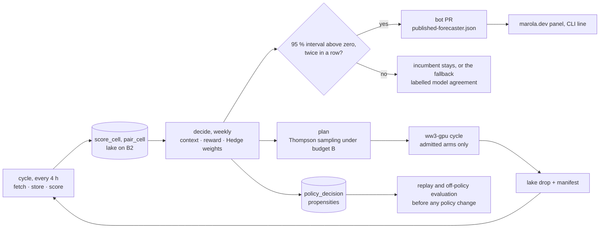

# MIP-0091: The Marola forecaster's architecture — the evaluation goes first, no new repo, and the design requirements from Read, Evaluate, Adopt on Operational WeatherBench

| | |
|---|---|
| **Status** | Accepted (2026-10-13, initial review by Hoffmann; needs refinement before its task list is written) |
| **Author** | Hoffmann |
| **Created** | 2026-10-13 |
| **Phase** | None: R&D outside the phase list, as MIP-0083. Zero cloud spend; computed arms run on owned hardware; nothing here moves Phase 1 (the Telegram bot), which is not done |
| **Related** | MIP-0083 (the forecast experiment: the evaluation this MIP puts first), MIP-0070 (the polyrepo split and its test for a new repo), MIP-0075 (the B2 lake the record must reach), MIP-0051 and MIP-0038 (the wave models and the shown disagreement), MIP-0052 (wave model compute), MIP-0062 (the ressaca veto, untouched), MIP-0053 (the learned local correction, a candidate arm), the policy note *Contextual Bandits for Weather Bench: The Marola forecaster* (v0.1.0, 2026-10-12, private until its Zenodo record; its own MIP follows this one), h0ffmann/ww3-gpu (the computed arms) |
| **Effort** | XL for the whole: a wave extension of marola-app's `experiment` (L), a `forecaster` sbt module with a replay (L), a lake-drop contract for computed arms (M), a site panel and the product hook (M). Stages 1 and 2 of §5.6, which this MIP orders first, are L together |
| **Gain** | `user value`: marola names the forecaster it quotes per coast and lead, chosen by verified skill, or says that the models agree or disagree; `community/outreach`: a continuous wave and wind benchmark on Brazilian instruments through a strong El Niño, with its method public; `infra/dev-loop`: the module order and the repo question stop resurfacing |
| **Effort vs Gain** | `do next` for stages 1 and 2 (wave truth into the evaluation; the decision layer written and replayed on the wind record that is already accumulating); `do when X lands` for stage 3 (X = a computed arm whose correctness gate passed) and stage 4 (X = the first gate pass on a `scored` point); `park` for any new repo, with the two triggers of §5.6 |
| **Depends on** | MIP-0083 v0 running unattended: its `experiment` module is in marola-app's `main` at f769245 (checked 2026-10-13). MIP-0075 task 5, the B2 `SampleStore`: a record kept in the Actions cache is evicted after 7 days unused, and a learner cannot learn from it. PNBOIA files through BNDO (MIP-0083 task 18, a person's act) for wave truth. The policy MIP for the rules' parameters. No Phase 1 gate, no paid resource |
| **Blocked by** | 0083 |
| **Risk** | The forecaster learns from a record that is not durable, or too short, and flips the quoted model on noise. §5.6 makes the B2 lake a prerequisite of stage 2, and R10's gate, hysteresis and fallback make a flip need evidence twice |

### Readiness

| | |
|---|---|
| **Manually reviewed** | yes — Hoffmann, 2026-10-13 (initial review: Accepted, needs refinement) |
| **Written by** | Hoffmann, with Claude Code |
| **Tasks** | not yet: the refinement comes first; §5.6's stages then become `MIP-0091.tasks.md` |
| **Tests** | `WaveScoreSpec`, `LicenceTierSpec`, `LakeDropSpec`, `ContextSpec`, `RewardSpec`, `HedgeSpec`, `GateSpec`, `FallbackSpec`, `BudgetSpec`, `PropensityLogSpec`, `ReplaySpec`, `DoublyRobustSpec`, `PublishSpec` (§7), named here, not written |
| **Spec-kit** | none |
| **Issues** | not filed — waits on the refinement and the task list |

## 1. Summary

marola will quote one wind and wave forecast per beach, chosen among several candidates by
verified skill. This MIP settles three questions before any of it is built. The evaluation
(marola-eval) goes first and the forecaster (marola-forecaster) is built on top of it, because the
forecaster's reward is the evaluation's output, and the evaluation is already two thirds built as
MIP-0083's `experiment` module. No new repository is needed: the forecaster is a second sbt module
in marola-app, the computed wave runs stay in h0ffmann/ww3-gpu behind a pinned artifact, and the
science goes to marola-research, which holds only a licence today. The architecture must satisfy
the twenty requirements of §4.3, which come from reading Brightband's Operational WeatherBench
(OWB), evaluating what of it holds on Brazilian instruments, and adopting the rest. §5 draws the
modules and the order they land in.

## 2. Motivation

The owner asked three things on 2026-10-13: which module goes first, marola-forecaster or
marola-eval; how many repos are needed; and what the architecture must satisfy, applying Read,
Evaluate, Adopt (REA) to OWB.

Three facts decide the first two questions:

- **Nothing can be chosen before it is measured.** The policy note's rule (its §4.5) replaces the
  incumbent only when the 95 % paired bootstrap interval of the skill difference lies above zero,
  twice in a row. That interval is MIP-0083's `HeadToHead` in
  [`Scorer.scala`](https://github.com/marola-dev/marola-app/blob/main/experiment/src/main/scala/marola/experiment/score/Scorer.scala),
  already in `main`. Without score cells there is no interval, no Hedge weight and no bandit
  posterior. The one forecaster that works without them is the deterministic fallback, the median
  of the admissible models, which is MIP-0038's spread with a number attached.
- **The evaluation is already underway.** marola-app `main` at f769245 (2026-10-13) has
  `experiment/` with 17 Scala sources and 6 resources, a lake DDL of seven tables, the paired
  block bootstrap, and `experiment.yml` running a cycle every 4 hours. Its record lives in the
  Actions cache, evicted after 7 days unused (marola-app's `4-reference_experiment-cycle.md`), so
  it is not yet a record a learner can use.
- **A "marola-eval" repo was proposed and withdrawn** on 2026-10-09 (MIP-0083 §9): the experiment
  keeps marola-app's HTTP, JSON and ledger code by staying there. That decision, four days old,
  answers half of the repo question.

What is missing is the layer above the scores: the context, the reward, the two decision rules,
the replay, the contract through which a computed wave run enters the record, and the one file
through which the product learns which forecaster to quote. That layer is what §5 designs.

## 3. User-visible change

Nothing until a point is `scored` (MIP-0083 §5.8) and the gate has passed twice. Then the detailed
CLI block, and later the beach page, gain one labelled line, computed from the record and never
written by a model:

```text
Today:     Waves 1.3 m                          (MIP-0038's agreed / mixed / split word beside it)
Winner:    Waves 1.3 m, IFS wind + WW3. Quoted because it beat GFS wind + WW3 by 0.08 CRPSS at the
           Santa Catarina buoys, 24–72 h, over the last 90 days (n = 212). Models: agreed.
Fallback:  Waves 1.3 m, model agreement (median of 4 models; no winner yet at this coast).
```

The swimability score and the ressaca veto print exactly what they print today (§6).

## 4. Data sources and dependencies reviewed

This section is the REA pass for the architecture. The policy note did it for the method; the
same three steps are repeated here for the modules and contracts, and they end in the requirements
§5 must satisfy.

### 4.1 Read: what OWB is (checked 2026-10-13)

The methodology page at <https://owb.brightband.com/methodology>, fetched 2026-10-13 `(v)`:

| Element | OWB | What it means for an architecture |
|---|---|---|
| Truth | "by default each model is scored against its own analysis"; precipitation against ERA5 | truth is a choice of the protocol, stated once and versioned |
| Grid and weights | "a fixed 0.25° global grid (1440×721; no regridding)", means "area-weighted … proportional to the cosine of latitude" | one fixed geometry per protocol version |
| Regions | "the global mean plus the tropics, the northern and southern hemispheres, North America, and Europe"; "Region boundaries follow the WBX public-benchmark convention"; "Scores are computed for a wider set of regions than the dashboard exposes" | the regions a dashboard shows are a subset of the regions scored |
| Leads and ranking | every 6 h to 360 h; "The scorecard summarizes a subset — days 1, 3, 5, 7, 10, and 15"; "Only each day's 12Z cycle is ranked" | the scorecard is a projection of the score store, not the store |
| Metrics | RMSE, ACC (Z500), vector-wind RMSE, SEEPS; fair CRPS, spread, debiased ensemble-mean RMSE, spread–skill, K = 16 | proper scores, aggregated by component |
| Baseline | an ERA5 climatology, always on the chart | a skill floor is part of the protocol, not a view |
| Variables | geopotential, temperature, 10 m wind, 850 hPa wind, 24 h precipitation; no wave or ocean variable | waves are marola's addition |
| In-situ truth | none: no station, buoy or point verification on the page | observation truth is marola's addition |
| Licence and citation | "distributed under the CC BY 4.0 license", covering "this dashboard and the derived scores"; third-party data under its own terms; no DOI and no citation instructions for OWB itself | derived scores can be CC BY 4.0 with each source's terms carried through |
| Engine | WeatherBench-X (Google Research, Apache 2.0 `(v)` its repository page, 2026-10-13); scores stored per model, target, variable, metric, region, init and lead | scoring is a library; the store is keyed, and the dashboard reads the store |
| Decision | none: OWB ranks | choosing a model is marola's addition |

### 4.2 Evaluate: what holds on Brazilian instruments, and what marola already has

MIP-0083 §4.10 and the policy note §3 did the data side. The architectural consequences:

| Gap | Consequence for the architecture |
|---|---|
| OWB's truth is each model's analysis; over a sparsely observed ocean that favours agreement with IFS, not with the sea | truth is observations at points (METAR, INMET, PNBOIA buoys, radiosondes), with representativeness error carried, never compared with OWB's numbers directly |
| No South America region; the Brazilian shelf is a sliver of the southern-hemisphere mean | marola's regions are its own context cells (South, Southeast, Northeast; buoy, station, beach), and the scorecard is a projection of them |
| No waves | wave variables (Hs, peak period, direction) with their own truth, their own climatology floor and a hazard-weighted score above the ressaca threshold (MIP-0062) |
| Few instruments: PNBOIA ran at most about nine buoys at once (MIP-0083 §4.10) | most cells stay `low_sample` for a long time; the fallback is the normal state, and the design must make it honest, not exceptional |
| Some truth comes under agreements that restrict redistribution (BNDO's Termo de Compromisso, MIP-0083 §4.10; the technical-cooperation agreements the policy note lists as planned) | every observation row carries a licence tier; scoring uses every tier, the export filters by tier, and the scorecard says which cells it could not show |
| No money for GPU inference every cycle | fetched arms are free, scoring runs on GitHub Actions, computed arms run on owned hardware under a budget that is a protocol value |
| OWB ranks; marola must pick one number per beach for a swimmer | a decision layer with a conservative rule, no live exploration, and safety outside it |

What marola already has, checked 2026-10-13 `(v)` unless marked otherwise:

- marola-app `experiment` at f769245: `Protocol`, `Provider` and `Route` as data; `Variable` with
  five cases and no wave; `Network.Pnboia` and `PointKind.Buoy` already declared; `ScoreCell` and
  `PairCell` as monoids; `Scorer.HeadToHead` with its `Verdict.Tie`; `SampleStore` over a local
  DuckLake; `Export` writing the scorecard only once a point is `scored`; the ENSO week and
  anomaly logged as MLflow params on each cycle.
- MIP-0038 (Draft): the agreed / mixed / split word and the per-model numbers in the detailed block.
- MIP-0062 (Draft): the ressaca veto at the Navy's warning height, deterministic, in `scoring/`.
- h0ffmann/ww3-gpu at fe472ab, via the policy note's source note of 2026-10-12, not re-read ⚠: WW3 built and
  regression-tested in one command; `W3SNL1` ported and bit-identical on three backends; WFIP-0001
  (GFS wind against WeatherNext 3 wind on the southern-Brazil case) a Draft; WW4 at 0.0.0 with
  placeholder physics on 2026-10-07.
- marola-research at 875b0e0: a `LICENSE` and nothing else.
- The private note repository (bundle `marola-forecaster.bundle`, head 5eca2ee): the note in two
  languages, its PDF pipeline, a Zenodo script, and a MIP draft held "until the owner's go-ahead".

### 4.3 Adopt: the requirements the architecture must satisfy

| # | Requirement | Comes from | Satisfied by (§5) |
|---|---|---|---|
| R1 | Measurement before decision: the forecaster reads score cells and writes nothing the scorer reads; the build enforces the direction (`forecaster` depends on `experiment`, never the reverse) | OWB's engine/store split; §2's first fact | §5.1, §5.4 |
| R2 | One fixed, versioned, public protocol: leads every 6 h to 360 h, scorecard days 1/3/5/7/10/15, a 12Z ranking, K = 16, fair CRPS, windows 7/30/90 d, `min_n`; a change is a new version and a new MLflow experiment | OWB's fixed protocol; MIP-0083 §4.8, §5.6 | `protocol.json`, unchanged |
| R3 | The decision parameters (η, hysteresis, bootstrap seed, budget B, hazard weight, kill switch) live in a `policy.json` versioned like the protocol, committed before the first replay | the policy note §4.5.3 (pre-registration) | §5.4 |
| R4 | Truth is observations at points; each row carries instrument, averaging, QC flag and licence tier; a missing observation is a `missing` row, never a model value | §4.2 row 1; MIP-0083 §5.5 | §5.3 |
| R5 | Waves are first-class: Hs, peak period, direction, with buoy truth, a climatology floor and a threshold-weighted CRPS above 2.5 m; wind and wave rows stay separate | §4.2 row 3; policy note §4.4 | §5.3 |
| R6 | A climatology floor is always present and the reward is skill relative to it (CRPSS); a cell with no floor publishes no reward | OWB's baseline; MIP-0083 §4.10 | §5.3, §5.4 |
| R7 | Scores stay monoids; the decision layer consumes windowed folds, never raw samples, so every decision is a pure function of (protocol, policy, cells, context) and `replay` reproduces `decide` | MIP-0083 §5.2 | §5.4 |
| R8 | Two information structures, two algorithms: fetched arms are full-information experts (Hedge); computed arms are a budgeted bandit (Thompson sampling with a knapsack); never a bandit over arms whose loss is observed anyway | policy note §4.5.1, §4.5.2 | §5.4 |
| R9 | Causality: every context feature is dated before the issue time; the replay rejects a feature stamped after the decision | policy note §4.3; MIP-0083 §5.11 | `ContextSpec`, `ReplaySpec` |
| R10 | Conservative switching: a change of the quoted forecaster needs the paired block-bootstrap 95 % interval above zero against the incumbent on the common set, on two consecutive weekly runs; otherwise the incumbent stays; a cell that is `low_sample`, or where the gate has never passed, publishes the median of the admissible arms, labelled model agreement; a kill switch in `policy.json` returns every cell to the fallback | policy note §4.5.1, §4.6; MIP-0083 §5.14 rule 8 | §5.4 `Gate`, `Fallback` |
| R11 | No live exploration: a swimmer sees only an arm that passed its correctness gate and was verified; exploration changes which computed arms run | policy note §4.6 | §5.4 `Budget`, §5.5 |
| R12 | Safety outside the learner: `Swimability.score` and the ressaca veto read nothing from the forecaster; `cli` does not depend on `forecaster`; the product reads one committed file, moved only by a reviewed PR | MIP-0083 §6; AGENTS.md | §5.5, §6 |
| R13 | Every decision is logged with its propensity (context, sampled values, chosen set, probability of each arm), so a new policy is valued off-policy (doubly robust) on the logs before it goes live | policy note §4.5.2 | §5.4 `PropensityLog`, `Evaluate` |
| R14 | Non-stationarity: a 90-day sliding window for the experts, a discounted posterior for the bandit, and a reset of a cell to its parent's weights when the ENSO status changes | policy note §4.6; the El Niño window | §5.4 `Context` |
| R15 | Admission is correctness, not skill: WW3 regtests for A1–A3 (bit-for-bit for the GPU port), GoogleTest plus a regtest replay for WW4; the pass is recorded with commit and command and travels with the samples; skill is measured only by R4–R7 | policy note §4.2 | §5.5 manifest |
| R16 | Contracts, not trees: a computed run enters the record as a drop of `ForecastSample` rows with a manifest; the run plan goes back the same way; one lake writer; no repo reads another's tree | MIP-0070 §5.4; MIP-0075 §5.4 | §5.5 |
| R17 | Zero spend by construction: free fetched arms, scoring on Actions, computed arms on owned hardware; B is a protocol value; nothing provisions | AGENTS.md cost rule; policy note §4.8 | §5.6 |
| R18 | Disagreement is shown: when admissible arms disagree beyond a threshold the published view says so beside the winner | MIP-0038 | §3 |
| R19 | Honest output: every published number names its forecaster, window, `n` and `low_sample`, and no page compares a station-truth score with an OWB number | MIP-0083 §4.10 | §3, §5.5 |
| R20 | A public chain: scorecards CC BY 4.0 with each source's terms; a dated Zenodo dataset per protocol version; the note and the weekly reports in marola-research and on marola.dev | OWB's licence; MIP-0079; policy note §5 | §5.6 stage 5 |

### 4.4 Where the code could live

| Candidate | What was checked | Verdict |
|---|---|---|
| marola-app `experiment` (exists) | f769245: ADR-0002 made it a fourth sbt project, aggregated by `root`, `cli` not depending on it; its routes, clients, lake and scorer are the measurement | **the evaluation**: waves are rows, variables and one route added to it (§5.3) |
| a `forecaster` sbt module in marola-app (new) | the same toolchain (Scala 3, Kyo RC7, JDK 25), the same lake engine, `dependsOn(experiment)`; a jar built from it alone, like the experiment's | **the decision layer** (§5.4): the dependency direction R1 asks for is one `dependsOn` line |
| a `marola-forecaster` code repo (new) | it would consume score cells as a pinned artifact: a versioned Parquet export per cycle, and two PRs for every schema change (MIP-0070 §9's "full modularity" cost) | rejected now; §5.6 names the trigger that would change this |
| a `marola-eval` repo (new) | withdrawn by the owner on 2026-10-09 (MIP-0083 §9) | rejected |
| h0ffmann/ww3-gpu (exists, outside the org) | Fortran, MPI, NetCDF, Kokkos under Nix; regtests; owned RTX 4090 | **the computed arms**, behind the lake-drop contract (§5.5); whether it joins the org is §11 |
| marola-ml (exists) | offline Python: DSPy, the fine-tune, the benchmark gate; MIP-0083 task 21 already points its grid-score job here | optional analysis only (figures, the WBX South crop); nothing the forecaster needs runs here |
| marola-site (exists) | marola-site#99 is the scorecard page (MIP-0083 task 10); marola.dev has no research page (policy note §5) | the panel of §3 and the research page, stage 5 |
| marola-research (exists, empty) | 875b0e0: `LICENSE` only | the note's public copy, the replay results per protocol version, the weekly reports' sources |
| the private note repository (exists as a bundle) | the drafting place of the note and its PDF and Zenodo pipeline; holds a MIP draft until the owner's go-ahead | not part of the runtime architecture; stays private until publication |

**The pick:** zero new repositories. Two modules in marola-app, one contract to ww3-gpu, two
existing repos for pages and science.

## 5. Design

### 5.1 The module map

```d2
direction: right
measure: "marola-app · experiment (marola-eval)" {
  routes: "forecast routes\nopen_meteo · marine · lake_drop"
  obs: "observation clients\nMETAR · INMET · PNBOIA"
  lake: "lake on B2\nsamples · score_cell · pair_cell"
  scorer: "Matcher · Scorer\nmonoids · HeadToHead"
  routes -> lake
  obs -> lake
  lake -> scorer
  scorer -> lake
}
decide: "marola-app · forecaster (marola-forecaster)" {
  ctx: "Context · Reward"
  hedge: "Hedge · Gate · Fallback"
  budget: "Budget\nThompson sampling, knapsack"
  log: "PropensityLog · Replay · Evaluate"
  ctx -> hedge
  ctx -> budget
  hedge -> log
  budget -> log
}
compute: "h0ffmann/ww3-gpu, owned hardware" {
  ww3: "A1–A4 runs\nregtest record"
}
product: "marola-app cli and core · marola-site" {
  file: "published-forecaster.json\nmoved by a reviewed PR"
  swim: "Swimability · ressaca veto\nunchanged"
}
measure.lake -> decide.ctx: "score cells, by protocol version"
decide.budget -> compute.ww3: "run-plan.json"
compute.ww3 -> measure.routes: "lake drop + manifest"
decide.hedge -> product.file: "bot PR"
```

The arrows are the only places data crosses a boundary, and each is a row of §5.5. Nothing
points from `product` back into `decide` or `measure`.

### 5.2 The flow



### 5.3 marola-eval: what `experiment` gains

All of it is data and rows in the shape MIP-0083 §4.4 set, plus one route and one score term:

- **Licence tier.** `Instrument` gains `tier: Tier` (`enum Tier(label)`: `public`, `agreement`),
  carried into `ObservationSample` and every `ScoreCell` it produces. `Export` drops
  `agreement`-tier cells and lists them as "not shown: n cells under agreement terms"
  (`LicenceTierSpec`).
- **Wave variables.** `Variable` gains `wave_height`, `wave_peak_period`, `wave_direction`
  (`MeasureUnit`: metres, seconds, degrees). Direction is scored only above a wave-height floor,
  as wind direction is above 2 m/s.
- **Wave truth.** PNBOIA buoys as `buoy` sampling points (MIP-0083 task 12), the BNDO files
  read by a `PnboiaClient` into `ObservationSample` with `tier = agreement` where the Termo de
  Compromisso applies.
- **Wave forecasts.** A `marine` route: the Open-Meteo marine API with `models=` (the call
  MIP-0051 and MIP-0038 already describe), one `providers.json` row per wave model. Which models
  Open-Meteo serves on this coast is ⚠ until the first live fixture records it.
- **The climatology floor.** A `climatology_cell` table (point, variable, day-of-year window,
  mean, CRPS of the climatological distribution) built once per point from ERA5 point series or
  the instrument's own record; `Scorer` writes `sumCrpsClim` beside `sumCrps`, so CRPSS is read
  off any window.
- **The hazard tail.** A threshold-weighted CRPS sum, `sumTwCrps`, with the threshold and weight
  from `policy.json` (2.5 m, weight 2, the policy note's defaults). One more monoid field;
  `ScoreMonoidSpec`'s laws cover it unchanged.
- **The lake-drop route.** `Route.LakeDrop`: a `ForecastSource` that reads
  `ww3/<arm>/<run_init>/samples.parquet` and its `manifest.json` from a B2 prefix instead of an
  HTTP API, refuses a drop whose manifest lacks the gate record of R15, and writes `run_index`
  rows like any other route. The experiment's cycle stays the lake's only writer (MIP-0075 §5.4).

### 5.4 marola-forecaster: the `forecaster` module

`build.sbt` gets a fifth project, `forecaster` (`marola-forecaster`), `dependsOn(experiment)`,
aggregated by `root`, its own jar, no dependency from `cli`. Files under
`forecaster/src/main/scala/marola/forecaster/`:

| File | What |
|---|---|
| `Policy.scala` | `Policy` (`derives Schema`): version, `eta`, `windowDays`, `hysteresisRuns = 2`, `bootstrapSeed`, `budget: Budget`, `hazard: Threshold`, `killSwitch: Boolean`; read from `forecaster/policy.json` |
| `Context.scala` | `Context(enso: EnsoStatus, region: Region, pointKind: PointKind, leadBucket: LeadBucket, season: Season, seaState: SeaState)` and `Context.of(cells, cycle: Instant): Context` reading only rows dated before `cycle` (R9); `parent: Option[Context]` for the `low_sample` fallback |
| `Reward.scala` | `crpss(cell: Score, clim: Score): Double`; `reward(ctx, arm, window): Option[Double]` summing `ω_v · CRPSS_v`, `None` without a floor (R6) |
| `Hedge.scala` | `Weights(ctx) = Map[Arm, Double]`; `update(w, losses, eta)` as `w · exp(−η ℓ)`; pure |
| `Gate.scala` | `decide(incumbent: Arm, candidate: Arm, pairs: Chunk[PairCell], seed): Verdict` on `Scorer.HeadToHead`; `Hysteresis(runs)` counting consecutive passes (R10) |
| `Fallback.scala` | `median(admissible: Chunk[Forecast]): Forecast` and the `model agreement` label |
| `Budget.scala` | `plan(ctx, posteriors, costs, budget, rng): RunPlan` by sampled reward per cost until B is spent; `discount(posterior, factor)` (R14); every arm's selection probability from the sampled draws |
| `PropensityLog.scala` | `PolicyDecision(cycle, ctx, arm, probability, sampled, chosen, policyVersion)` to the `policy_decision` table |
| `Replay.scala` | `replay(from, until)`: runs `decide` and `plan` over the lake in time order, per ENSO stratum, emitting cumulative regret against the best fixed arm, the number of changes, and the CRPSS in the hazardous bin (policy note §4.5.3) |
| `Evaluate.scala` | the doubly robust estimate of a candidate `Policy` on the logs (R13) |
| `Publish.scala` | `PublishedForecaster(version, perContext: Map[Context, Quoted])`, `Quoted(arm, crpss, n, window, lowSample, agreement)`; writes `published-forecaster.json` and `forecaster/latest.json` |
| `Main.scala` | `decide`, `plan`, `replay`, `evaluate`, `publish` |

Shape, in the house style: the registry, policy, context, reward, Hedge, gate, fallback and
budget are plain Scala with no effect; `Sync`, `Env[Deps]` and `Abort` appear only in `Main` and
the store reads, as `experiment` does. `Clock` is the only source of now, so `ReplaySpec` fixes it.

The weekly job is `forecaster.yml` in marola-app: `schedule` on Monday 06:17 UTC, the
`oods-lake` concurrency group, `decide` then `plan` then `publish`; when `publish` changes
`published-forecaster.json`, the job opens a PR against marola-app with the diff and the two
HeadToHead intervals in its body. A person merges it. The run plan goes to B2 as
`forecaster/run-plan/<cycle>.json`.

### 5.5 Contracts

| Producer → consumer | Artifact | Pinned or gated by |
|---|---|---|
| `experiment` → `forecaster` | `score_cell`, `pair_cell`, `climatology_cell` in the lake | the protocol version; a schema change is a new version, and the forecaster reads one version |
| `forecaster` → `cli`, `core` | `published-forecaster.json`, a resource in marola-app | a PR a person merges (`PublishSpec` checks the file against the decision log); the kill switch empties it |
| `forecaster` → ww3-gpu | `forecaster/run-plan/<cycle>.json` on B2 | the `policy.json` version in the file; ww3-gpu runs only arms the plan names and it has admitted |
| ww3-gpu → `experiment` | `ww3/<arm>/<run_init>/samples.parquet` + `manifest.json` (run_init, content sha, grid, forcing, the regtest commit and command, the parity hash for the GPU port) | the `lake_drop` row in `providers.json`; a drop without a gate record is a `missing` run row with a reason |
| `experiment`, `forecaster` → marola-site | `forecast-benchmark/latest.json` (MIP-0083) and `forecaster/latest.json` on `site-data` | the JSON Schemas the jar ships |
| `forecaster` → marola-research | replay results per protocol version; the weekly report's numbers | a dated Zenodo dataset per protocol version |

### 5.6 The order, and when a repository would be warranted

| Stage | Where | Delivers | Waits on |
|---|---|---|---|
| 0 | marola-app, marola-oods | MIP-0083 v0 done: 7 unattended days; the B2 `SampleStore` (MIP-0075 task 5) so the record is durable | in flight |
| 1 | marola-app `experiment` | §5.3: tier, wave variables, PNBOIA, the marine route, the climatology floor, the hazard term | stage 0; the BNDO files |
| 2 | marola-app `forecaster` | §5.4 on the wind record alone: the module, `decide`, `replay`, `evaluate`, `forecaster/latest.json` for information; the replay on the IFS and GFS archive per ENSO stratum | stage 0; can run beside stage 1, different files |
| 3 | marola-app `experiment`, ww3-gpu | the `lake_drop` route and manifest; `Budget` and `plan`; ww3-gpu's side of the contract | an admitted computed arm: WW3 regtests recorded for the nest in use |
| 4 | marola-app, marola-site | `published-forecaster.json`, `forecaster.yml`'s PR, the `models=` hook in `OpenMeteoClient` reading it, the panel of §3 | the first gate pass on a `scored` point, twice |
| 5 | marola-research, marola-site | the note's public copy, the research page, the weekly report, the Zenodo datasets | the owner's publication go-ahead (policy note §5) |

Stage 2 before stage 3 is the ordering the owner asked about, in one line: the forecaster's code
can start as soon as the wind record is durable, and nothing it publishes waits on a wave or a
computed arm; what it *quotes* waits on stage 1 and stage 4.

A new repository is warranted by MIP-0070 §9's test, "once one grows its own cadence or
contributors", on two triggers and no other:

- **`marola-ww3`** (or ww3-gpu adopted into the org) when the WW3 cycle runs unattended on a
  self-hosted runner with its own workflow, data cadence and gates. Its toolchain is nothing
  marola-app's sbt build should carry, and the lake-drop contract already isolates it, so the move
  changes no consumer.
- **A private adapter repository** when an agreement delivers data in a format, or under terms,
  that cannot be parsed in public code. It would hold one `ObservationSample` adapter, consumed as
  a pinned artifact, and nothing else.

### 5.7 What is deterministic

Everything. No LLM reads or writes any of it. The LLM summary may name the quoted forecaster, read
from `published-forecaster.json` under MIP-0039's fact guard, and nothing more.

## 6. Scoring / safety impact

None. `Swimability.score` and the ressaca veto (MIP-0062) read nothing this MIP produces; `cli`
does not depend on `forecaster`; the only product-side change, in stage 4, is which model id
`OpenMeteoClient` passes in `models=`, from a committed file, with the spread of MIP-0038 shown
beside it.

## 7. Verification plan

munit specs, fixtures through `Http.withTransport`, the lake on a local directory as `experiment`
tests it:

- `WaveScoreSpec`: `wave_direction_scored_only_above_floor`, `tw_crps_weights_tail_only`,
  `crpss_zero_at_climatology`, `no_floor_no_reward`.
- `LicenceTierSpec`: `agreement_rows_scored`, `agreement_rows_never_exported`,
  `export_lists_hidden_cells`.
- `LakeDropSpec`: `drop_without_gate_record_is_missing_run`, `content_sha_mismatch_recorded`,
  `parity_hash_required_for_gpu_arm`.
- `ContextSpec`: `features_dated_before_cycle_only`, `low_sample_falls_back_to_parent`,
  `enso_change_resets_to_parent`.
- `RewardSpec`: `weights_fixed_from_policy`, `reward_is_sum_of_crpss`.
- `HedgeSpec`: `weights_follow_exp_minus_eta_loss`, `best_expert_dominates_on_fixed_sequence`.
- `GateSpec`: `interval_above_zero_twice_switches`, `interval_containing_zero_keeps_incumbent`,
  `one_pass_then_tie_keeps_incumbent`, `kill_switch_empties_every_cell`.
- `FallbackSpec`: `median_of_admissible_only`, `labelled_model_agreement`.
- `BudgetSpec`: `budget_never_exceeded`, `probabilities_sum_to_one_per_slot`,
  `discount_forgets_old_rewards`, `gpu_arm_changes_cost_not_reward`.
- `PropensityLogSpec`: `every_decision_logged_with_probability`.
- `ReplaySpec`: `replay_equals_live_decisions`, `later_observation_changes_nothing`,
  `strata_reported_separately`.
- `DoublyRobustSpec`: `recovers_known_value_of_logged_policy` on a synthetic log.
- `PublishSpec`: `file_matches_decision_log`, `low_sample_cells_quote_fallback`.

Live, after stage 2: `replay` on the IFS and GFS archive from 2024-03-14, with `policy.json`
committed first; `forecaster/latest.json` on `site-data` for four weekly runs. **Done** for stage
2 when four weekly runs show the gate and the fallback behaving on real cells and `replay` equals
the logged decisions; for stage 4 when the first `published-forecaster.json` PR merges with its
two intervals in the body.

## 8. Risks, limitations, and honest caveats

- **The record is not durable yet.** Until MIP-0075 task 5 lands, `experiment.yml` keeps the lake
  in the Actions cache, evicted after 7 days unused. Stage 2 waits for the B2 store; starting it
  earlier would train on a record that can vanish.
- **The fallback is the normal state.** With a handful of buoys, most cells stay `low_sample`
  for months, and the panel will say "model agreement" far more often than it names a winner.
  That is the honest result, and the page must not dress it up.
- **A learner on a short, El Niño-only record.** Skill learned in October 2026 to March 2027 may
  not hold in neutral years; R14's window and reset, and the strata of the replay, keep that
  visible rather than fixing it.
- **One lake writer.** The experiment's cycle, the weekly `decide` and the OODS ETLs share one
  concurrency group; a long ETL delays a decision by minutes, never corrupts it.
- **The published file is a human merge.** A week in which nobody merges the PR is a week on the
  previous winner, which the gate already judged acceptable; the bot never merges it.
- **ww3-gpu is one person's repository.** If it stalls, stage 3 stays unbuilt and the forecaster
  chooses among fetched arms only; nothing else waits.
- **Open-Meteo's marine models on this coast, the PNBOIA file format and the agreements' terms are
  ⚠.** Each is a `missing` row or a `not shown` cell until checked, never a guess.

## 9. Alternatives considered

- **Do nothing, rank only as OWB does.** marola still has to pick one number per beach; today it
  picks `best_match` silently (MIP-0038 §2).
- **The forecaster first, trained on simulations.** A bandit tuned on synthetic rewards learns the
  simulator; and every cycle not sampled during the El Niño window is lost (MIP-0083 §2), while a
  forecaster module loses nothing by waiting.
- **A `marola-eval` repository.** Withdrawn by the owner on 2026-10-09 (MIP-0083 §9).
- **A `marola-forecaster` code repository now.** It would read score cells as a versioned export,
  so every schema change becomes two PRs and a version bump, the cost MIP-0070 §9 rejected for
  `core` and `local`; the dependency direction R1 asks for is one `dependsOn` line in the same
  build. §5.6 keeps the trigger.
- **The decision layer inside `experiment`.** Loses the build-enforced direction of R1: a scorer
  that can read the policy's output is one import away from a score that depends on a choice.
- **The bandit in Python (marola-ml).** The replay and the live rule would be two
  implementations, and `replay_equals_live_decisions` could not be a test.
- **A blend of the arms.** Averages their errors and hides which model is quoted (MIP-0083 §9,
  §5.11).
- **One bandit over every arm.** Discards the losses of fetched arms that marola observes anyway
  (policy note §4.5.1).
- **Live epsilon-greedy.** Shows swimmers a forecast chosen at random (R11).

## 11. Open questions

- **Rename `experiment` to `eval`?** **Default:** no. ADR-0002 named it and eight filed tasks
  reference it; "marola-eval" is the name of the benchmark, `experiment` the name of its module.
- **One MIP or two?** The policy note's own MIP draft (arms, reward, algorithms) is held in the
  private repository. **Default:** two: this MIP is the architecture and the order; the policy MIP
  takes the next free number, cites this one, and carries the parameters' defaults. The owner
  decides at that PR.
- **Does ww3-gpu join marola-dev?** **Default:** no, it stays h0ffmann/ww3-gpu; the lake-drop
  contract is the same either way, and §5.6's first trigger says when to revisit.
- **Which wave truth first?** **Default:** a PNBOIA buoy off Santa Catarina with a continuous
  record (the policy note §6), confirmed when the BNDO files are read.
- **Who merges the `published-forecaster.json` PR?** **Default:** a person, as every merge but the
  pointer sync (AGENTS.md); never `pointer-sync-merge.yml`'s path.
- **`forecaster.yml` as its own workflow, or a step of `experiment.yml`?** **Default:** its own,
  weekly, in the same concurrency group, so a failed decision never blocks a cycle.
- **η, B, the hazard weight, the hysteresis.** **Default:** the policy note's: η = 1, B = one
  1.1 km cycle a day on owned hardware, weight 2 above 2.5 m, two consecutive weekly passes;
  fixed in `policy.json` v1 before the first replay.
- **Follow-up MIP:** the policy MIP from the private note repository, with the next free number.
- **Follow-up MIP:** WeatherBench-X on a South crop (MIP-0083 task 21), unchanged by this MIP.

## Appendix

### Checked live

- <https://owb.brightband.com/methodology>, 2026-10-13 (fetched through the session's web tool;
  a direct `curl` is refused by the environment's egress policy): regions, truth, grid and
  weights, leads and the 12Z ranking, scorecard days, metrics, the CC BY 4.0 statement, no DOI
  and no citation instructions, no wave or in-situ variable.
- <https://github.com/google-research/weatherbenchX>, 2026-10-13: "A modular framework for
  evaluating weather forecasts", Apache License 2.0; its region definitions were not located on
  the landing page.
- marola-dev/marola at 638cb1f, 2026-10-13: `AGENTS.md`, `docs/MIPs/TEMPLATE.md`, the MIP index
  (highest 0087), MIP-0083 and its tasks, MIP-0070, MIP-0075, MIP-0051, MIP-0052, MIP-0038,
  MIP-0062, MIP-0053, `docs/2-Building-marola/REPOS.md`, `NEW-REPO.md`, `.claude/rules/docs.md`;
  open PRs #796, #798 and #801 take MIP-0088, MIP-0089 and MIP-0090.
- marola-dev/marola-app at f769245, 2026-10-13: `build.sbt` (the `experiment` project and its
  dependencies), `experiment/` (17 Scala sources, 6 resources, `lake.sql` with seven tables,
  `Scorer.HeadToHead`, `Labels.scala`'s enums), `.github/workflows/experiment.yml`, ADR-0002,
  `docs/4-reference_experiment-cycle.md`, `protocol.json`, `providers.json`,
  `sampling-points.json`.
- marola-dev/marola-research at 875b0e0, 2026-10-13: `LICENSE` only.
- marola-dev/marola-devkit at 0749822, 2026-10-13: the `mip` skill and `docs_lint.py`.
- The policy note v0.1.0 (2026-10-12) and its repository bundle at 5eca2ee: the note in English
  and Portuguese, the source notes on OWB, MIP-0083 and ww3-gpu, the held MIP draft, the
  publication chain.

### Not checked

- h0ffmann/ww3-gpu directly: every ww3-gpu fact above is the policy note's source note at
  fe472ab (2026-10-12).
- The status of any technical-cooperation agreement, and what each partner can provide.
- WeatherBench-X's region boundaries, and whether OWB's hidden regions include South America.
- Open-Meteo's marine API: which wave models it serves on the Brazilian coast, and `models=` on
  it (taken from MIP-0051 and MIP-0038).
- PNBOIA's file format, averaging and latency; the BNDO terms per station.
- Kyo RC7 names beyond those `experiment` already uses.
- The seven unattended days of MIP-0083 v0, and whether the B2 secrets are set in marola-app.
