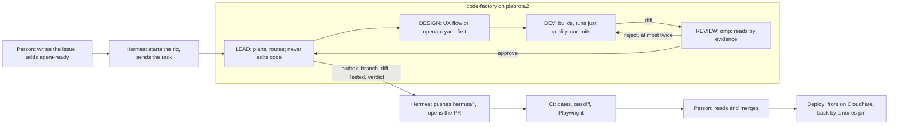

# MIP-0092: A generic code factory on OpenRig, and marola-front and marola-back as its first build

| | |
|---|---|
| **Status** | Draft |
| **Author** | Hoffmann |
| **Created** | 2026-11-05 |
| **Phase** | 1, as an experiment that serves no Phase 1 gate: the Telegram bot (MIP-0002) is still the missing prerequisite, and this MIP adds no spend |
| **Related** | MIP-0005 (the map and the static site), MIP-0009 (MapLibre rejected then), MIP-0054 (i18n), MIP-0070 (the polyrepo), MIP-0078 (the Cloudflare Worker), MIP-0086 (the bot Apps), MIP-0088 (React on Vite, parked) |
| **Effort** | XL: a rig template, two new repositories, a contract, a port of the map and every page |
| **Gain** | `infra/dev-loop`: issues built end to end with little human time; `cost/ops`: no Mapbox bill; `user value`: indexable pages per language and an API that other clients can read |
| **Effort vs Gain** | `do when X lands`: the rig runs one task in an existing repository first, which proves the loop before it builds two repositories |
| **Depends on** | piabrota/nix-os's `openrig.nix` (OpenRig 0.7.7 on piabrota2), its `loco.nix`, Hermes's GitHub App (piabrota-hermes); a person to create the two repositories |
| **Blocked by** | none |
| **Risk** | The factory makes PRs faster than one person reviews them, and review becomes the bottleneck it was meant to remove |

### Readiness

| | |
|---|---|
| **Manually reviewed** | no |
| **Written by** | Hoffmann and Leo, with Claude Code (a Claude Project thread) |
| **Tasks** | `MIP-0092.tasks.md`, written once Accepted |
| **Tests** | the contract check, the front's parity run, the rig's dry run (§7) |
| **Spec-kit** | none |
| **Issues** | not filed — Draft |

## 1. Summary

A generic OpenRig rig, `code-factory`, with four roles (LEAD, DESIGN, DEV, REVIEW), lives as a
template in piabrota/nix-os and runs on piabrota2. Its first job is to rebuild marola.dev as two
new repositories: `marola-front` (Vite, TypeScript, MapLibre, a multi-page site under `/pt-br/`
and `/en/`) and `marola-back` (Rust, Loco). marola-site stays live and is the reference until the
new pair reaches parity.

## 2. Motivation

- marola-site is one static repository with 1,371 lines of hand-written JavaScript (`app.js` 829,
  `flow.js` 298, `ui.js` 176, `chat.js` 68, `wc -l` on its `main`, 2026-11-05) and a vendored
  Mapbox GL JS. Every feature is a hand-made PR.
- Mapbox bills per map load above its free tier (marola-site's `AGENTS.md`). MapLibre on keyless
  tiles has no bill and no token.
- The language of a page is chosen in the browser today, so a crawler sees one address per page.
  An address per language (`/pt-br/about/`, `/en/about/`) gives each language its own indexed page.
- The boards are files: no other client (the Telegram bot, a partner) can query them.
- OpenRig runs on piabrota2, but its own page says "the seats are idle. No task has gone through
  the builder to reviewer loop yet" (piabrota/nix-os `docs/OPENRIG.md`, read 2026-11-05).

## 3. User-visible change

Before: marola.dev serves marola-site; the language is a client-side switch on one address.

After, during the experiment: `beta.marola.dev/pt-br/` and `beta.marola.dev/en/` serve the new
front, pre-rendered, reading the boards from `https://api.marola.dev/api/v1`. marola.dev does not
change until the parity gate (§5.5 step 6). After it, marola.dev moves to marola-front in its own
PR, and marola-site is archived.

## 4. Data sources and dependencies reviewed

- **OpenRig 0.7.7** (Apache-2.0), as `openrig/package.nix` packages it; RigSpec `version: "0.2"`.
  The upstream factory
  ([`rig.yaml` at `73cf813`](https://github.com/mvschwarz/openrig/blob/73cf8138e797a922c72bdb921cd50e49a6536e7a/packages/daemon/specs/rigs/launch/factory/rig.yaml))
  has 7 seats in 3 pods: lead, advisor, build, QA, design and two reviewers. This MIP keeps 4.
- **piabrota2's limits** (piabrota/nix-os `openrig.nix` and `AGENTS.md`, 2026-11-05): the
  `openrig` unit has `MemoryHigh=1536M` and `MemoryMax=2G`, "at most two seats at the same time";
  the seats cannot push (`hermes/omp.yml` denies `git push`, `gh`, `sudo`); Hermes pushes only
  `hermes/*` branches; its App has contents, pull requests and issues, not workflows.
- **Databases on piabrota2** (same files): "Do not add a PostgreSQL server or Redis for an app:
  SQLite and in-process workers"; Paperclip's PostgreSQL 17 is the one exception and Paperclip is
  off since 2026-11-04; PGX runs, for "data you can lose", never an app's own data.
- **Loco** on Rust with SeaORM (SQLite and Postgres). `loco.nix` runs an app as `loco-<name>`
  with SQLite in `/var/lib/loco-<name>`, a daily backup, nginx and ACME, `MemoryMax=256M`.
- **MapLibre GL JS** (BSD-3-Clause). Not checked: the version and its CSP worker build.
- **OpenFreeMap** for vector tiles, no key. Not checked: its terms and rate limits.
- **Pick:** the above, with the defaults of §11.

## 5. Design

### 5.1 The rig: `code-factory`

One pod, four seats. It is simpler than the upstream factory in four ways: no advisor (a person
shapes the issue, and `agent-ready` is the gate), no QA (DEV runs the gates, CI runs the
end-to-end tests), one reviewer instead of two, and one pod instead of three.



The rig spec, `openrig/specs/rigs/code-factory/rig.yaml` in piabrota/nix-os:

```yaml
# A generic factory: the target repository and issue come with the task.
# Start: rig up /etc/openrig/specs/rigs/code-factory/rig.yaml (Hermes or a person).
version: "0.2"
name: code-factory
culture_file: CULTURE.md
summary: A lead, a designer, a builder and a reviewer that take one agent-ready issue at a time
permission_policy: builtin:yolo
env:
  USER: openrig
  LOGNAME: openrig
  HOME: /var/lib/openrig
pods:
  - id: cf
    label: Code factory
    members:
      - id: lead
        agent_ref: "local:../../agents/cf-lead"
        runtime: claude-code
        model: claude-sonnet-5-5
        cwd: /var/lib/openrig/work/code-factory/lead
      - id: design
        agent_ref: "local:../../agents/cf-design"
        runtime: claude-code
        model: claude-sonnet-5-5
        cwd: /var/lib/openrig/work/code-factory/design
      - id: dev
        agent_ref: "local:../../agents/cf-dev"
        runtime: claude-code
        model: claude-sonnet-5-5
        cwd: /var/lib/openrig/work/code-factory/dev
      - id: review
        agent_ref: "local:../../agents/cf-review"
        runtime: omp
        model: anthropic/claude-sonnet-5-5
        cwd: /var/lib/openrig/work/code-factory/review
    edges:
      - { kind: delegates_to, from: lead, to: design }
      - { kind: delegates_to, from: lead, to: dev }
      - { kind: delegates_to, from: lead, to: review }
      - { kind: collaborates_with, from: design, to: dev }
      - { kind: can_observe, from: review, to: dev }
      - { kind: can_observe, from: review, to: design }
edges: []
```

- **The roles.** LEAD reads the task, writes the plan as a short slice note, routes work to DESIGN
  and DEV, sends the result to REVIEW, and hands the reviewed diff to Hermes; it never edits code.
  DESIGN works ahead of DEV: for the front, the UX flow, the states and the copy keys, checked
  against marola-site's `DESIGN.md` and pages; for the back, the endpoint and schema change,
  written into `openapi.yaml` first. DEV builds in its own clone, runs the target's `just quality`
  and tests, and commits with the `Tested:` trailer. REVIEW reads the diff by evidence
  (`file:line`, command output), checks §5.4's rules, and approves or rejects; it edits nothing.
- **Generic by construction.** No seat file names a repository. A task is a short text that Hermes
  sends to LEAD: the issue URL, the repository, the branch name. Each seat reads the target's
  `AGENTS.md` in its clone; where it is stricter than the rig's norms, it wins.
- **What each seat may do.** Seats clone with a read-only token (`piabrota.openrig.githubRead`).
  DEV commits in its clone; nobody in the rig pushes. LEAD writes the result (branch, diff summary,
  the `Tested:` line, REVIEW's verdict) to `/var/lib/rig-outbox/code-factory/`. Hermes reads it,
  checks the diff, pushes `hermes/<issue>-<slug>` and opens the PR. A person merges.
- **Loop limits.** REVIEW may reject at most twice; on a third rejection LEAD stops and writes the
  reason to the outbox, and Hermes comments on the issue. One issue at a time.
- **Option.** `piabrota.openrig.codeFactory.enable`, off by default. On, it adds Node 24 and the
  Rust toolchain to the seats' profile, the outbox, read-only tokens for `marola-dev/marola-front`
  and `marola-dev/marola-back`, and `memoryMax = "4G"` (§11). The closure difference goes in that
  PR, measured with `dix`, as nix-os's `AGENTS.md` asks.

### 5.2 marola-front

Vite with TypeScript and no UI framework, structured as a Multi-Page Application (MPA) with clean
`/en/` and `/pt-br/` subdirectories for explicit URL-based i18n routing. MapLibre GL JS replaces
Mapbox GL JS, on a vector base map with no key. Deployed as pre-rendered static files.

- **Pages.** One HTML entry per page (`index`, `about`, `news`, `support`, `members`, `404`), each
  built once per language: `/pt-br/`, `/pt-br/about/`, `/en/`, `/en/about/`, and so on.
- **Language in the URL, for indexing.** Every page carries `<html lang>`, `hreflang` links to its
  twin and an `x-default`; the build writes `sitemap.xml` with both languages. `/` sends the visitor
  to `/pt-br/`, or to `/en/` from `Accept-Language`, at the Worker. The language switch is a link
  to the twin page, not a client-side swap.
- **Pre-rendered.** `npm run build` writes every page into `dist/` with its text in the HTML; the
  map and the board data load after. The output is static files only.
- **i18n.** The pt-BR and English catalogs move from marola-site's `site/i18n/` (MIP-0054) with their
  check script, and feed the pre-render. `DESIGN.md` and the Inter fonts move too.
- **Map.** MapLibre GL JS from npm, bundled by Vite into a file served from the same origin, so the
  CSP keeps `script-src 'self'`. The only map origins are the tile host and NASA GIBS, whose raster
  layers stay as today. `flow.js`'s WebGL wind and wave layer becomes a MapLibre
  `CustomLayerInterface` with the same shaders.
- **Data.** One module, `src/api/`, is the only code that calls the back. Its types are generated
  from the pinned `openapi.yaml` (`openapi-typescript`). The rest of the app sees typed functions,
  never URLs.
- **Tests.** Vitest for logic; Playwright end-to-end in CI, never on the VPS, against a mock server
  made from the contract's examples, and a daily run against the live back. marola-site's
  screenshot rule (before and after, 1280 × 800 and 390 × 844, both languages, the
  `pr-screenshots` branch) holds here.

### 5.3 marola-back

- **Stack.** Rust, Loco, SeaORM, SQLite on piabrota2 through `loco.nix` (§11). The module sets
  `DATABASE_URL`; the code uses no SQLite-only feature, so a move to Postgres is a configuration
  change.
- **v1, read only.** `GET /api/v1/health`, `GET /api/v1/areas`,
  `GET /api/v1/areas/{id}/boards/latest`, `GET /api/v1/areas/{id}/boards/{day}`. A board response is
  the board JSON as marola-site's `board.schema.json` defines it, unchanged, with `ETag` and
  `Cache-Control`.
- **Ingest.** A Loco scheduler job pulls new boards from marola-site's `site-data` branch once an
  hour and validates each one against `board.schema.json` before it stores it. The back never
  computes a board: the pinned marola-app image stays the one writer.
- **Contract.** `openapi.yaml` is written by hand, checked in, and tested: a test starts the app
  and checks every response against it.
- **Packaging.** A flake whose `packages.x86_64-linux.default` has `bin/marola-back-cli` and
  `share/marola-back/config/`, as nix-os's `docs/LOCO.md` gives; `marola-back-cli doctor
  --production` in CI.
- **Deploy.** `piabrota.loco.apps.marola-back` with `domain = "api.marola.dev"` (DNS to piabrota2
  first), CORS open to the front's origins only, `MemoryMax=256M`.

### 5.4 Keeping front and back loosely coupled

The two repositories share one artifact, the contract, and nothing else: no shared code, no
shared CI, no build of one inside the other (MIP-0070 §5.4).

1. **One contract, owned by the producer.** `openapi.yaml` lives in marola-back and is attached to
   each `v*` release as `marola-back-openapi-<tag>.yaml`. marola-front pins a tag in
   `openapi.version`, as marola-site pins the app image today. A bump is a PR in the front.
2. **Versioned paths.** Every path starts with `/api/v1`. A breaking change is a new major path
   (`/api/v2`), served beside v1 until the front's `main` no longer calls v1, plus one release.
3. **Additive only within a version.** A CI job in marola-back compares the PR's `openapi.yaml`
   with the last release using `oasdiff breaking`, and fails on a removed field, a new required
   field or a changed type.
4. **Tolerant reader.** The front ignores unknown fields and treats every field the contract marks
   optional as possibly missing. The board's own `schema` integer stays the version of the board
   payload.
5. **Consumer check on the producer side.** The front publishes the operations it calls
   (`front-ops.json`, generated from `src/api/`); marola-back's CI fails a PR that removes or breaks
   one of them.
6. **Independent deploys.** The front deploys on Cloudflare; the back deploys when a nix-os PR
   moves its flake pin. Neither waits for the other. When the back is down, the front shows the
   last good board with its `generated_at`, and says so.
7. **No shared database, no shared secret.** The front holds no key. The back's ingest needs none:
   the `site-data` branch is public.

### 5.5 Parity order with marola-site

Each step is one or more `agent-ready` issues; marola.dev moves only after step 6.

1. Contract v1 and the back's skeleton with `/health` and `/areas`.
2. The front's skeleton: the MPA with `/pt-br/` and `/en/`, one map, one area, the board from the
   API.
3. Beach list and beach card, with every field marola-site shows today.
4. Layers: wind and waves (the `flow.js` port), SST, water quality, the GIBS layers.
5. Pages: about, news (the news build), support, members (the members build), the 404 forwarder.
6. Parity check: a Playwright run that opens each marola-site page and its two twins, at both
   sizes, and lists the differences for a person to accept.

### 5.6 Bot automations and manual steps

Manual, once, by a person, in order:

- [ ] GitHub: create `marola-dev/marola-front` and `marola-dev/marola-back`, empty, on `main`.
- [ ] GitHub: labels, the rulesets (`just rulesets-apply`) after the first `ci-ok`, marola-merge-bot
      on both, the org Project ([NEW-REPO](../3-Ways-of-working/NEW-REPO.md) steps 12 to 16).
- [ ] GitHub: install piabrota-hermes on both (contents, pull requests, issues).
- [ ] GitHub: the Cloudflare deploy token as a secret of marola-front. marola-back needs none for v1.
- [ ] Cloudflare: a Worker, or an environment of `marola`, for `beta.marola.dev`, and its DNS record.
- [ ] DNS: an A record for `api.marola.dev` to piabrota2, before the nix-os PR that declares the app.
- [ ] piabrota2: `/var/lib/loco-secrets/marola-back.env` with `JWT_SECRET`, written by hand
      (nix-os's `docs/LOCO.md` step 3).
- [ ] piabrota2: only if §11's database question picks PostgreSQL, its role and database by hand,
      and the owner's exception written into nix-os's `AGENTS.md`.
- [ ] piabrota/nix-os: read and merge the rig PR (§5.1) and the app PR (§5.3). The merge deploys.
- [ ] Every issue: write it and add `agent-ready`. Every factory PR: read and merge.

Automated, with no person after setup:

| What | Who | When |
|---|---|---|
| The scaffold PR of each repository (NEW-REPO steps 1 to 11) | an agent session | once |
| Start the rig, send an `agent-ready` issue to LEAD | Hermes (`hermes-rig` skill) | when asked, or a routine the owner approves |
| Design, build, test, review | the four seats | per issue |
| Push `hermes/<issue>-<slug>`, open the PR | Hermes | per issue |
| Gates, `oasdiff`, Playwright, screenshots to `pr-screenshots` | GitHub Actions | per PR |
| Attach `openapi.yaml` to a marola-back release | `release.yml`, after a person pushes the tag | per release |
| Bump `openapi.version` in the front | marola-pr-bot | per back release |
| Bump the `marola-back` flake input in nix-os | piabrota-ops, as `flake-update.yml` does | per back release |
| Deploy the back | nix-os's `deploy.yml`, on merge | per merge |
| Deploy the front | the front's deploy workflow on `main` | per merge |
| Probe `/api/v1/health` and the front's two roots | `kvm4-health` and a `site-health`-style job | daily |
| Devkit bumps, pointer sync | `bump-consumers`, `pointer-sync.yml` | as today |

## 6. Scoring / safety impact

None. The back serves the boards marola-app computes; no score, note or veto is computed outside
marola-app.

## 7. Verification plan

- **Rig dry run.** `rig up` of `code-factory` on piabrota2 with a toy issue in a scratch
  repository: `rig ps --nodes` shows four seats, the outbox gets a result, and
  `systemctl show openrig -p MemoryPeak` stays under `memoryMax`.
- **Contract.** marola-back's `contract` test (every response matches `openapi.yaml`);
  `oasdiff breaking` in CI; the `front-ops.json` check.
- **Front.** `just quality`, Vitest, Playwright against the mock; every page answers at `/pt-br/…`
  and `/en/…` with its `hreflang` pair; `sitemap.xml` lists both; §5.5 step 6.
- **Back.** `cargo test`, `marola-back-cli doctor --production`, `nix build`; after the deploy,
  `curl https://api.marola.dev/api/v1/health`.
- **Done.** §5.5 steps 1 and 2 built by the factory, each from one `agent-ready` issue, each merged
  by a person, with no code written by hand.

## 8. Risks, limitations, and honest caveats

- Review load: four seats make PRs faster than one person reads them. The limit is one issue at a
  time.
- piabrota2's 16 GB of RAM is the plan's figure, not read on the machine ⚠.
- OpenRig's builder-to-reviewer loop has never run a task on this box (nix-os `docs/OPENRIG.md`).
- The Hermes App has no `workflows` permission, so a factory PR cannot change
  `.github/workflows/`; those changes stay with an agent session or a person.
- OpenFreeMap's limits and MapLibre's CSP build are not checked yet.
- Two sites run side by side until parity, and both need care.

## 9. Alternatives considered

- **Do nothing.** marola-site keeps growing by hand-made PRs, and the Mapbox bill stays.
- **The upstream factory as it is.** 7 seats do not fit the box (2 today); QA and the advisor
  repeat CI and the `agent-ready` gate.
- **One repository for front and back.** Simpler CI, but the two cannot deploy or version apart.
- **A single-page app with a client-side language switch.** One address per page, so search
  engines index one language; the MPA under `/pt-br/` and `/en/` gives each its own page.
- **React on Vite (MIP-0088).** Parked by its author: there are not enough features to justify it.
- **Keep Mapbox.** No port, but the bill and the token stay.

## 11. Open questions

- Which database does marola-back use? Paperclip's PostgreSQL 17 is off, PGX is for data you can
  lose, and nix-os forbids a Postgres server for an app. **Default:** SQLite through `loco.nix`, with
  SeaORM so a move to the PostgreSQL 17 server Paperclip used is a later nix-os PR carrying the
  owner's exception. Hoffmann decides.
- What does marola-back serve in v1? **Default:** the read-only boards of §5.3, ingested from the
  `site-data` branch; no write endpoint. Hoffmann decides.
- Four seats need about 4 GB and the unit allows two seats in 2 GB. **Default:** `memoryMax = "4G"`
  for this rig only, never run beside another rig. Hoffmann decides, as nix-os's owner.
- Is LEAD a seat, or is Hermes the LEAD? **Default:** a Claude Code seat; Hermes stays the operator
  that starts the rig, commits, pushes and opens the PR. Hoffmann decides.
- Which runtime and model does each seat use? **Default:** DESIGN, DEV and LEAD on Claude Code,
  REVIEW on `omp`, all on `claude-sonnet-5-5`, so the reviewer runs another harness. Hoffmann
  decides.
- Which vector tiles back MapLibre? **Default:** OpenFreeMap, no key; Protomaps PMTiles on
  piabrota2 or R2 is the fallback. Hoffmann picks it once its terms are read.
- Where does marola-front run during the experiment? **Default:** pre-rendered static files on a
  Cloudflare Worker at `beta.marola.dev`, with Version URLs as PR previews; marola.dev stays on
  marola-site until parity. Hoffmann decides.
- Which licence do the new repositories carry? **Default:** marola-site's; MIP-0090 proposed a split and
  was closed with no answer. Hoffmann decides.
- Which branch do factory PRs come from? Hermes pushes only `hermes/*`, and the project's rule
  wants `claude/<issue>-<slug>`. **Default:** `hermes/<issue>-<slug>`, and the devkit's branch check
  learns that prefix in a devkit PR. Hoffmann decides.
- Does `/` redirect by `Accept-Language`, or always to `/pt-br/`? **Default:** by
  `Accept-Language`, `/pt-br/` when it says nothing. Leo and Hoffmann decide.

## Appendix

### Checked live

- piabrota/nix-os `main`, 2026-11-05: `AGENTS.md`, `openrig.nix`, `docs/OPENRIG.md`, `loco.nix`,
  `docs/LOCO.md`, `openrig/specs/rigs/piabrota-dev/rig.yaml`,
  `openrig/specs/rigs/wave-forecaster-dev/rig.yaml`, `openrig/specs/agents/{builder,reviewer,shared}/agent.yaml`.
- mvschwarz/openrig at `73cf8138`, 2026-11-05: `packages/daemon/specs/rigs/launch/factory/rig.yaml`,
  `CULTURE.md`, `guidance/lead-first-move.md`, `guidance/advisor-role.md`.
- marola-site `main`, 2026-11-05: `site/static/` (line counts above), `site/board.schema.json`,
  `site/areas.json`, `AGENTS.md`.
- marola-dev/marola#796 (MIP-0088), 2026-11-05: closed, with the comment "There's not enough
  features to justify adding react yet."

### Not checked

- MapLibre GL JS's current version and CSP worker build.
- OpenFreeMap's terms, rate limits and attribution text.
- piabrota2's real memory, CPU and disk (the plan's figures only).
- `oasdiff` and `openapi-typescript` versions.
- Whether Cloudflare's Worker can serve the `Accept-Language` redirect on the static-assets plan
  with no paid feature.
