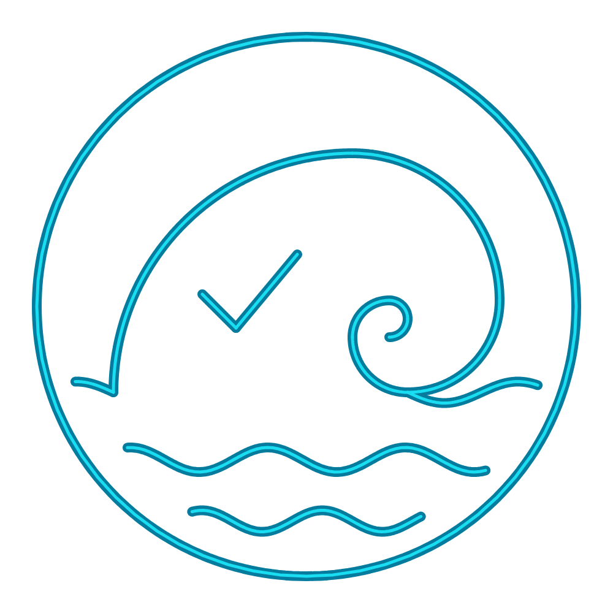

# marola logo v2

O logo do marola desenhado como um gráfico do Desmos: uma onda quebrando dentro de um disco, com
quatro faixas de mar e o check da qualidade da água dentro do tubo. A apresentação segue a do
desenho do [h0ffmann/smart-alerts](https://github.com/h0ffmann/smart-alerts/tree/main/docs/drawings).

O script `gen.js` escreve todos os arquivos a partir de uma geometria só. Cada elemento leva o LaTeX
do Desmos e a função JS equivalente, e o PNG é desenhado com as funções, sem depender do Desmos.
`node docs/assets/logo-v2/gen.js` precisa do playwright e reescreve:

| Arquivo | O que é |
|---|---|
| [`marola-logo-v2.png`](marola-logo-v2.png) | O logo, 1000 x 1000 px |
| [`marola-logo-v2-grid.png`](marola-logo-v2-grid.png) | O mesmo desenho sobre a grade e os eixos do Desmos |
| [`marola-logo-v2.desmos.json`](marola-logo-v2.desmos.json) | O estado do gráfico do Desmos (`version` 11), com cores e espessuras |
| [`marola-logo-v2.expressions.txt`](marola-logo-v2.expressions.txt) | As 34 expressões em LaTeX, uma por linha |
| [`colar-no-console.js`](colar-no-console.js) | `Calc.setState(...)` com o estado, pronto para o console |

## A geometria

Tudo fica dentro do disco x² + y² ≤ 100.

- **A onda** é uma espiral logarítmica, r(t) = 6e^(−0,29t), com centro em (−0,6; 2,3). A borda de
  fora do tubo é r(t); a de dentro é r(t)(1 − 0,5(1 − t/T)^0,7), que encontra a de fora na ponta.
  O polígono junta as duas bordas e uma curva de Bézier quadrática que desce pelas costas da onda.
- **O mar** são quatro faixas y ≤ fₙ(x), cada fₙ uma soma de dois senos, desenhadas na frente da
  onda, cada uma com a crista em branco.
- **Os respingos** são sete discos pequenos ao longo da borda de fora, perto da crista.
- **O sol** e **o check** completam o desenho. O check fica dentro do tubo, como no logo original.

As cores são as da marca: `#19ddf0`, `#1ac5da`, `#1badc5`, `#057b9e` e `#0b4261`.

## Abrir no Desmos

1. Abra <https://www.desmos.com/calculator>.
2. Abra o console do navegador (F12).
3. Cole o conteúdo de [`colar-no-console.js`](colar-no-console.js) e dê Enter.

⚠ Não conferido: o desmos.com não abria na máquina que gerou estes arquivos. A conferência foi
local: o PNG é desenhado com as mesmas funções de cada expressão. A espessura das linhas pode
mudar um pouco no Desmos. O Desmos é um serviço gratuito, mas não é software livre: o arquivo é só
dado, e o marola não depende do Desmos.

## Créditos

O desenho é original, de Matheus Hoffmann ([@h0ffmann](https://github.com/h0ffmann)), 2026, a
partir do logo do marola ([`../logo.svg`](../logo.svg)).

As imagens estão sob CC BY 4.0 e os scripts sob AGPL-3.0-only ([`REUSE.toml`](https://github.com/marola-dev/marola/blob/main/REUSE.toml)).
