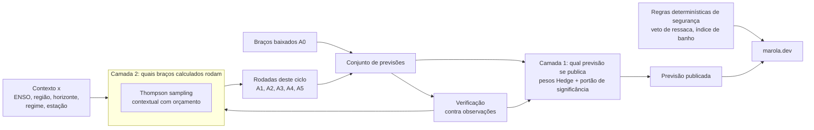
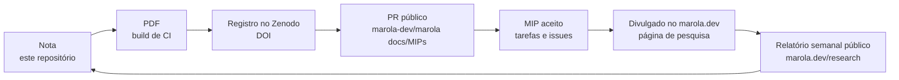

# POLÍTICA — Bandits contextuais para o Weather Bench: o previsor Marola

> [!abstract] A política em cinco linhas
>
> 1. **Publicar quem vence.** O marola mostra o previsor cuja habilidade verificada vence no contexto atual, com margem estatisticamente significativa. Sem vencedor significativo, fica o atual. ([[#4.5 A política, em duas camadas|§4.5]])
> 2. **Explorar só em sombra.** A exploração muda quais previsores o marola *roda e avalia*. Ela nunca muda o que o banhista vê. ([[#4.6 Segurança, com o El Niño em curso|§4.6]])
> 3. **Segurança determinística.** O veto de ressaca e o índice de banho nunca leem a saída do bandit [@marola_mip0062; @marola_mip0083].
> 4. **Respeitar os termos dos dados.** Dados sob Acordo de Cooperação Técnica (ACT) são avaliados em privado. Só se publica o que o acordo permite. ([[#4.7 Dados: dados abertos brasileiros e parceiros com ACT|§4.7]])
> 5. **Seguir o processo público.** Cada resultado segue a cadeia nota → PDF → Zenodo → PR público → MIP aceito → site, com relatório semanal público. ([[#5 Processo e cadeia de publicação|§5]])

## 0 Como ler esta nota

Esta é uma nota de *política* no padrão REA (Read, Evaluate, Adopt; em português, Ler, Avaliar,
Adotar), que é o padrão de trabalho de quem a pediu:

- **Ler** (§2) reapresenta a fonte da disciplina, a metodologia do Operational WeatherBench da
  Brightband [@brightband_owb_2026], sem julgamento.
- **Avaliar** (§3) critica essa fonte. O OWB é uma metodologia dos EUA, feita com pesquisa e
  instrumentos dos EUA. A §3 pergunta o que dela se consegue em termos brasileiros.
- **Adotar** (§4) traz a metodologia para o contexto e o orçamento do marola: os braços, os
  portões, a recompensa, a política, as regras de segurança, os parceiros de dados e os custos.

Cada afirmação diz o que a conferiu. `(v)` marca um fato verificado durante a escrita, com fonte
e data. `⚠` marca um fato não verificado. Essa é a convenção do marola para escrita científica
[@marola_mip0083]. O Apêndice lista os dois grupos.

Os quadros **ELI20** explicam a matemática por trás de cada decisão para quem tem base de
graduação em engenharia ou matemática (cálculo, probabilidade, um pouco de otimização). Eles não
acrescentam premissas à política. Os números dentro deles são ilustrativos, salvo quando a fonte
vem citada.

> [!eli20] Glossário mínimo
>
> **Previsor** (ou braço, *arm*): qualquer fonte de previsão que a política pode escolher. **Horizonte** (*lead*): tempo entre a emissão da previsão e o instante previsto. **Hs**: altura significativa de onda, em metros, aproximadamente a média do terço mais alto das ondas. **Ensemble**: conjunto de previsões do mesmo modelo com pequenas perturbações; a dispersão entre os membros estima a incerteza. **Verdade**: o valor contra o qual a previsão é comparada (uma observação ou uma análise de modelo). **ENSO**: El Niño–Oscilação Sul; o índice Niño-3.4 é a anomalia de temperatura da superfície do mar no Pacífico equatorial central.

## 1 A decisão

O marola precisa de uma previsão costeira de vento e ondas por praia. Os candidatos diferem em
custo, em maturidade e no jeito como erram. Quem pediu a nota fez quatro perguntas:

1. O marola deve investir no **esforço ww3-gpu** [@hoffmann_ww3gpu] ou adotar o **modelo mais
   recente do Google** (WeatherNext 3) [@google_weathernext_access]?
2. Qual disciplina de correção vale: as **suítes GoogleTest** do WAVEWATCH IV
   [@noaa_ww4; @tolman_2026_on528] ou os **testes de regressão clássicos do WW3** (regtests)
   [@ww3dg_2019]?
3. Por segurança, com um El Niño forte em curso, qual modelo o marola publica?
4. Como o marola equilibra **exploração e aproveitamento** (*exploration* e *exploitation*)
   enquanto aprende a resposta?

A resposta é uma política, não a escolha de um modelo: *quem vence publica, e o bandit
contextual decide quem vence*. O resto da nota define "vence", "contexto" e "seguro".

## 2 Ler: o Operational WeatherBench

Fonte: a página de metodologia do OWB, lida em 2026-10-12 `(v)` [@brightband_owb_2026]. Detalhes
em [[SRC - Operational WeatherBench methodology]].

| Elemento | O que o OWB faz `(v)` |
|---|---|
| Propósito | Um painel ao vivo que avalia continuamente previsões globais operacionais de tempo |
| Motor de avaliação | WeatherBench-X (WBX), biblioteca de avaliação do Google Research [@google_weatherbenchx], descendente do WeatherBench 2 [@rasp_weatherbench2_2024] |
| Modelos | ECMWF IFS ENS, HRES, AIFS ENS; NOAA GFS, GEFS, AIGFS, AIGEFS; Google DeepMind GraphCast [@lam_2023_graphcast], WeatherNext 2, WeatherNext 3; Microsoft Aurora 1.5; NVIDIA Atlas; uma climatologia de referência |
| Variáveis | velocidade do vento a 10 m; Z500 (só ACC); vetor vento em 850 hPa (determinístico) ou velocidade (probabilístico); precipitação em 24 h |
| Horizontes | a cada 6 h até 360 h; *scorecard* nos dias 1, 3, 5, 7, 10 e 15 |
| Verdade | a própria análise de cada modelo (horizonte 0); o membro de controle no passo 0 para ensembles; a análise do IFS para WeatherNext 2/3 e para a climatologia; ERA5 [@hersbach_2020_era5] para precipitação |
| Métricas determinísticas | RMSE, ACC, RMSE do vetor vento, SEEPS [@rodwell_2010_seeps] |
| Métricas probabilísticas | CRPS justo [@ferro_2014_fair; @gneiting_raftery_2007], dispersão, RMSE da média do ensemble sem viés, razão dispersão–habilidade; K = 16 membros subamostrados |
| Grade | 0,25° global (1440 × 721), sem reamostragem, pesos de área por cos(latitude) |
| Agregação numa janela | tipo RMSE: raiz da média dos quadrados; CRPS e SEEPS: média simples; ACC: média em z de Fisher; dispersão–habilidade: recomposta pelos componentes |
| Linhas de base | climatologia ERA5 1990–2019 (janela de 61 dias, 0,25°); climatologia de 30 anos em ensemble de anos como piso probabilístico; piso do SEEPS fixo em 1 |
| Licença | painel e escores derivados em CC BY 4.0; dados de terceiros sob seus próprios termos |
| Citação | a página não dá DOI para o próprio OWB; cita WBX, WeatherBench 2, SEEPS, ERA5 e os modelos |

Três propriedades fazem do OWB uma *disciplina*, e não um ranking:

- **Protocolo fixo.** Todo modelo é avaliado nos mesmos horizontes, grade, métricas e regras de
  agregação, declarados em público.
- **Escores próprios.** O CRPS e seu estimador justo premiam a previsão probabilística honesta
  [@gneiting_raftery_2007; @ferro_2014_fair].
- **Piso de habilidade.** A climatologia está sempre no gráfico. Um modelo que não a supera não
  tem habilidade, seja qual for sua posição.

> [!eli20] CRPS, o escore que mede previsões probabilísticas
>
> Uma previsão probabilística é uma distribuição acumulada $F$; a observação é um número $y$. O CRPS compara $F$ com a "distribuição" degrau da observação:
>
> $$\mathrm{CRPS}(F, y) = \int_{-\infty}^{\infty} \big(F(z) - \mathbb{1}\{z \ge y\}\big)^2 \, dz$$
>
> Ele tem a unidade da variável (m/s para vento, m para Hs) e é menor quando melhor. Para uma previsão determinística $x$, $F$ vira um degrau em $x$ e a integral vale exatamente $|x - y|$, o erro absoluto. Para um ensemble de $m$ membros $x_1, \dots, x_m$, a versão **justa** [@ferro_2014_fair] é
>
> $$\mathrm{CRPS}_{\text{fair}} = \frac{1}{m}\sum_i |x_i - y| \;-\; \frac{1}{2m(m-1)}\sum_{i \ne j} |x_i - x_j|$$
>
> O primeiro termo pune a distância à observação; o segundo devolve crédito pela dispersão. O fator $m-1$ (em vez de $m$) tira o viés que favoreceria ensembles grandes. **Próprio** quer dizer que o escore esperado é mínimo quando o previsor declara a distribuição em que de fato acredita [@gneiting_raftery_2007]: não há como ganhar pontos inflando ou encolhendo a incerteza.
>
> *Exemplo ilustrativo:* ensemble {1,8; 2,2} m, observação 2,0 m. Primeiro termo: (0,2 + 0,2)/2 = 0,2. Segundo termo: (0,4 + 0,4)/(2·2·1) = 0,2. CRPS justo = 0,0 m. Uma previsão determinística de 2,2 m teria CRPS 0,2 m.

## 3 Avaliar: o que serve para o Brasil

O OWB é uma metodologia dos EUA, com pesquisa e instrumentos dos EUA. Esta seção pergunta o que
dela se consegue em termos brasileiros. A realidade brasileira não se resume às restrições do
marola. Ela é do país: poucos instrumentos, menos pesquisa, menos dinheiro e modelos menos
calibrados. O orçamento do marola vem depois disso (§4.8). O MIP-0083 §4.10 começou essa
comparação para o vento [@marola_mip0083]. Esta seção a estende para ondas, que o OWB não avalia.

### 3.1 Onde o OWB amostra o Sul

Não amostra. `(v)` [@brightband_owb_2026], lido em 2026-10-12:

- **Nenhum ponto, nenhuma estação.** Toda a verificação acontece na grade global de 0,25°, com
  pesos de área por cos(latitude). A página não cita verificação contra estação ou boia.
- **Nenhuma região Brasil ou América do Sul.** O painel mostra a média global, os trópicos, os
  hemisférios norte e sul, a América do Norte e a Europa. Os limites das regiões "seguem a
  convenção do benchmark público do WBX", e a página não os informa. Há escores "para um conjunto
  de regiões mais amplo do que o painel expõe", e a página não diz quais.
- **No que a costa Sul se transforma.** O Sul e o Sudeste do Brasil (cerca de 20–34°S) são uma
  fatia pequena da média do hemisfério sul, dominada em área pelo Oceano Austral. O Rio de
  Janeiro (cerca de 23°S) pode cair logo fora de uma faixa tropical de 20°S–20°N ⚠ (limites do
  WBX não lidos). Nenhum número do OWB isola a plataforma brasileira.
- **A verdade é mais fraca onde há menos instrumentos.** A verdade do OWB é a análise do próprio
  modelo (a análise do IFS para WeatherNext e climatologia). Sobre um oceano pouco observado, a
  análise se apoia mais na previsão curta do próprio modelo, e o escore passa a favorecer quem
  concorda com o IFS, não com o mar ⚠ (propriedade geral da assimilação de dados, não medida
  aqui).

Um ranking do OWB, portanto, não diz nada medido sobre a costa brasileira. Ele serve como
*prior* global, e o marola precisa verificar localmente.

> [!eli20] Por que a costa brasileira some numa média hemisférica
>
> Numa grade regular em latitude–longitude, a área de uma célula é proporcional a $\cos\varphi$. A fração da área da Terra entre as latitudes $\varphi_1$ e $\varphi_2$ é
>
> $$f = \frac{\sin\varphi_2 - \sin\varphi_1}{2}$$
>
> Para a faixa de 20°S a 34°S: $f = (\sin 34° - \sin 20°)/2 \approx (0{,}559 - 0{,}342)/2 \approx 0{,}109$, ou seja, cerca de 22 % do hemisfério sul. Uma fatia de 10° de longitude dessa faixa (a ordem de grandeza da plataforma Sul–Sudeste) é 1/36 disso: **cerca de 0,6 % do hemisfério sul**. Um erro sistemático do modelo nessa fatia mexe a média hemisférica em menos de 1 % do seu valor local. A conta é geométrica e não depende do OWB; ela mostra por que só a verificação local enxerga a nossa costa.

### 3.2 A realidade brasileira

| Lacuna | EUA (o cenário do OWB) | Brasil | O que ela impõe |
|---|---|---|---|
| **Poucos instrumentos** | redes de boias e estações densas e abertas (por exemplo, NDBC ⚠); radiossondagem operacional | o PNBOIA operou no máximo cerca de nove boias ao mesmo tempo (2016) `(v)` via [@marola_mip0083] §4.10; muito dado offshore é privado (óleo e gás, portos) ⚠ | A verdade é o recurso que limita tudo. **ACTs** fazem parte do método (§4.7). Boia ausente vira linha `missing`, nunca valor de modelo. Muitas células de contexto ficam `low_sample` |
| **Menos pesquisa** | décadas de verificação de ondas e de previsão numérica nas costas dos EUA; a NOAA e grupos universitários mantêm os benchmarks | não se conhece benchmark público e contínuo de ondas na costa brasileira ⚠; poucos grupos (por exemplo, o LabECO da UFSC, coorientadores do ww3-gpu) | O marola constrói o benchmark e publica o método abertamente (§5) |
| **Menos dinheiro** | inferência em GPU de GraphCast, Aurora e Atlas a cada ciclo | nenhum benchmark operacional financiado; o marola não gasta com nuvem até a Fase 2 [@marola_phases] | Os braços são baixados ou rodam em hardware próprio (§4.8). O orçamento de computação vira restrição do bandit (§4.5.2) |
| **Modelos menos calibrados** | modelos globais e regionais ajustados e verificados contra dados locais densos | os modelos globais são ajustados em outros lugares; o MONAN, modelo brasileiro, entrou em operação em setembro de 2026 e sua saída não é pública ⚠; os modelos públicos de ondas divergem em até 6,7× numa praia abrigada [@marola_mip0051] | Espere viés local. Correção local (o braço de análogos `A5`) e verificação local pesam mais que a posição global |

### 3.3 Consequências para o método

| Premissa do OWB | Consequência para o marola |
|---|---|
| A verdade é a análise do próprio modelo numa grade global | A verdade precisa ser **observação**: boias, estações costeiras, radiossondas. A verdade de estação inclui erro de representatividade, então os números não se comparam com os do OWB [@marola_mip0083] |
| Só atmosfera (vento, Z500, precipitação) | **Variáveis de onda** (Hs, período de pico, direção média) exigem verdade própria (PNBOIA, boias de parceiros, altimetria) e modelos próprios. O perigo é a *ressaca* [@marola_mip0062] |
| Regiões globais e hemisféricas | As células de contexto são regiões brasileiras e tipos de ponto (§4.3) |
| Avaliação em grade global com o WBX em Python | Avaliação em pontos agora; um recorte de grade no Atlântico Sul (cerca de 20–35°S, 40–58°W) com o WBX fica como tarefa opcional [@marola_mip0083] |
| Climatologia de 30 anos do ERA5 | **Serve**, e pode servir também como linha de base climatológica de ondas (o ERA5 inclui um modelo de ondas ⚠) |

### 3.4 O que serve sem mudança

- O protocolo fixo e público: horizontes, dias do *scorecard*, o ranking das 12Z.
- CRPS justo, dispersão, RMSE da média do ensemble sem viés, razão dispersão–habilidade e K = 16
  membros.
- Agregação por componentes. Os escores são somas e por isso se combinam como monoides
  [@marola_mip0083] §5.2.
- O piso de habilidade da climatologia.
- CC BY 4.0 para os escores derivados, com a licença de cada fonte carregada junto.

### 3.5 O que o Brasil acrescenta e o OWB não tem

- **Verdade observada** em mar aberto (PNBOIA), na costa (INMET, METAR) e em altitude
  (radiossondas) [@marola_mip0083].
- **Os avisos METAREA V da Marinha como previsão a verificar**: taxa de acerto e taxa de alarme
  falso dos avisos de vento forte [@marola_mip0083].
- **O modelo do próprio Brasil**, o MONAN (INPE), quando sua saída for pública ⚠.
- **Um benchmark de ondas.** O autor não conhece benchmark operacional público de modelos de
  ondas na costa brasileira ⚠.
- **Uma camada de decisão.** O OWB ordena modelos. O marola também precisa *escolher* um para o
  usuário, por contexto, com segurança. A §4 é essa camada.

### 3.6 O contexto do El Niño

Há um El Niño forte em curso. O MIP-0083 cita o comunicado do CPC/NOAA de 2026-10-08 ⚠ (não
relido para esta nota) [@marola_mip0083; @noaa_cpc_enso] e espera o pico entre outubro de 2026 e
março de 2027. Anos de El Niño se associam a mudanças na chuva e na circulação sobre o sul da
América do Sul [@grimm_2000]. *Se* eles mudam o clima de ondas, ou a habilidade relativa dos
modelos, nas praias do marola é hipótese deste estudo, não fato. Disso decorrem duas
consequências:

- Os próximos meses são a janela mais informativa do estudo, porque contêm o regime com menos
  exemplos passados.
- São também a janela mais arriscada para um aprendiz. A habilidade aprendida em anos neutros
  pode não valer. A §4.6 trata disso.

## 4 Adotar: o previsor Marola

### 4.1 Os braços

Um *braço* é um previsor que a política pode escolher. Cada braço tem um tipo (baixado ou
calculado), um portão de correção (§4.2) e um custo (§4.8).

| Braço | O quê | Tipo | Portão de admissão | Situação (2026-10-12) |
|---|---|---|---|---|
| `A0.*` provedores públicos | Vento: IFS HRES, GFS, WeatherNext 2 e outros via Open-Meteo [@marola_mip0083]. Ondas: os modelos marinhos públicos que o marola já lê [@marola_mip0051] | baixado | a operação do próprio provedor | vento v0 aceito no MIP-0083 `(v)`; linhas de ondas ⚠ |
| `A1` WW3 clássico | WW3 em Fortran na CPU, forçado pelo vento do GFS (ou IFS), numa grade aninhada no Sul do Brasil [@ww3dg_2019; @marola_mip0052] | calculado | regtests do WW3 aprovados para o conjunto de *switches* usado | build e regtest rodam no ww3-gpu `(v)` [@hoffmann_ww3gpu]; sem ciclo operacional ⚠ |
| `A2` WW3 + vento WeatherNext 3 | `A1` com a forçante trocada pelo vento a 10 m do WeatherNext 3 [@hoffmann_wfip0001] | calculado | o portão de `A1` mais a checagem de conversão da forçante do WFIP-0001 | rascunho (WFIP-0001) `(v)`; acesso aos dados por formulário ⚠ |
| `A3` ww3-gpu | `A1` com kernels portados para GPU (C++/Kokkos) [@hoffmann_ww3gpu] | calculado | **paridade bit a bit** com `A1` nos regtests | só o `W3SNL1` foi portado (idêntico bit a bit em três backends) `(v)`; replay de ponta a ponta pendente `(v)` |
| `A4` WW4 | reescrita do WW3 em C++ pela NOAA (com Rust em paralelo) [@noaa_ww4; @tolman_2025_on525; @tolman_2026_on528] | calculado | GoogleTest L1–L4 aprovados **e** os casos de regtest do WW3 combinados reproduzidos dentro da tolerância | versão 0.0.0, sem física, em 2026-10-07 `(v)` [@hoffmann_ww3gpu]; lançamento em janeiro de 2027 é a data de planejamento de quem pediu ⚠ |
| `A5` análogos do marola | o ensemble de análogos do marola, feito a partir do registro de cada estação [@marola_mip0083; @delle_monache_2013], estendido a Hs onde houver registro de boia | calculado (barato) | `AnalogSpec` e checagens de causalidade [@marola_mip0083] | vento aceito no MIP-0083 `(v)`; ondas sem desenho |
| `A6` linhas de base | climatologia ERA5 e persistência | calculado (barato) | nenhum | sempre ligado |

Três observações moldam o resto da política:

- **`A3` não é uma previsão nova.** Se `A3` for idêntico bit a bit a `A1`, a habilidade é a mesma
  de `A1`. O valor dele está no *custo*: mais membros, grade mais fina ou mais ciclos com o mesmo
  orçamento. No bandit, `A3` não concorre com `A1`. Ele muda o **preço** da família `A1`, `A2` e
  `A4` (§4.5.2).
- **`A2` contra `A1` é uma questão de forçante.** O erro de onda vem em grande parte do erro de
  vento [@cavaleri_2009] ⚠. Um vento melhor pode, então, melhorar Hs mais do que um solver mais
  rápido. O WFIP-0001 mede isso diretamente no caso do Sul do Brasil [@hoffmann_wfip0001].
- **`A4` não é braço antes de passar no portão.** Em 2026-10-07 o WW4 era um esqueleto de
  *driver* com termos-fonte de mentira (*placeholders*) `(v)` [@hoffmann_ww3gpu]. Um lançamento
  em janeiro de 2027 ⚠ sem física validada contra o WW3 não é braço.

> [!eli20] Por que "bit a bit" é difícil, e por que importa
>
> A soma em ponto flutuante não é associativa: $(a + b) + c$ pode diferir de $a + (b + c)$ no último bit, porque cada operação arredonda. Uma GPU soma em paralelo, em outra ordem, e por isso o mesmo algoritmo costuma dar resultados ligeiramente diferentes na CPU e na GPU. O ww3-gpu exige igualdade bit a bit com o Fortran, e a vantagem é lógica: se $A3 \equiv A1$ em todos os bits, qualquer escore de habilidade de $A1$ vale para $A3$ sem nova verificação. A única pergunta que resta sobre $A3$ é quanto ele custa.

### 4.2 Portões de correção: GoogleTest contra os regtests clássicos do WW3

Quem pediu a nota quis comparar "Google tests" e "regtests clássicos do WW3". Os dois respondem a
perguntas diferentes. Ambos são portões de admissão, e nenhum mede habilidade.

| | Regtests clássicos do WW3 | Níveis GoogleTest do WW4 |
|---|---|---|
| Unidade de teste | uma rodada inteira do modelo (`ww3_tp*`, `ww3_ts*`), compilada por conjunto de *switches*, com saída comparada a uma referência [@ww3dg_2019] | funções e componentes (L1 unitário e L2 integração presentes; L3 e L4 declarados e ausentes em 2026-10-07) `(v)` [@hoffmann_ww3gpu] |
| O que a aprovação prova | o build reproduz um resultado de referência para uma configuração | o código faz o que seus testes dizem |
| O que ela não prova | que a configuração tem habilidade nesta costa | que a física bate com o WW3, ou que tem habilidade |
| Custo | recompilar entre testes é "insustentável" na escala da NOAA [@tolman_2025_on525] | barato, roda a cada commit |
| Uso nesta política | **portão de `A1`, `A2`, `A3`**; `A3` exige igualdade bit a bit | **portão necessário de `A4`**, não suficiente |

**Regra do portão.** Um braço entra na política só quando passa no portão e a aprovação fica
registrada com commit e comando. Para `A4`, o portão é GoogleTest L1–L4 verde **mais** o replay
dos casos de regtest do WW3 combinados, com Hs, Tp e direção dentro de tolerâncias declaradas. As
tolerâncias se fixam antes do primeiro replay. Depois da admissão, a *habilidade* se mede só pela
verificação da §4.4.

> [!eli20] Correção não é habilidade
>
> Pense em duas perguntas separadas. *Verificação de software*: "o programa calcula o que as equações dizem?" *Validação científica*: "as equações descrevem o mar desta costa?" Um teste unitário responde à primeira para uma função; um regtest responde à primeira para o modelo inteiro numa configuração. Nenhum dos dois responde à segunda. A segunda só se responde comparando previsões com observações, que é o papel da §4.4. Por isso os testes decidem quem *entra*, e os escores decidem quem *vence*.

### 4.3 O contexto

O contexto `x` é o que a política sabe na hora de decidir. Cada atributo se calcula antes da
emissão da previsão, e assim a política continua causal.

| Atributo | Valores | Fonte |
|---|---|---|
| Estado do ENSO | anomalia do Niño-3.4; status do CPC (El Niño, neutro, La Niña) | CPC/NOAA [@noaa_cpc_enso], gravado com cada ciclo [@marola_mip0083] |
| Região | Sul (SC, RS), Sudeste (SP, RJ), Nordeste (BA) | áreas do marola |
| Tipo de ponto | boia offshore, estação costeira, praia (amostrada, nunca avaliada) | o registro de pontos de amostragem [@marola_mip0083] |
| Faixa de horizonte | 0–24 h, 24–72 h, 3–7 d, 7–15 d | protocolo |
| Estação do ano | DJF, MAM, JJA, SON | calendário |
| Regime do mar | faixa de Hs prevista (< 1 m, 1–2,5 m, ≥ 2,5 m); *swell* ou vaga local; sinal de atenção para ressaca | as próprias previsões dos braços; o limiar de 2,5 m do [@marola_mip0062] ⚠ |
| Habilidade recente | CRPSS de 30 dias de cada braço neste contexto | o armazém de escores |

Para a camada de informação completa (§4.5.1), o contexto é uma *partição*; para a camada de
bandit (§4.5.2), é um vetor de atributos. Uma célula de contexto com menos de `min_n` pares
verificados fica `low_sample` [@marola_mip0083] e herda a célula-mãe (por exemplo, região sem
estação do ano).

### 4.4 A recompensa

Para o braço `k` no contexto `x`, a perda é um escore próprio contra a observação, normalizado
pela linha de base climatológica:

$$
\mathrm{CRPSS}_k(x) = 1 - \frac{\overline{\mathrm{CRPS}}_k(x)}{\overline{\mathrm{CRPS}}_{\mathrm{clim}}(x)}
$$

$$
r_k(x) = \sum_{v} \omega_v \, \mathrm{CRPSS}_{k,v}(x)
$$

- O `CRPS` usa o estimador justo para ensembles [@ferro_2014_fair]. Para um braço determinístico
  ele se reduz ao erro absoluto, como no MIP-0083 §5.14 [@marola_mip0083].
- As variáveis `v` são a velocidade do vento a 10 m e Hs. Período de pico e direção entram quando
  houver verdade que os sustente. Os pesos `ω_v` ficam fixos no arquivo de protocolo, sem
  aprendizado.
- **Peso de perigo.** Para um banhista, errar na cauda perigosa importa mais do que errar em mar
  calmo. O termo de Hs usa um CRPS ponderado por limiar [@gneiting_ranjan_2011] que pesa os
  desfechos acima de 2,5 m [@marola_mip0062]. O peso se fixa antes do primeiro dia avaliado.
- A recompensa só existe onde há observação. Observação ausente é linha `missing`, nunca valor
  imputado.

> [!eli20] Lendo o CRPSS
>
> O CRPSS é um *skill score*: a fração do erro da climatologia que o previsor elimina. CRPSS = 1 é previsão perfeita; CRPSS = 0 empata com a climatologia (não há habilidade); CRPSS < 0 é pior que simplesmente dizer "vai acontecer o de sempre nesta época". Normalizar pela climatologia deixa comparáveis contextos com variabilidades muito diferentes: errar 0,5 m de Hs numa ressaca de inverno é menos grave, em termos relativos, do que errar 0,5 m numa semana calma de verão.
>
> O **CRPS ponderado por limiar** troca $dz$ por $w(z)\,dz$ na integral do CRPS, com $w(z)$ maior acima de 2,5 m. Ele continua próprio [@gneiting_ranjan_2011]; só passa a cobrar mais caro o erro na região que importa para a segurança.

### 4.5 A política, em duas camadas

O enquadramento como bandit precisa respeitar a estrutura de informação. Os braços do marola são
de dois tipos e pedem algoritmos diferentes [@lattimore_szepesvari_2020].



#### 4.5.1 Camada 1: braços baixados são especialistas com informação completa

O marola baixa todas as previsões `A0` a cada ciclo, sem custo. Depois da verificação, ele
conhece a perda de **todos** os braços baixados, e não só a do escolhido. Esse é o problema de
*previsão com conselho de especialistas*, não um bandit [@cesa-bianchi_lugosi_2006]. Explorar
aqui não custa nada, porque todos os braços são observados. Um algoritmo de bandit jogaria fora
informação que o marola tem.

- **Pesos.** Em cada célula de contexto, usar média com pesos exponenciais (Hedge)
  [@freund_schapire_1997]: `w_{k,t+1}(x) = w_{k,t}(x) · exp(−η · ℓ_{k,t}(x))`, com
  `ℓ = 1 − CRPSS` e a taxa de aprendizado `η` fixa no protocolo.
- **A previsão publicada é uma escolha, não uma mistura.** A mistura tira a média dos erros dos
  braços, e o marola também precisa dizer *qual* modelo está citando
  [@marola_mip0051; @marola_mip0083]. O candidato é o braço de maior peso.
- **Portão de significância.** O candidato substitui o atual só se a vantagem pareada de CRPSS
  sobre o atual tiver intervalo de 95 % por bootstrap pareado em blocos acima de zero, no conjunto
  comum de casos. É a regra 8 do MIP-0083 [@marola_mip0083] §5.14. Caso contrário, dá empate e o
  atual fica. Essa política é *conservadora*: nunca fica significativamente pior que a política
  de referência [@wu_2016_conservative].
- **Histerese.** Trocar o modelo publicado exige o portão aprovado em dois relatórios semanais
  seguidos. Isso impede que o modelo publicado fique pulando entre dois braços quase iguais.

> [!eli20] Especialistas contra bandit: o que muda é o que você vê
>
> Nos dois problemas você escolhe um braço por rodada e quer acumular pouca perda. A diferença está no *feedback*. Com **informação completa**, depois de cada rodada você vê a perda de todos os braços. Com **feedback de bandit**, vê só a do braço escolhido. O arrependimento (*regret*) mede quanto você perdeu a mais que o melhor braço fixo em retrospecto. Com $K$ braços e $T$ rodadas, as ordens de grandeza do pior caso são [@cesa-bianchi_lugosi_2006; @lattimore_szepesvari_2020]:
>
> $$\text{informação completa (Hedge): } O\big(\sqrt{T \ln K}\big) \qquad \text{bandit (EXP3): } O\big(\sqrt{T K \ln K}\big)$$
>
> O fator $K$ extra é o preço de ter que *explorar* para enxergar. Como o marola enxerga todos os braços baixados de graça, tratá-los como bandit seria pagar um preço desnecessário.
>
> *Exemplo ilustrativo do Hedge* com $\eta = 1$ e dois braços com pesos iniciais iguais: perdas da semana 0,2 (braço 1) e 0,5 (braço 2). Novos pesos proporcionais a $e^{-0{,}2} \approx 0{,}82$ e $e^{-0{,}5} \approx 0{,}61$, ou seja, 57 % e 43 % após normalizar. Um braço que erra mais perde peso de forma multiplicativa, sem nunca ir a zero de uma vez.

> [!eli20] Por que bootstrap pareado *em blocos*
>
> Queremos saber se a diferença média $\bar d$ entre os CRPSS de dois braços é real ou ruído. *Pareado*: compara-se os dois braços nos mesmos casos (mesmo ponto, mesmo instante), o que cancela a dificuldade de cada dia. *Bootstrap*: reamostra-se os casos com reposição milhares de vezes e olha-se a distribuição de $\bar d$. *Em blocos*: os erros de dias vizinhos são correlacionados (uma frente fria dura dias e afeta vários horizontes). Reamostrar casos isolados finge que há mais informação independente do que existe e encolhe o intervalo. Reamostrar dias inteiros (blocos) preserva essa correlação e dá um intervalo honesto.

#### 4.5.2 Camada 2: braços calculados formam um bandit contextual com orçamento

O marola só tem orçamento para algumas rodadas de `A1`, `A2`, `A3` e `A4` por ciclo. Rodada que
não acontece não gera previsão, e então nenhuma perda é observada. Esse é um bandit de verdade,
com orçamento: *bandits with knapsacks* [@badanidiyuru_2018_bwk].

- **Algoritmo.** Thompson sampling contextual [@agrawal_goyal_2013; @russo_2018_ts] com um
  modelo linear bayesiano de `r_k(x)` por braço. A cada ciclo, sorteia-se uma recompensa para
  cada braço, divide-se pelo custo do braço, e os braços rodam nessa ordem até gastar o
  orçamento `B` do ciclo (horas-núcleo e horas de GPU).
- **Onde entra o `A3`.** Com a paridade valendo, `A3` tem a mesma recompensa de `A1` (§4.1). Ele
  muda o custo `c_{A1}`. O valor do esforço ww3-gpu passa a ser medido, não argumentado: é o
  ganho de recompensa por unidade de orçamento que um `c` menor permite (mais membros, grade mais
  fina ou mais ciclos).
- **Registro para avaliação.** Cada decisão registra o contexto, os valores sorteados, o
  conjunto escolhido e a probabilidade de seleção de cada braço (a propensão).
- **Avaliação fora da política.** Antes de uma nova política da camada 2 entrar no ar, seu valor
  se estima a partir dos registros com um estimador duplamente robusto [@dudik_2011_dr]. Ela só
  entra se a estimativa superar a política atual pela mesma regra de 95 %.

> [!eli20] Thompson sampling com mochila, passo a passo
>
> Para cada braço $k$ mantém-se uma posterior gaussiana sobre os coeficientes $\theta_k$ do modelo $r_k(x) \approx x^\top \theta_k$, atualizada por regressão linear bayesiana a cada nova observação. Em cada ciclo:
>
> 1. Sorteie $\tilde\theta_k$ da posterior de cada braço e calcule $\tilde r_k = x^\top \tilde\theta_k$.
> 2. Ordene os braços por $\tilde r_k / c_k$ (recompensa sorteada por unidade de custo), como na heurística gulosa da mochila.
> 3. Rode braços nessa ordem enquanto couberem no orçamento $B$.
>
> A exploração acontece sozinha: um braço com poucas observações tem posterior larga e às vezes sorteia um valor alto, então ganha uma rodada e passa a ser conhecido. Um braço bem conhecido e ruim quase nunca sorteia alto. Esse mecanismo é a "*probability matching*": cada braço roda com a probabilidade de ser o melhor [@russo_2018_ts].

> [!eli20] Avaliar uma política nova sem colocá-la no ar
>
> A política atual $\mu$ escolheu a ação $a_i$ com probabilidade $p_i = \mu(a_i \mid x_i)$ e observou $r_i$. Queremos o valor de uma política nova $\pi$. O estimador **duplamente robusto** [@dudik_2011_dr] combina um modelo de recompensa $\hat r$ com uma correção por importância:
>
> $$\hat V_{\mathrm{DR}}(\pi) = \frac{1}{n}\sum_{i=1}^{n}\left[\hat r\big(x_i, \pi(x_i)\big) + \frac{\mathbb{1}\{a_i = \pi(x_i)\}}{p_i}\,\big(r_i - \hat r(x_i, a_i)\big)\right]$$
>
> Se o modelo $\hat r$ estiver certo, o segundo termo tem média zero. Se as propensões $p_i$ estiverem certas, o segundo termo corrige o viés do modelo. Basta um dos dois estar certo para a estimativa ser não viesada, daí o "duplamente". É por isso que a §4.5.2 manda registrar as propensões: sem $p_i$, não há correção.

#### 4.5.3 Simulações de bandit contextual

Quem pediu a nota quer que o vencedor "possa ser experimentado com simulações de bandit
contextual". A simulação é um replay sobre o arquivo:

1. **Biblioteca.** Rodadas únicas do IFS desde 2024-03-14 e do GFS desde 2026-04-02 (arquivos do
   Open-Meteo `(v)` via [@marola_mip0083] §4.1) e os arquivos de observação da §4.7.
2. **Estratos.** Cada dia simulado carrega seu estado de ENSO. O replay reporta resultados por
   estrato, e o estrato El Niño nunca fica escondido numa média.
3. **Políticas comparadas.** Sempre-IFS; sempre-o-melhor-dos-últimos-30-dias; Hedge com portão
   de significância (camada 1); LinUCB [@li_2010_linucb] e Thompson sampling na camada 2, com os
   braços calculados simulados a partir de *hindcasts* onde existirem.
4. **Saídas.** Arrependimento acumulado contra o melhor braço fixo em retrospecto, número de
   trocas do modelo publicado e CRPSS na faixa perigosa de Hs.
5. **Pré-registro.** Protocolo, `η`, `B`, pesos e tolerâncias entram no repositório antes do
   replay. Qualquer mudança abre uma nova versão de protocolo [@marola_mip0083] §5.6.

```text
para cada ciclo t, em ordem temporal:
    x   <- contexto(t)                                 # §4.3, causal
    S   <- camada2.seleciona(x, orcamento=B)           # §4.5.2, registra propensões
    F   <- previsoes_baixadas(t) ∪ roda(S)             # A0 sempre; braços calculados só em S
    pub <- camada1.publica(x, F, atual[x])             # §4.5.1, portão + histerese
    emite(pub)                                         # regras de segurança aplicadas depois, fora do aprendiz
    quando as observações de t amadurecerem:
        ℓ   <- 1 − CRPSS(F, obs)                       # §4.4
        camada1.atualiza(x, ℓ)                         # todos os braços baixados
        camada2.atualiza(x, ℓ[S])                      # só os braços que rodaram
```

### 4.6 Segurança, com o El Niño em curso

A regra de quem pediu a nota é: *por segurança, o modelo escolhido deve ser quem vence*. A
política a implementa com cinco restrições.

1. **Nenhuma exploração ao vivo.** A camada 1 não precisa explorar, porque observa todos os
   braços baixados. A camada 2 explora quais braços *rodam*, e as previsões que ela gera só entram
   na camada 1 depois de verificadas. O banhista nunca vê uma previsão exploratória.
2. **A segurança continua determinística.** O veto de ressaca e o índice de banho não leem o
   bandit [@marola_mip0062; @marola_mip0083] §6. O aprendiz escolhe quais números o marola cita.
   Ele não decide se o mar está seguro.
3. **A discordância aparece.** Quando os braços admitidos divergem além de um limiar, o marola
   diz isso e não esconde a divergência atrás do vencedor [@marola_mip0038_spread].
4. **Não estacionariedade.** O El Niño é um regime com poucos exemplos passados. A camada 1 usa
   uma janela deslizante de 90 dias [@marola_mip0083], e a camada 2 uma posterior com desconto
   [@garivier_moulines_2011]. Uma mudança de fase do ENSO devolve a célula de contexto aos pesos
   da célula-mãe.
5. **Recuo.** Numa célula `low_sample`, ou quando o portão de significância nunca passou, o
   marola publica a mediana dos braços admitidos e a rotula como valor de concordância entre
   modelos, não como vencedor. Uma chave de desligamento no arquivo de protocolo leva todas as
   células para esse recuo.

> [!eli20] Esquecer de propósito
>
> Um estimador com fator de desconto $\gamma < 1$ pesa a observação de $j$ passos atrás por $\gamma^j$. A memória efetiva é $\sum_j \gamma^j = 1/(1-\gamma)$ passos: com um ciclo por dia, $\gamma = 0{,}99$ lembra cerca de 100 dias e $\gamma = 0{,}95$ cerca de 20. A janela deslizante de 90 dias faz o mesmo com um corte seco. O preço é variância maior (menos dados efetivos); o ganho é acompanhar um regime que mudou, como a passagem de neutro para El Niño. Num mundo estacionário, esquecer só custa; num mundo que muda, lembrar demais custa mais [@garivier_moulines_2011].

### 4.7 Dados: dados abertos brasileiros e parceiros com ACT

Quem pediu a nota cita três Acordos de Cooperação Técnica (ACT). A situação deles não foi
verificada nesta nota ⚠. Eles aparecem como parceiros planejados.

| Parceiro | Contribuição esperada | Situação | Governança |
|---|---|---|---|
| Marinha do Brasil (CHM, BNDO, PNBOIA) | vento, ondas e TSM de boias; avisos METAREA V; registros de estações e radiossondas | ACT planejado ⚠; parte pública baixável pelo BNDO `(v)` via [@marola_mip0083] | dados do BNDO sob *Termo de Compromisso* podem restringir a redistribuição `(v)` via [@marola_mip0083]: avaliação em privado |
| Petrobras | medições meteoceanográficas offshore (por exemplo, nas bacias de Santos e Campos) ⚠ | ACT planejado ⚠ | camada privada; publicar agregados só se o ACT permitir |
| INPO (Instituto Nacional de Pesquisas Oceânicas) ⚠ | rede de pesquisa, dados e talvez computação ⚠ | ACT planejado ⚠ | conforme o ACT |
| Fontes abertas | estações do INMET; METAR; precipitação MERGE (CC BY 4.0); MONAN quando público; ERA5; Open-Meteo | disponíveis `(v)`/⚠ por fonte em [@marola_mip0083] §4.10 | camada pública |

**Regra das duas camadas.** Cada linha de observação carrega sua licença. Escores calculados com
verdade da camada privada ficam guardados e a política os usa. Eles só se publicam na forma que o
acordo permitir (por exemplo, um número agregado de habilidade sem a série bruta). A promessa de
fundação do marola é devolver tudo o que reúne [@hoffmann_marola]. Onde um ACT proibir isso, o
relatório público diz que há uma lacuna, em vez de escondê-la.

### 4.8 Orçamento

O orçamento do marola segue a disciplina de fases: nenhum recurso pago de nuvem antes da Fase 2,
e nenhum provisionamento sem aval humano [@marola_phases; @marola_agents].

| Item | Custo para o marola | Fonte |
|---|---|---|
| Braços baixados `A0` | zero (Open-Meteo, gratuito para uso não comercial, cerca de 10.000 chamadas por dia) | [@marola_mip0083] §4.1 `(v)` |
| Avaliação, armazenamento, agendamento | zero: GitHub Actions; o bucket B2 já existente | [@marola_mip0083] §5.6, §5.9 `(v)` |
| `A1`/`A2` numa grade de 1,1 km | cerca de 87 horas-núcleo por ciclo de previsão; cerca de 2,7 h em 32 núcleos; hardware próprio | [@marola_mip0052] §1 `(v)` |
| Dados de forçante de `A2` | formulário de acesso, 5–7 dias úteis; custo de saída de dados não cotado ⚠ | [@hoffmann_wfip0001] `(v)`/⚠ |
| Rodadas de `A3` em GPU | RTX 4090 própria; acesso a H100 ⚠; sem ganho de custo até portar os kernels dominantes (o `W3SDS4` responde por cerca de 67 % do tempo dos termos-fonte num primeiro perfil) `(v)` | [@hoffmann_ww3gpu] |
| Desenvolvimento de `A3` | o plano de porte estima 7–12 meses com uma pessoa, com cerca de 40 % de risco de travar | [@marola_mip0052] `(v)` |
| Ensemble completo do WN3 (Zarr no GCS) | *Requester Pays* ⚠; exige aval do dono | [@marola_mip0083] §11 |

> [!eli20] Quanto ganha um porte para GPU: a lei de Amdahl
>
> Se uma fração $p$ do tempo de execução é acelerada $s$ vezes e o resto não, o ganho total é
>
> $$S = \frac{1}{(1 - p) + p/s}$$
>
> Mesmo com $s \to \infty$, $S \le 1/(1-p)$. *Exemplo ilustrativo:* se um kernel que responde por 10 % do tempo total fica 500× mais rápido, $S = 1/(0{,}9 + 0{,}0002) \approx 1{,}11$, só 11 % de ganho. É por isso que portar o `W3SNL1` sozinho, apesar do ganho local grande medido no ww3-gpu, ainda não muda o custo de `A1`, e por isso o `W3SDS4` (a maior fatia medida dos termos-fonte) decide o próximo passo. O valor de $p$ para o modelo inteiro, incluindo propagação e E/S, não foi medido nesta nota ⚠.

**Decisão sobre a pergunta 1 (ww3-gpu contra o modelo mais recente do Google).**

- **Adotar `A2` primeiro.** O WeatherNext 3 muda a forçante, que é o termo com mais chance de
  mexer na habilidade de Hs. O custo é um pedido de acesso aos dados e uma rodada em CPU por
  ciclo, em hardware próprio.
- **Manter `A3` como trilha de pesquisa e do livro** [@hoffmann_ww3gpu]. Ele entra na política
  como mudança de preço da família WW3, assim que passar na paridade de ponta a ponta. O bandit
  da camada 2 então informa seu valor em recompensa por hora-núcleo.
- **Não rodar GraphCast, Aurora ou Atlas** no marola. Isso pede GPU a cada ciclo, que é dinheiro
  da Fase 2 [@marola_mip0083] §4.10.

### 4.9 O que esta política não decide

- Não muda o índice de banho nem o veto de ressaca (§4.6).
- Não inicia a Fase 2 nem provisiona nada.
- Não assina nem pressupõe nenhum ACT. Ela declara o que o método precisa deles.
- Não publica nada fora deste repositório privado antes do aval do dono (§5).

## 5 Processo e cadeia de publicação

A nota segue o processo público de MIPs do marola [@marola_mip_readme]. Cada etapa tem um portão
e um responsável.



| Etapa | Portão | Quem age |
|---|---|---|
| Nota | `scripts/check_note.py` passa: frontmatter, citações, wikilinks | agente, neste repositório |
| PDF | o workflow `note` gera o PDF a partir da nota | CI |
| Zenodo | workflow `zenodo`, só por disparo manual, sandbox por padrão; publicar exige a confirmação `publish` e o ambiente protegido | **dono** |
| PR público | um rascunho de MIP no modelo do marola, aberto contra `marola-dev/marola` com o DOI do Zenodo | **aval do dono**, depois agente |
| MIP aceito | revisão manual na tabela *Readiness* do MIP | **dono** |
| Site | uma página de pesquisa no marola.dev; ela não existe em 2026-10-12 `(v)` no marola-site em `3f05563`, então vira tarefa do MIP | agente, depois da aceitação |
| Relatório semanal | uma nota datada por semana ISO em `research/weekly/`, depois publicada em marola.dev/research | agente rascunha; dono publica |

## 6 Questões em aberto

Cada questão tem um padrão, para que nada fique em aberto por omissão.

- **Qual verdade de ondas para o primeiro ponto avaliado?** **Padrão:** uma boia do PNBOIA ao
  largo de Santa Catarina com registro contínuo, a confirmar quando os arquivos do BNDO forem
  lidos ⚠.
- **Quais modelos públicos de ondas viram linhas `A0`?** **Padrão:** os modelos que o ensemble do
  MIP-0051 já usa [@marola_mip0051], confirmados um a um quando as linhas forem escritas.
- **Valores de `η`, `B` e do peso de perigo?** **Padrão:** `η = 1`, `B` = um ciclo de 1,1 km por
  dia em hardware próprio, peso 2 acima de 2,5 m. Fixos no arquivo de protocolo antes do replay;
  o dono pode mudá-los com uma nova versão de protocolo.
- **Tolerâncias do WW4 no replay dos regtests?** **Padrão:** Hs dentro de 1 % de RMS do WW3, e
  período de pico e direção dentro de uma classe espectral, nos casos que o WW4 conseguir rodar.
  Fixas antes do primeiro replay.
- **Escores da camada privada podem sair como agregados?** **Padrão:** não, até cada ACT dizer
  que sim por escrito.
- **MIP novo ou emenda ao MIP-0083?** **Padrão:** um MIP novo que depende do MIP-0083, porque
  acrescenta ondas, uma camada de decisão e braços calculados.

## 7 Riscos

- **O bandit se ajusta demais a um registro curto.** Mitigação: portão de significância,
  histerese, pré-registro e avaliação fora da política.
- **A verdade de estações e boias é esparsa.** Muitas células de contexto ficam `low_sample` e
  publicam o recuo. É o resultado honesto.
- **Os ACTs não saem do papel.** O método roda mesmo assim na camada aberta, e o *scorecard*
  informa quais células não conseguiu avaliar.
- **O WW4 atrasa.** `A4` fica de fora. Nada mais depende dele.
- **O ww3-gpu trava.** `A3` fica de fora. `A1` e `A2` rodam em CPU, e a política só perde
  orçamento.

## Referências

::: {#refs}
:::

## Apêndice

### Conferido ao vivo (2026-10-12)

- <https://owb.brightband.com/methodology>: modelos, verdade, métricas, horizontes, grade,
  agregação, licença e citações do OWB (§2); suas regiões e a ausência de verificação em pontos
  (§3.1).
- `marola-dev/marola` em `638cb1f`: MIP-0083 (§4.1, §4.10, §5.2, §5.5, §5.6, §5.11, §5.14, §6,
  §11), MIP-0052 §1, a declaração do veto de 2,5 m do MIP-0062, `docs/PHASES.md`, `AGENTS.md`, o
  índice e o modelo de MIP.
- `h0ffmann/ww3-gpu` em `fe472ab`: README (situação do porte do W3SNL1, perfil do W3SDS4), lição
  14 (situação do WW4 em 2026-10-07, DOIs das ON 525 e ON 528), WFIP-0001.
- `marola-dev/marola-site` em `3f05563`: não há página de pesquisa.
- As contas dos quadros ELI20 (fração de área, Hedge, Amdahl, memória efetiva) são aritmética
  reproduzível a partir das fórmulas mostradas; os números de entrada são ilustrativos.

### Não conferido

- Nenhuma resolução de DOI: `doi.org` e a API do Crossref estavam inacessíveis no ambiente de
  escrita. Os dados bibliográficos da literatura vêm do conhecimento do autor e precisam ser
  conferidos antes do registro no Zenodo.
- A situação dos três ACTs e o que cada parceiro pode fornecer.
- O texto do comunicado de ENSO do CPC e o valor do Niño-3.4.
- A data de lançamento do WW4 em janeiro de 2027.
- Os limites de região do WBX, e se as regiões ocultas do OWB incluem a América do Sul.
- A data de operação do MONAN e o acesso à sua saída (tirados do MIP-0083).
- Se os campos de onda do ERA5 servem de linha de base climatológica nos pontos do marola.
- Quais modelos públicos de ondas o Open-Meteo serve ao longo da costa brasileira.
- A fração do tempo total do WW3 gasta em cada kernel no caso do marola (entrada da lei de Amdahl).
